# WS 2016 — BAŞLANGIÇ AYARLARI

[← Modül içindekiler](README.md) · [Tüm laboratuvar notları](../LAB-INDEX.md)

### **LOCAL SERVER ADINI DEĞİŞTİRME ADIMLARI**

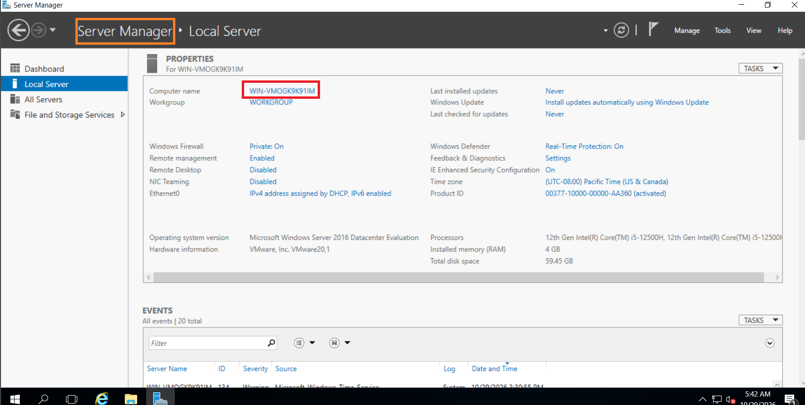

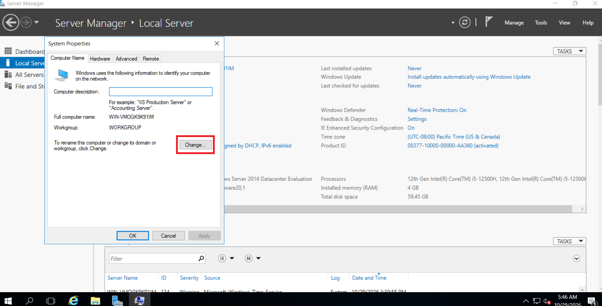

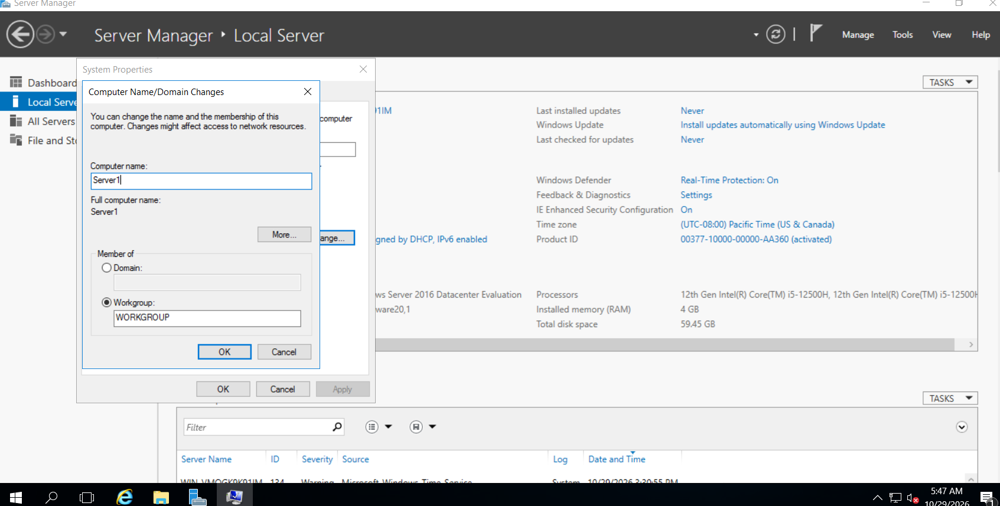

---

### **SERVER’A STATIC IP ATAMA**

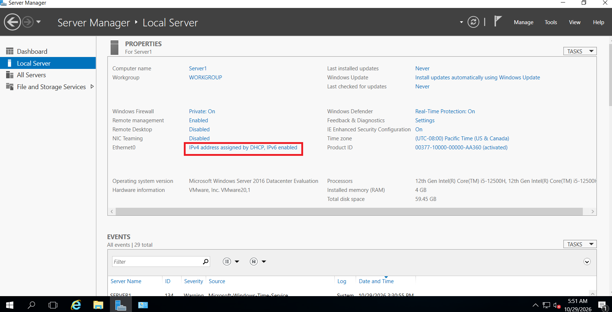

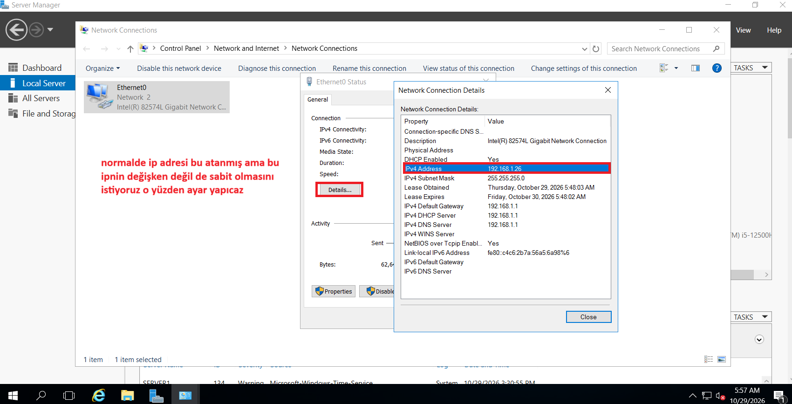

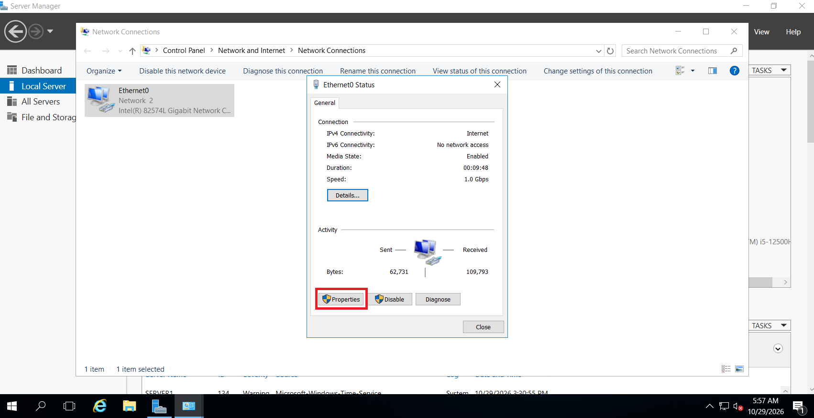

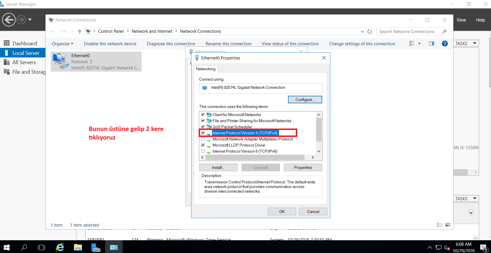

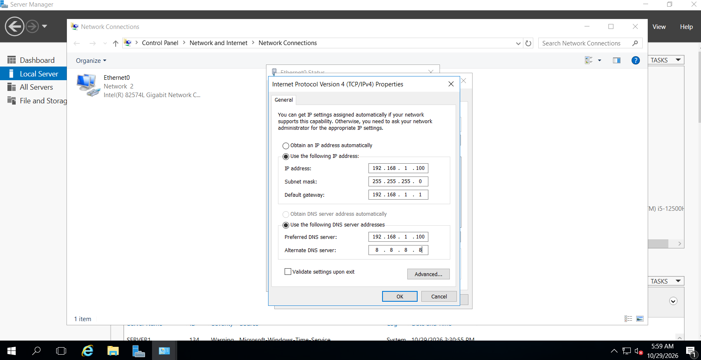

### 🧠 Günlük Hayattan Benzetme

> Bir şirketin adresinin sürekli değiştiğini düşün. Müşteriler şirketi bulamaz. Statik IP de sunucunun değişmeyen adresidir. Böylece diğer bilgisayarlar sunucuya sürekli aynı adresten ulaşabilir.
### 📌 1. Ne Yapıyoruz ve Neden?

Windows Server'a sabit IP adresi (Static IP) tanımlıyoruz.

İleride sunucuyu Domain Controller (Etki Alanı Denetleyicisi) yapacağımız için IP adresinin sabit olması önemlidir.

### ⚙️ 2. Yapılan Ayarlar

| Ayar | Değer | Görevi |
| --- | --- | --- |
| IP Address | 192.168.1.100 | Sunucunun sabit adresi |
| Subnet Mask | 255.255.255.0 | Yerel ağ sınırını belirler |
| Default Gateway | 192.168.1.1 | Diğer ağlara çıkışı sağlar |
| Preferred DNS | 192.168.1.100 | Sunucunun kendi DNS hizmetini kullanmasını sağlar (kurulduğunda) |
| Alternate DNS | 8.8.8.8 | Google'ın DNS sunucusu |

### 🏢 3. Gerçek İş Hayatında Kullanımı

Bir şirkette 50 bilgisayar olduğunu düşün.

- Windows Server'a sabit IP verilir.
- Active Directory ve DNS rolleri kurulur.
- Sunucu Domain Controller yapılır.
- Bilgisayarlar domaine bağlanır ve merkezi olarak yönetilir.

### ⚠️ 4. Dikkat Edilecekler

- Aynı IP adresi iki cihazda kullanılmamalı.
- VMware NAT/Bridged ayarlarıyla IP adresi uyumlu olmalı.
- Domain Controller üzerinde 8.8.8.8 alternatif DNS olarak önerilmez. Bunun yerine DNS Forwarder olarak kullanılabilir.
- Sunucunun kendi IP'sini DNS olarak göstermesi, DNS hizmetinin kurulduğu anlamına gelmez.

### 🔑 5. Önemli Terimler

- Static IP: Sabit IP adresi.
- DNS (Domain Name System): İsimleri IP adreslerine çözümler; AD hizmetlerini bulmaya da yardımcı olur.
- Gateway: Diğer ağlara çıkış noktası.
- DHCP: Otomatik IP dağıtan hizmet.
- Domain Controller: Kullanıcıları ve bilgisayarları merkezi olarak doğrulayan ve yöneten sunucu.

### ✅ Akılda Tut

Domain Controller kurulmadan önce sunucuya sabit IP verilir. Çünkü istemcilerin sunucuyu güvenilir şekilde bulabilmesi gerekir.

---

### **BAĞLANTI TESTLERİ**

→ Kendi kişisel bilgisayarımdan ping testi yaptım ve zaman aşımına uğradı

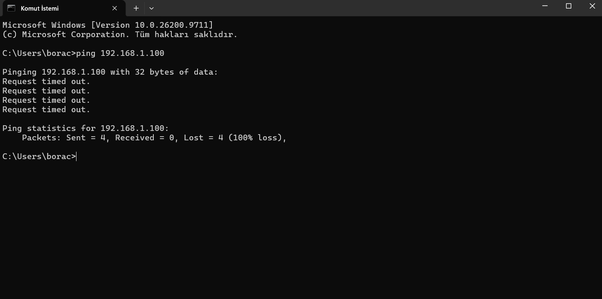

**SERVERLAR İLK KURULDUKLARINDA KENDİLERİNE GÖNDERİLEN PİNG İSTEKLERİNE KARŞI KAPALIDIRLAR BİZ ŞİMDİ BU PİNG İSTEKLERİNİ AÇMAYI ÖĞRENECEĞİZ**

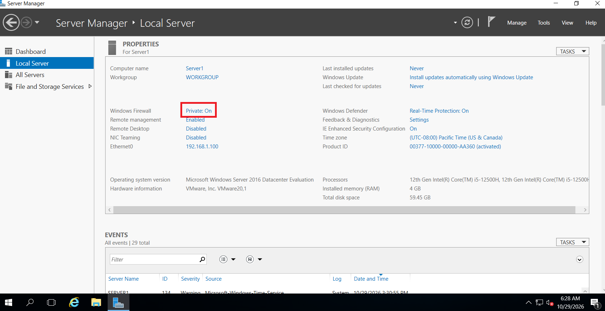

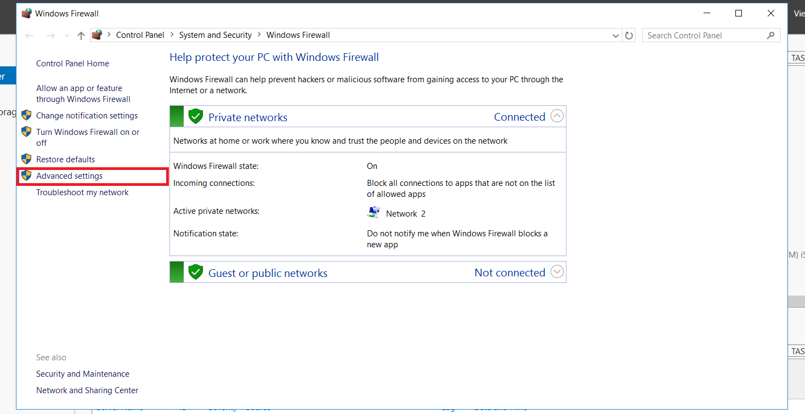

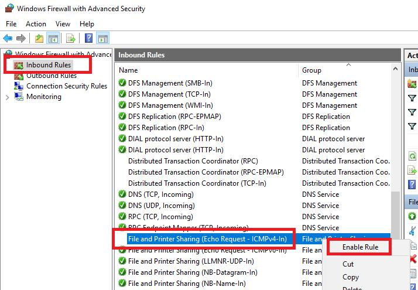

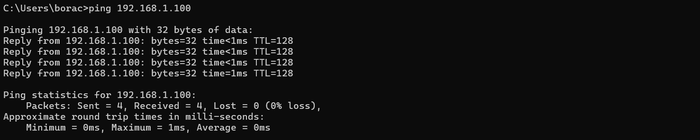

**→ TEKRAR TEST ETTĞİMİZDE ATTIĞIMIZ PİNG BAŞARILI BİR ŞEKİLDE BAĞLANTI KURUYOR**

---

### 🛡️ IE Enhanced Security Configuration (IE ESC)

### 🧠 Benzetme

> Bir şirketin girişinde güvenlik görevlisi olduğunu düşün. Tanımadığı kişileri içeri almıyor, sadece izin verilenleri geçiriyor. IE ESC de Windows Server'ın tarayıcısında benzer bir güvenlik kontrolü sağlar.
### 📌 1. Nedir ve Ne İşe Yarar?

IE Enhanced Security Configuration (Internet Explorer Gelişmiş Güvenlik Yapılandırması), Windows Server'da bulunan bir güvenlik özelliğidir.

- Güvenilmeyen web sitelerine erişimi kısıtlar.
- Zararlı web içeriklerinden kaynaklanabilecek saldırı riskini azaltır.
- Bazı sitelerin açılmasını, içerik çalıştırmasını veya dosya indirilmesini zorlaştırabilir.
- Varsayılan olarak etkin gelir.

Önemli: İnternet bağlantısını tamamen kapatmaz. Internet Explorer'ın güvenlik kısıtlamalarını artırır.

### ⚙️ 2. Neden Kapatıyoruz?

IT yöneticileri bazen sunucu üzerinden yazılım veya gerekli araçları indirmek zorunda kalır.

Örnek: Windows Server'a bir uygulama yüklemek için üreticinin web sitesine girdin fakat IE ESC güvenlik uyarıları çıkarıyor.

- IE ESC = On: Daha sıkı güvenlik, bazı web sitelerinde erişim kısıtlamaları.
- IE ESC = Off: Kısıtlamalar azalır, ancak güvenlik riski artar.

### 🏢 3. Gerçek İş Hayatında Ne Yapmalıyız?

- Test ortamında: Ders ve kurulum işlemlerini kolaylaştırmak için kapatılabilir.
- Gerçek şirket sunucusunda: Mümkünse açık tutulmalıdır.
- Gerekli siteler Trusted Sites (Güvenilen Siteler) listesine eklenebilir.
- İndirme işlemleri mümkün olduğunca yönetim bilgisayarından yapılmalıdır.

### 🖥️ 4. Nereden Kapatılır?

`Server Manager → Local Server → IE Enhanced Security Configuration`

İki seçenek bulunur:

| Seçenek | Açıklama |
| --- | --- |
| Administrators | Sistem yöneticileri için güvenlik ayarı |
| Users | Normal kullanıcılar için güvenlik ayarı |

Buradan ilgili kullanıcı grubu için Off (Kapalı) seçilebilir.

### 🔑 Önemli Terimler

- IE ESC: Gelişmiş Internet Explorer güvenliği.
- Trusted Sites: Güvenilen web siteleri.
- Administrators: Yönetici hesapları.
- Security Restriction: Güvenlik kısıtlaması.

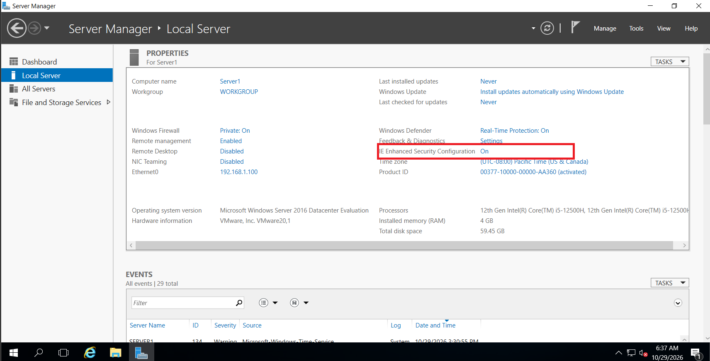

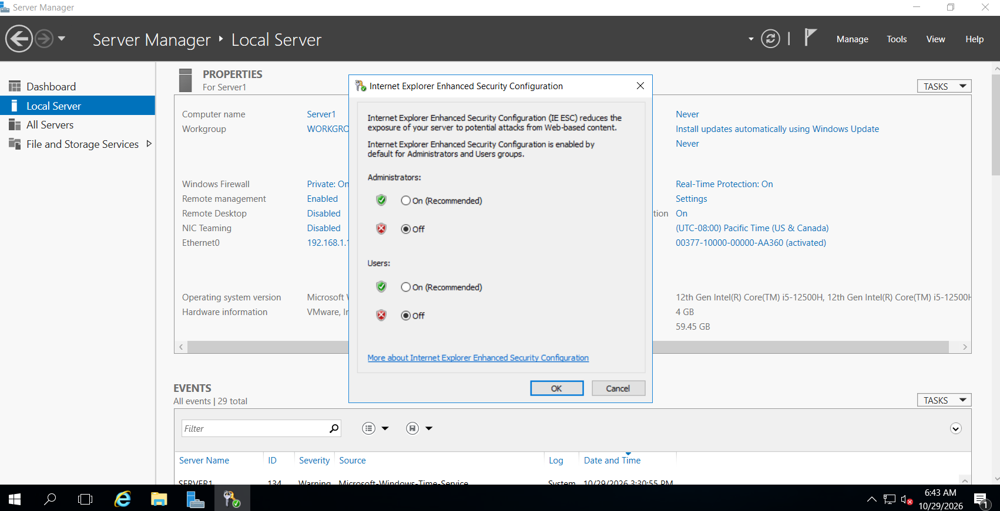

---
