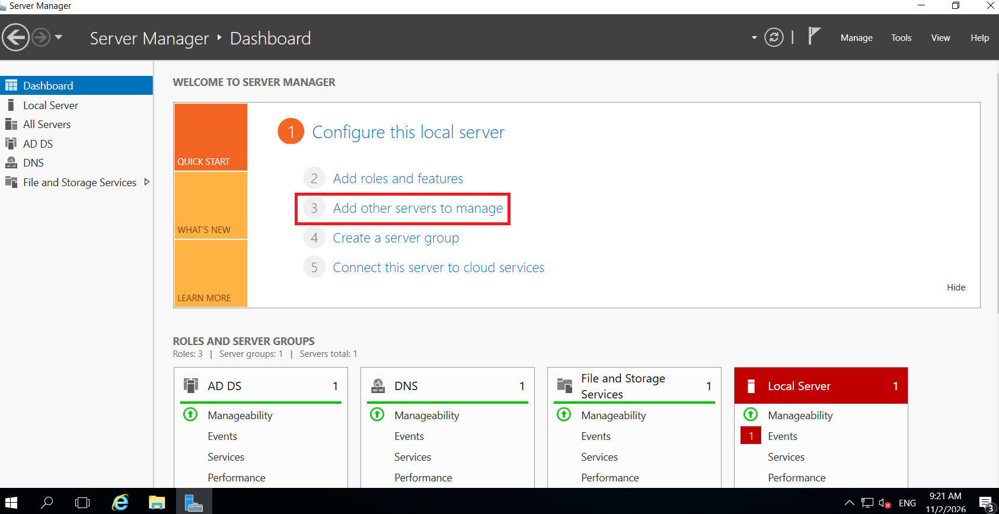
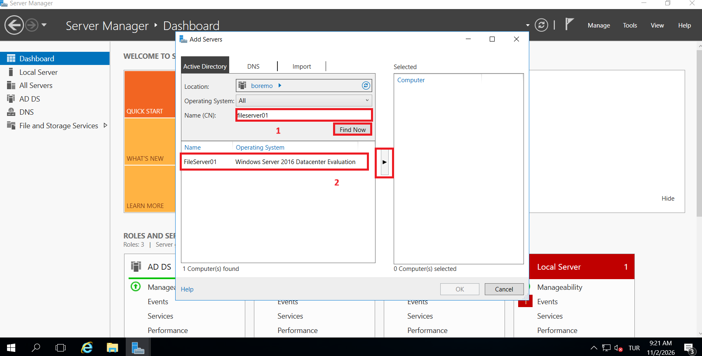
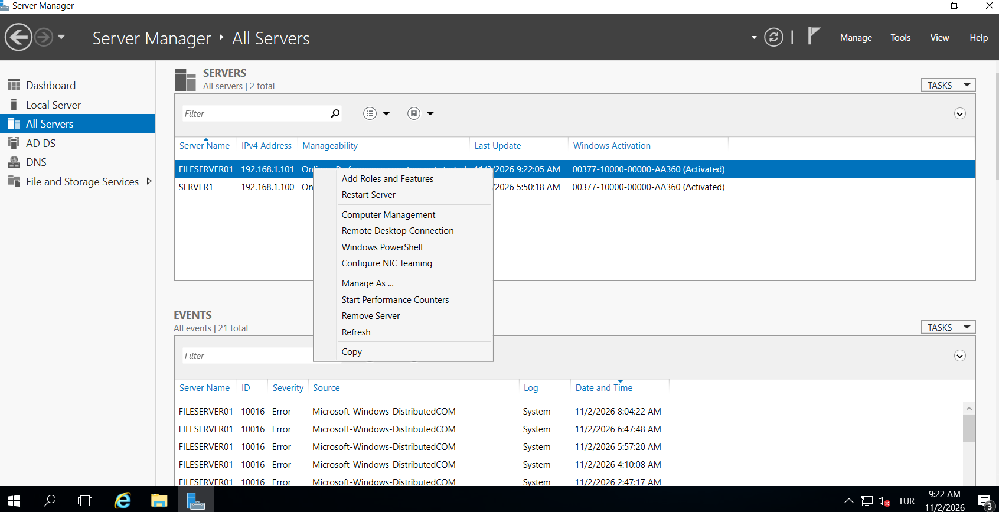

# WS 2016 — Server Yönetim Paneline Üye Sunucu Ekleme

[← Modül içindekiler](README.md) · [Tüm laboratuvar notları](../LAB-INDEX.md)

**→ Bu bizim domain controller olan sunucumuz.Buradaki amaç tek bir panel üzerinden tüm sunucuları yönetmek**

