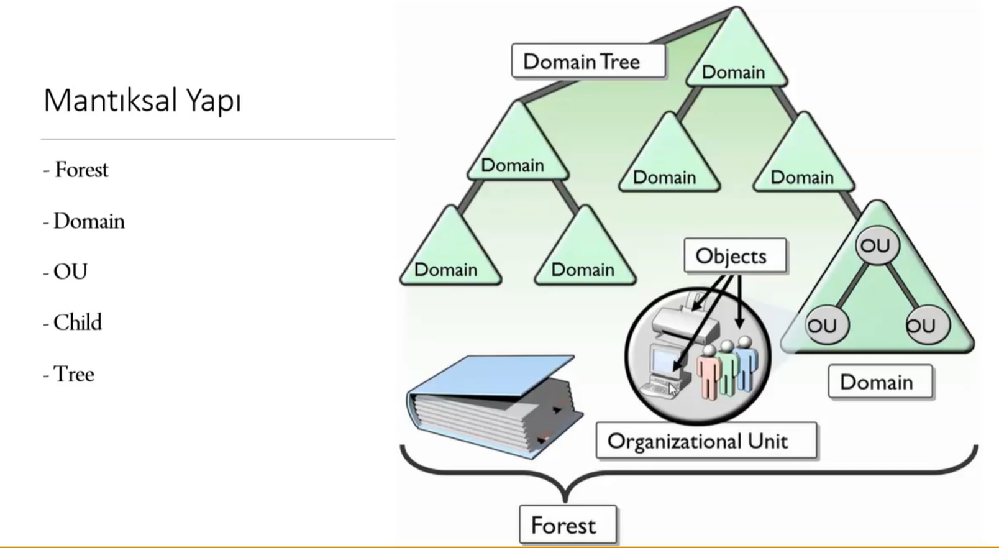

# Active Directory Mantıksal Yapısı — Forest, Domain, OU, Child, Tree

[← Modül içindekiler](README.md) · [Tüm laboratuvar notları](../LAB-INDEX.md)

## 🧠 Benzetme

> Active Directory’yi büyük bir şirketler grubu gibi düşün: **Forest (Orman)** holdingin tamamı, **Tree (Ağaç)** şirket ailesi, **Domain (Etki Alanı)** tek şirket, **OU (Organizasyon Birimi)** departman, **Object (Nesne)** ise çalışan/bilgisayar/yazıcıdır.


## 📌 Nasıl Çalışır

### Forest (Orman)

**Forest**, Active Directory’deki en üst mantıksal yapıdır.

Bir forest içinde:

- Bir veya daha fazla **Domain (Etki Alanı)**
- Bir veya daha fazla **Domain Tree (Etki Alanı Ağacı)**

bulunabilir.

```
Forest
├── firma.com
└── sirket.net
```

Forest içindeki domainler belirli AD altyapı bilgilerini paylaşır ve aralarında güven ilişkileri bulunabilir.

---

### Domain (Etki Alanı)

**Domain**, kullanıcıların, bilgisayarların, grupların ve diğer kaynakların merkezi olarak yönetildiği bölümdür.

Örnek:

```
firma.com
```

İçinde:

```
Users
Computers
Groups
Printers
Servers
```

gibi **Object (Nesne)'ler** bulunur.

---

### Child Domain (Alt Etki Alanı)

Bir domain’in altında oluşturulan başka domaine **Child Domain** denir.

Örneğin:

```
firma.com
│
├── istanbul.firma.com
└── ankara.firma.com
```

Burada:

- `firma.com` → **Parent Domain (Üst Domain)**
- `istanbul.firma.com` → **Child Domain (Alt Domain)**

Child domain de kendi kullanıcılarına, bilgisayarlarına ve Domain Controller’larına sahip olabilir.

> **OU ile Child Domain aynı şey değildir.** OU sadece domain içindeki düzenleme/yönetim yapısıdır; Child Domain ise ayrı bir domaindir.
---

### Domain Tree (Etki Alanı Ağacı)

Aynı DNS isim yapısını paylaşan parent ve child domainlerin oluşturduğu yapıdır.

```
firma.com
├── it.firma.com
└── satis.firma.com
```

Bunların tamamı bir **Domain Tree** oluşturur.

---

### OU — Organizational Unit (Organizasyon Birimi)

OU, domain içindeki nesneleri düzenlemek için kullanılan mantıksal bölümdür.

```
firma.com
│
├── IT
│   ├── Users
│   └── Computers
│
├── Muhasebe
└── IK
```

OU’nun önemli kullanım amaçları:

- Kullanıcı/bilgisayarları düzenlemek
- **Group Policy (Grup İlkesi)** uygulamak
- Belirli yöneticilere sınırlı yönetim yetkisi vermek

---

### Object (Nesne)

Active Directory’de yönetilen her kayıt bir **Object** olabilir.

Örneğin:

- **User Object (Kullanıcı Nesnesi)**
- **Computer Object (Bilgisayar Nesnesi)**
- **Group Object (Grup Nesnesi)**
- **Printer Object (Yazıcı Nesnesi)**

---

## 💡 Örnekler

Bir şirkette:

```
Forest: firma.local

Domain: firma.local

OU:
├── IT
├── Muhasebe
└── İnsanKaynaklari
```

IT departmanındaki 20 bilgisayara farklı bir politika uygulanacaksa `IT` OU’suna **GPO (Group Policy Object / Grup İlkesi Nesnesi)** bağlanabilir.

Başka bir senaryoda şirket gerçekten ayrı yönetim gerektiriyorsa:

```
istanbul.firma.com
ankara.firma.com
```

gibi **Child Domain** yapıları oluşturulabilir.

---
