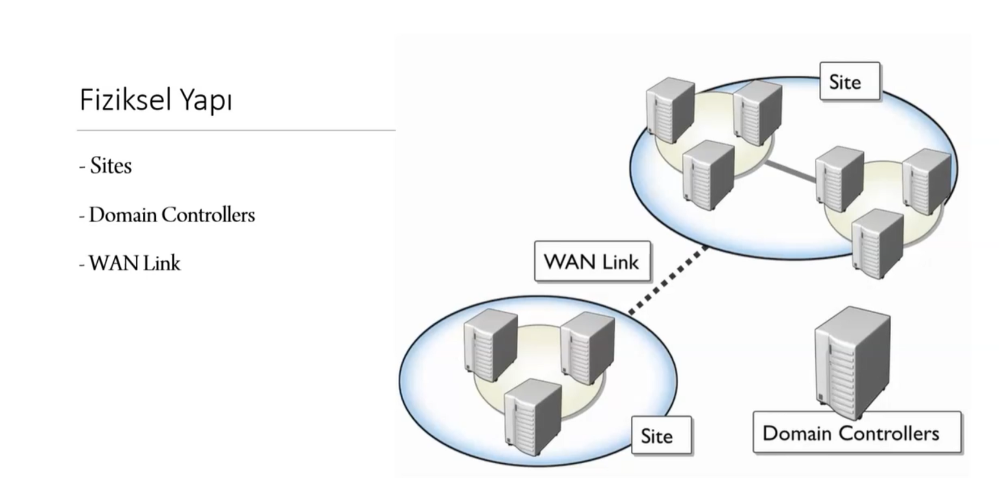

# Active Directory Fiziksel Yapısı — Sites,Domain Controllers,WAN Link

[← Modül içindekiler](README.md) · [Tüm laboratuvar notları](../LAB-INDEX.md)



## 🧠 Benzetme

> Active Directory’nin fiziksel yapısını **şubeleri olan bir banka** gibi düşün: Her şehirde bir **Site (Site/Lokasyon)**, o şubede işlemleri yapan **Domain Controller (Etki Alanı Denetleyicisi)** ve şehirleri birbirine bağlayan yol da  **WAN Link (Geniş Alan Bağlantısı)** dır.
## 📌 Nasıl Çalışır

### Site (Site / Fiziksel Lokasyon)

**Site**, Active Directory’de genellikle hızlı ağ bağlantısıyla birbirine bağlı cihazların bulunduğu fiziksel ağ bölgesidir.

Örneğin:

```
İstanbul Site
├── DC01
└── DC02

Ankara Site
└── DC03
```

Site çoğunlukla **IP Subnet (IP Alt Ağı)** bilgileriyle ilişkilendirilir.

Örneğin:

```
192.168.10.0/24 → İstanbul Site
192.168.20.0/24 → Ankara Site
```

Bu sayede bir bilgisayar hangi fiziksel lokasyonda olduğunu anlayabilir ve mümkünse kendisine yakın **Domain Controller (Etki Alanı Denetleyicisi)** ile iletişim kurar.

> **Site ile Domain aynı şey değildir.**
> **Domain** mantıksal yönetim yapısıdır, **Site** fiziksel/ağ konumunu temsil eder.
---

### Domain Controller — DC (Etki Alanı Denetleyicisi)

**Domain Controller**, Active Directory veritabanını tutan ve kullanıcı/bilgisayar işlemlerini gerçekleştiren Windows Server’dır.

Başlıca görevleri:

- **Authentication (Kimlik Doğrulama)**
- Kullanıcı ve bilgisayar hesaplarını yönetme
- **Group Policy (Grup İlkesi)** dağıtımına yardımcı olma
- Active Directory bilgilerinin diğer DC’lerle eşitlenmesi

Bir site içinde birden fazla DC bulunabilir:

```
Site
├── DC01
├── DC02
└── DC03
```

Bunun amacı **Redundancy (Yedeklilik)** sağlamaktır.

Bir DC kapanırsa diğer DC hizmet vermeye devam edebilir.

---

### Replication (Çoğaltma)

Bir Domain Controller’da yapılan Active Directory değişikliklerinin diğer DC’lere aktarılmasına:

**Replication (Çoğaltma / Senkronizasyon)**

denir.

Örneğin DC01’de yeni kullanıcı oluşturdun:

```
DC01
Yeni User: Bora
   ↓
Replication
   ↓
DC02
User: Bora
```

Böylece DC’ler aynı Active Directory bilgilerine sahip olur.

---

### WAN Link — Geniş Alan Bağlantısı

Farklı şehirlerdeki **Site (Site)** yapılarını birbirine bağlayan bağlantıdır.

```
İstanbul Site
     │
     │ WAN
     │
Ankara Site
```

WAN bağlantısı LAN’a göre:

- Daha yavaş olabilir
- Daha pahalı olabilir
- Daha yüksek **Latency (Gecikme)** içerebilir

Bu yüzden Active Directory, siteler arasındaki **Replication (Çoğaltma)** trafiğini kontrollü şekilde yapabilir.

---

### Site Link (Site Bağlantısı)

Active Directory’de hangi Site’ların birbirleriyle nasıl haberleşeceğini tanımlayan mantıksal bağlantıya:

**Site Link (Site Bağlantısı)**

denir.

Örneğin:

```
ISTANBUL-SITE
      ↕
IST-ANK-SITELINK
      ↕
ANKARA-SITE
```

Site Link üzerinden replication zamanı ve maliyeti gibi ayarlar yönetilebilir.

Bu işlemler genellikle:

**Active Directory Sites and Services (Active Directory Siteleri ve Hizmetleri)**

aracından yapılır.

---

## 💡 Örnekler

**Örnek 1:** İstanbul’daki çalışan domain’e giriş yapıyor. Bilgisayar mümkünse Ankara’daki DC yerine İstanbul’daki DC’ye ulaşır; böylece WAN üzerinden gereksiz trafik oluşmaz.

**Örnek 2:** IT Support olarak bir kullanıcı “Domain’e giriş çok yavaş” diyorsa bilgisayarın doğru **Site (Site)** ve **Subnet (Alt Ağ)** ile eşleşip eşleşmediği ve yakındaki DC’ye ulaşıp ulaşmadığı kontrol edilebilir.

**Örnek 3:** DC01 üzerinde oluşturulan kullanıcı DC02’de görünmüyorsa **Replication (Çoğaltma)** problemi olabilir.

---
