# WS 2016 — Active Directory Rolü Kurulumu

[← Modül içindekiler](README.md) · [Tüm laboratuvar notları](../LAB-INDEX.md)

### 📌 Ne?

- **Server Manager (Sunucu Yöneticisi):** Windows Server üzerindeki sunucu rollerini ve özelliklerini yönettiğimiz paneldir.
- **Add Roles and Features (Rol ve Özellik Ekleme):** Sunucuya yeni hizmetler kurmamızı sağlayan sihirbazdır.
- **Active Directory Domain Services (AD DS):** Kullanıcıları, bilgisayarları ve domain yapısını merkezi olarak yönetmek için kurulan sunucu rolüdür.
- **Domain Controller (Etki Alanı Denetleyicisi):** Domain'in kullanıcı kimlik doğrulama ve yönetim hizmetlerini sağlayan sunucudur.

### ⚙️ Neden?

- Windows Server 2016 kurulduğunda otomatik olarak Domain Controller olmaz.
- Öncelikle AD DS rolü yüklenir. Ardından sunucu, Domain Controller'a yükseltilir **(Promote).**
- Bu iki işlem farklıdır: AD DS rolünü yüklemek, tek başına domain oluşturmaz.
- Domain Controller yapılandırılırken yeni bir domain oluşturulabilir veya mevcut bir domain'e ek Domain Controller eklenebilir.

### 💡 Nerede Kullanılır?

Bir şirkette `firma.local` domain'i oluşturacağımızı düşünelim:

1. Server Manager açılır.
2. Manage → Add Roles and Features seçilir.
3. Role-based or feature-based installation seçilir.
4. Kurulum yapılacak sunucu seçilir.
5. Active Directory Domain Services işaretlenerek rol yüklenir.
6. Promote this server to a domain controller seçilerek domain yapılandırılır.

Böylece Windows Server, domain ortamında kullanıcıları ve bilgisayarları yönetebilecek hale gelir.

---

### **ROL EKLEME ADIMLARI**

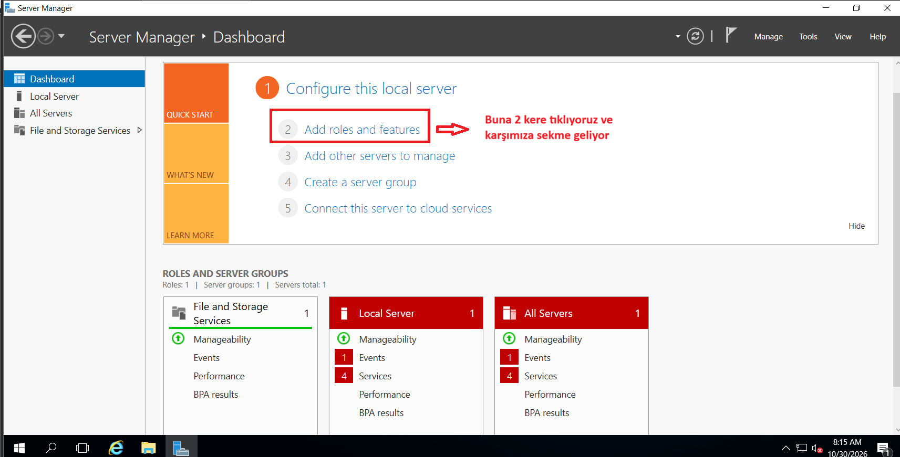

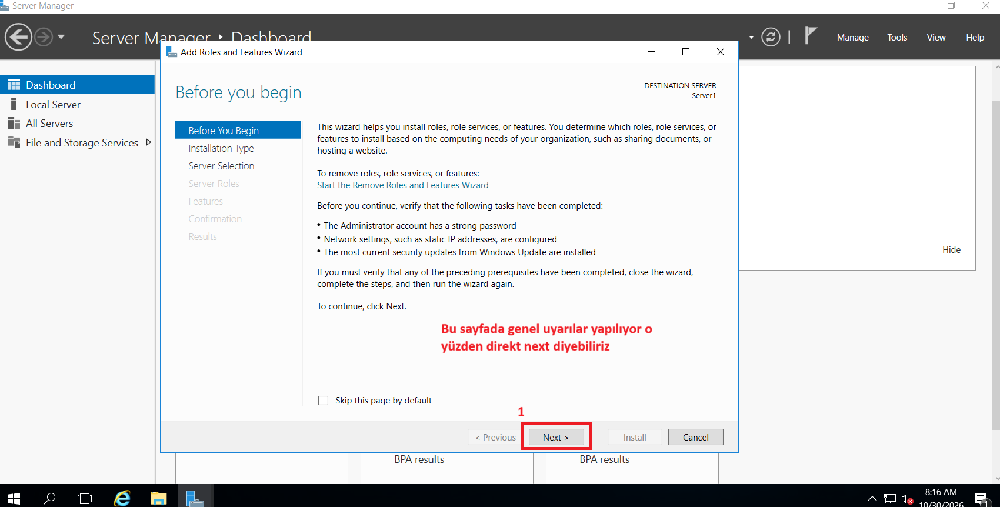

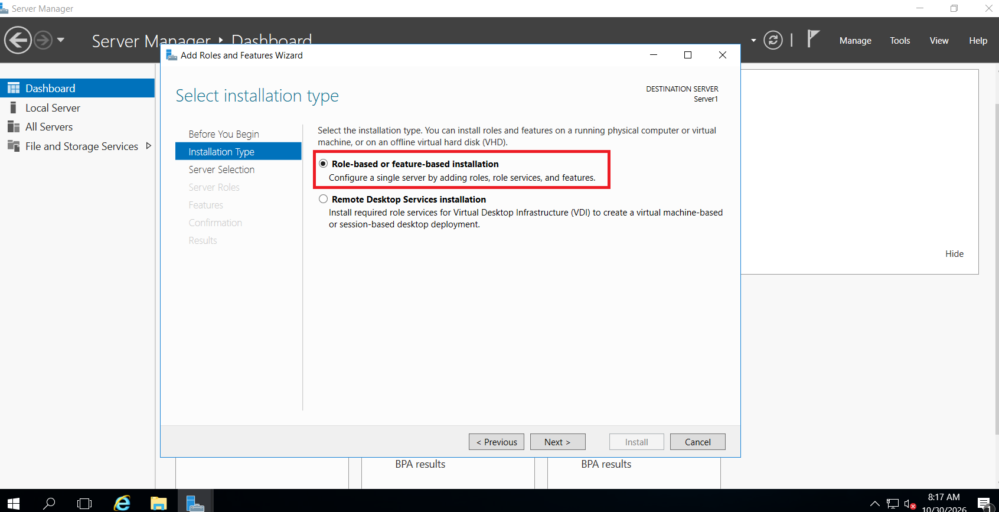

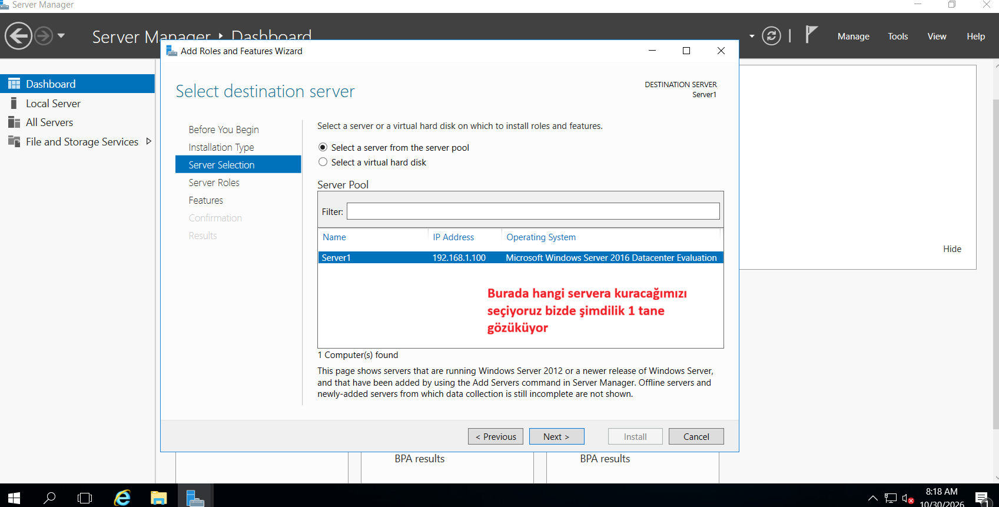

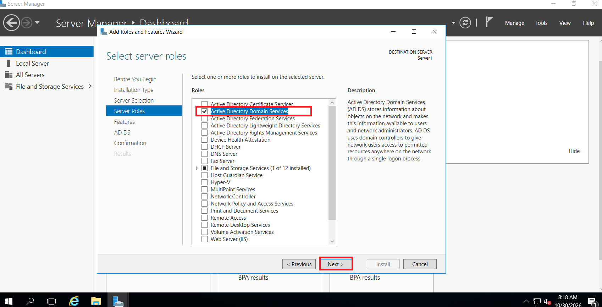

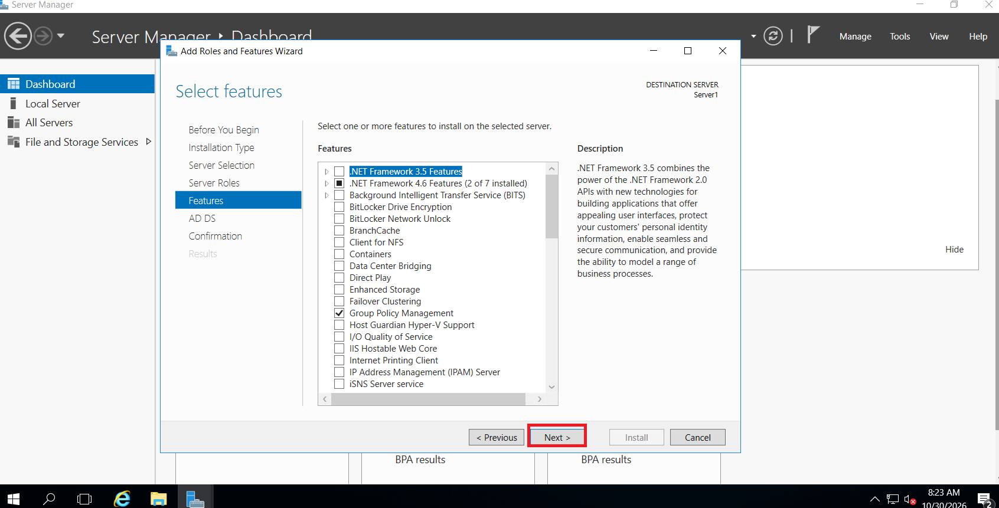

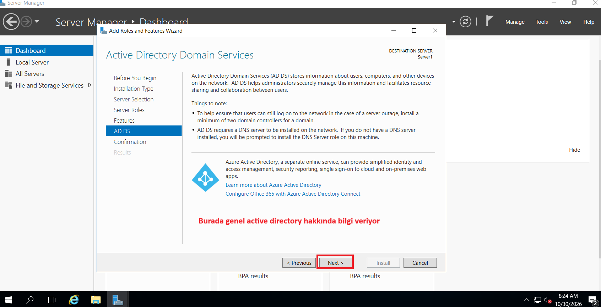

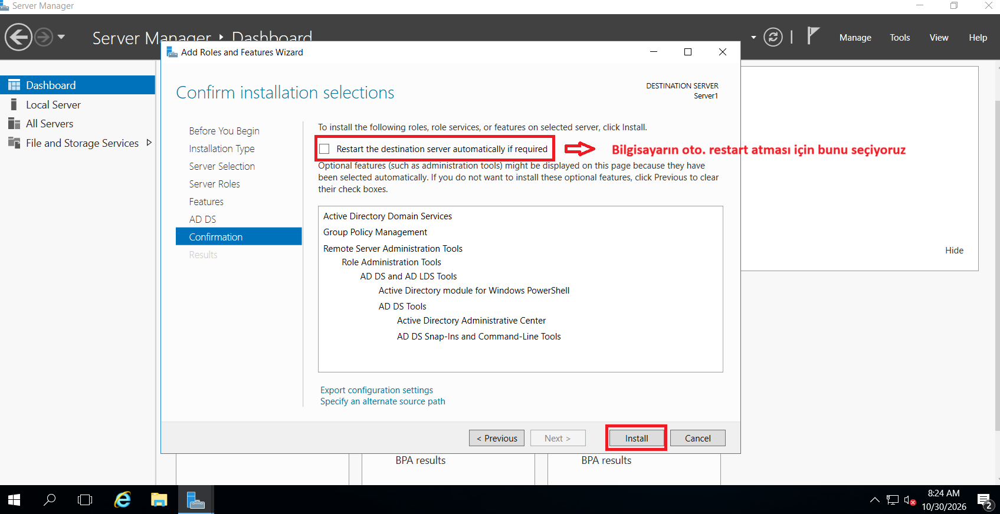

**→ İndirilme işlemi tamamlandıktan sonra sunucuyu yapılandırmamız lazım**

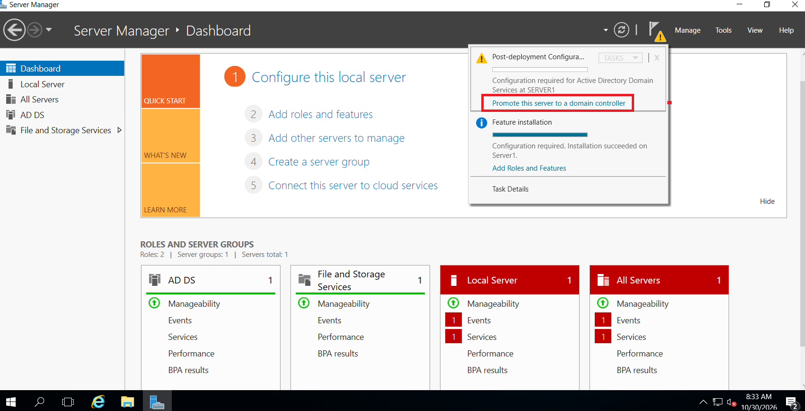

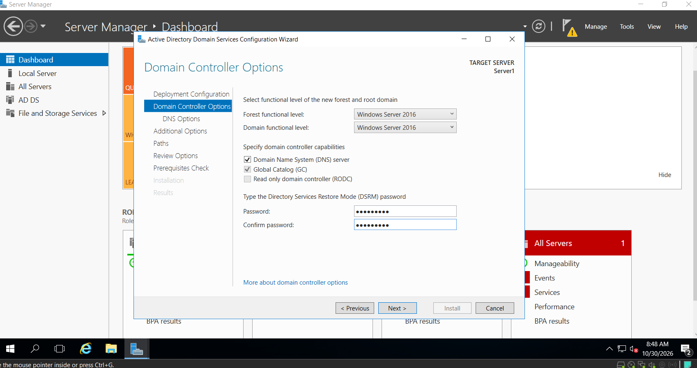

### 1. Forest Functional Level (Forest İşlev Düzeyi)

Ekranda:

```
Windows Server 2016
```

seçili.

Bu ayar, **Forest (Orman)** genelinde hangi Windows Server sürümlerindeki Domain Controller'ların destekleneceğini ve hangi AD özelliklerinin kullanılabileceğini belirler.

Sen yeni bir Windows Server 2016 laboratuvarı kurduğun için:

> ✅ **Windows Server 2016 bırak.**
Daha eski Domain Controller ekleme planın olmadığı için düşürmene gerek yok.

---

### 2. Domain Functional Level (Domain İşlev Düzeyi)

Bu da:

```
Windows Server 2016
```

seçili.

**Domain Functional Level (Domain İşlev Düzeyi)** yalnızca oluşturduğun domain için hangi AD özelliklerinin kullanılabileceğini ve desteklenen DC sürümlerini belirler.

Senin senaryonda:

> ✅ **Windows Server 2016 bırak.**
Kısaca:

```
Forest Functional Level → Tüm forest
Domain Functional Level → Sadece ilgili domain
```

---

### 3. DNS Server

```
☑ Domain Name System (DNS) server
```

**Kesinlikle işaretli bırak. ✅**

Active Directory, DNS ile çok sıkı çalışır.

Client bilgisayar:

```
"Domain Controller nerede?"
       ↓
      DNS
       ↓
   Domain Controller
```

şeklinde DC'yi DNS üzerinden bulur.

Sen ilk domain ve ilk DC'yi kurduğun için DNS'i bu sunucu üzerinde kurmak laboratuvar için doğru seçimdir.

---

### 4. Global Catalog (GC)

```
☑ Global Catalog (GC)
```

**İşaretli bırak. ✅**

**Global Catalog**, forest içerisindeki Active Directory nesneleri hakkında aranabilir bilgiler tutar.

Örneğin kullanıcı oturum açarken veya başka nesneler aranırken kullanılabilir.

İlk Domain Controller genellikle **Global Catalog** olarak çalışır.

```
AD Kullanıcıları
Bilgisayarlar
Gruplar
       ↓
 Global Catalog
       ↓
Hızlı arama / erişim
```

> Senin kurulumunda **değiştirme.**
---

### 5. Read Only Domain Controller (RODC)

```
☐ Read only domain controller (RODC)
```

**İşaretleme. ❌**

**RODC (Salt Okunur Domain Controller)**, Active Directory veritabanının ağırlıklı olarak **read-only (salt okunur)** kopyasını tutan özel DC türüdür.

Daha çok fiziksel güvenliği düşük uzak şubelerde kullanılır.

Örneğin:

```
İstanbul Merkez → Normal DC
       │
       │ WAN
       ▼
Küçük Şube → RODC
```

Sen şu anda **ilk Domain Controller'ını** oluşturuyorsun. Normal, yazılabilir DC gerekiyor.

> ✅ **RODC boş kalacak.**
---

## 💡 Örnekler

Senin mevcut laboratuvar kurulumun için ekran şöyle kalmalı:

```
Forest Functional Level : Windows Server 2016 ✅
Domain Functional Level : Windows Server 2016 ✅

DNS Server               : ☑ ✅
Global Catalog           : ☑ ✅
RODC                     : ☐ ❌
```

Sonuçta bu sunucu:

```
Server1
 ├── Domain Controller
 ├── DNS Server
 └── Global Catalog
```

olarak görev yapacak.

---

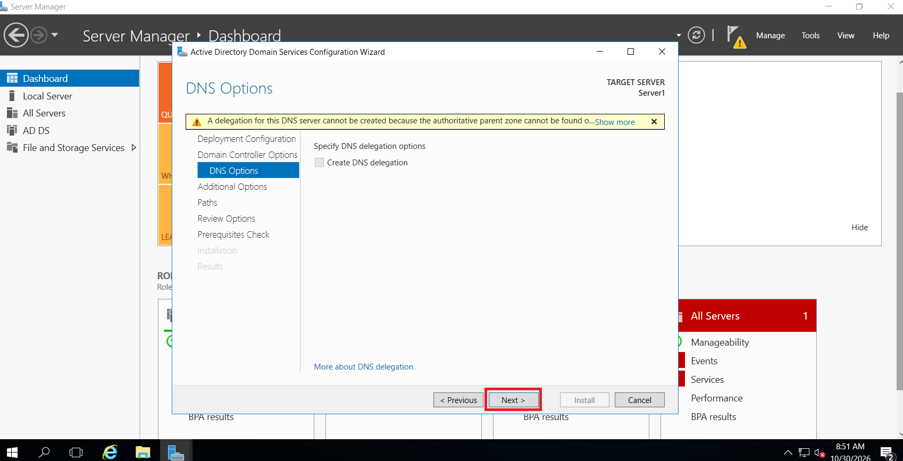

### 🧠 Günlük Hayattan Benzetme

> Yeni bir şirket açtığını düşün. Şirketinin başka bir ana şubesi yok, tamamen bağımsız.
> Birisi sana “Bağlı olduğun ana şube nerede?” diye soruyor.
> Sen de “Ana şubem yok, burası zaten merkez!” diyorsun.
> Windows Server'ın verdiği DNS uyarısının mantığı da bu.
### 📌 1. Uyarı Neden Çıkıyor?

Sadece ilk kez DNS kurduğumuz için değil, oluşturduğumuz domain için bir üst DNS bölgesi bulunamadığı için çıkıyor.

Örneğin yeni domain adımız `dmt.local` olsun.

- Windows Server, bu domain için bir üst DNS bölgesi olup olmadığını kontrol ediyor.
- Yetki devri oluşturabileceği bir üst bölge bulamıyor.
- Bu nedenle DNS Delegation oluşturulamıyor uyarısını gösteriyor.

Ancak biz sıfırdan bağımsız bir Active Directory ortamı kurduğumuz için bu normaldir.

O yüzden bu uyarıyı dikkate almayıp **next** diyoruz

---

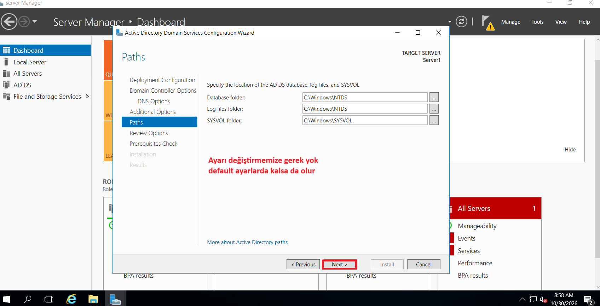

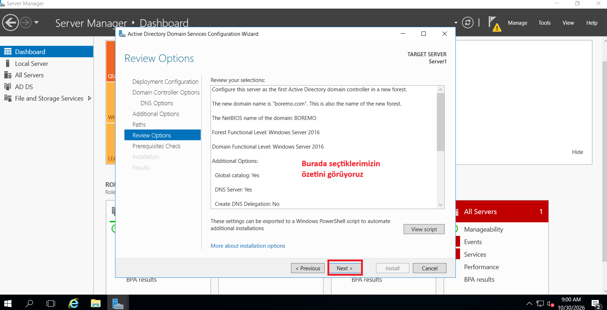

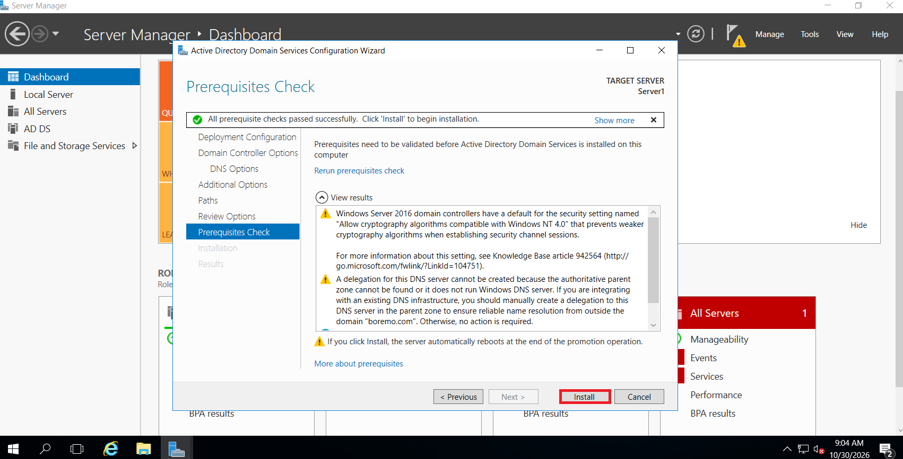

→ Sonrasında bilgisayar kendine restart atıyor ve Active Directory Rolü kurulmuş oluyor

---
