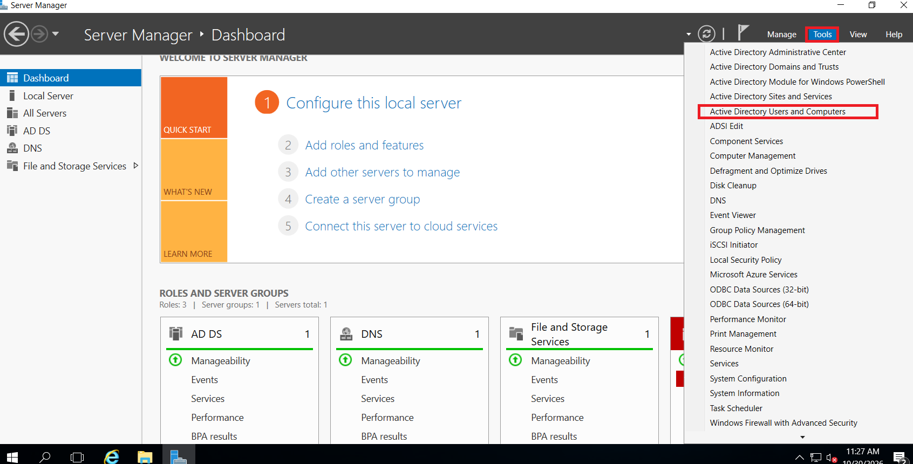
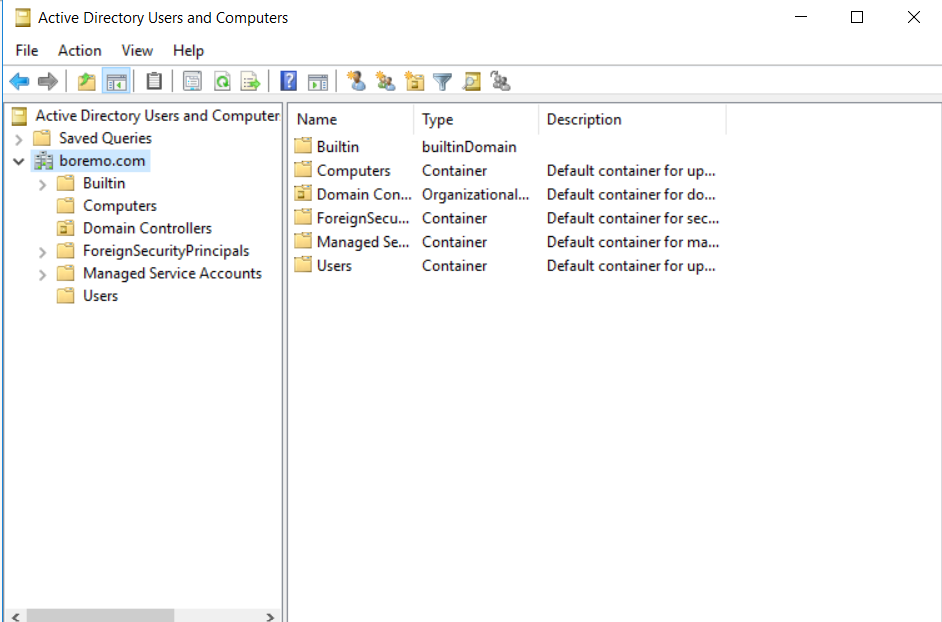
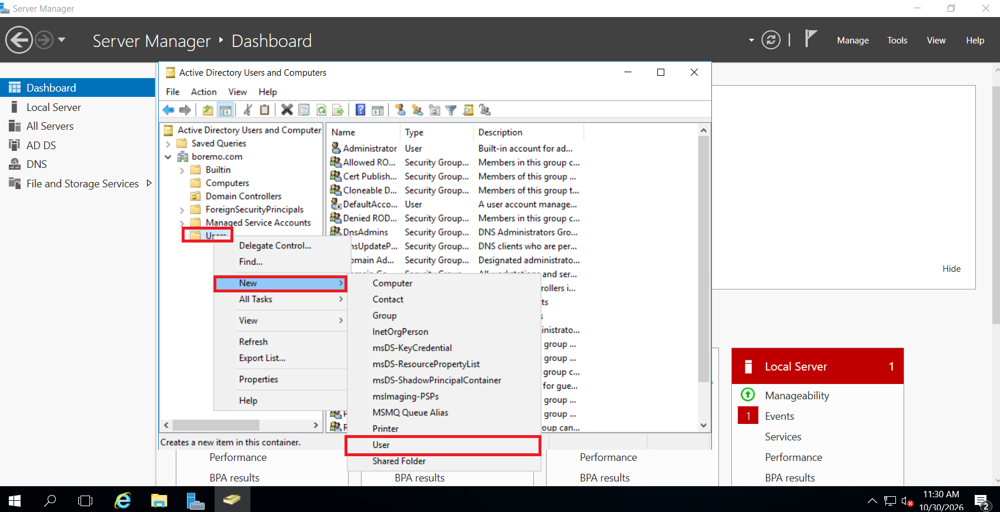
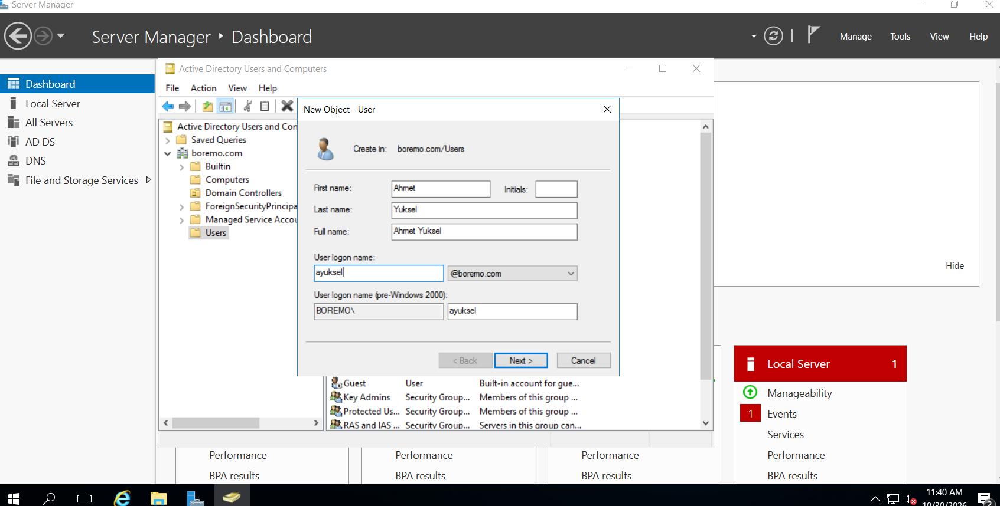
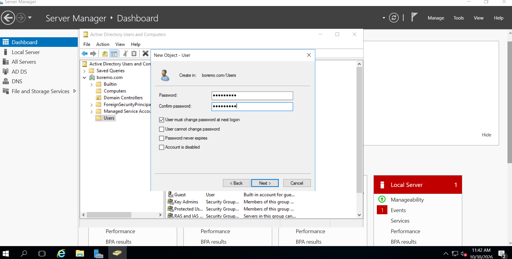
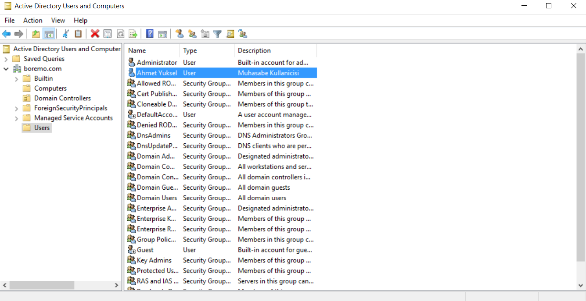

# WS 2016 — AD’de Kullanıcı Oluşturma

[← Modül içindekiler](README.md) · [Tüm laboratuvar notları](../LAB-INDEX.md)

# 🗂️ Active Directory – Varsayılan Klasörler ve Görevleri

### 🧠 Günlük Hayattan Benzetme

> Active Directory'yi bir şirketin insan kaynakları ve IT yönetim sistemi gibi düşün. Çalışanların, bilgisayarların, yöneticilerin ve servis hesaplarının ayrı kayıtları bulunur. Bu klasörler de domain içindeki nesneleri düzenlemek ve yönetmek için kullanılır.
### 📌 1. boremo.com Altındaki Klasörler

| Klasör | Görevi |
| --- | --- |
| Builtin | Administrators, Backup Operators gibi Windows'un hazır yetki gruplarını barındırır. |
| Computers | Domaine katılan normal bilgisayarların hesapları varsayılan olarak burada oluşur. |
| Domain Controllers | Domain Controller sunucularının bilgisayar hesapları burada tutulur. |
| ForeignSecurityPrincipals | Güven ilişkisi bulunan başka domain veya forest'lardaki kullanıcı ve grupların temsilci kayıtlarını tutar. |
| Managed Service Accounts | Uygulamaların ve Windows servislerinin kullanabileceği yönetilen servis hesapları için varsayılan konumdur. |
| Users | Administrator gibi varsayılan kullanıcı hesaplarını ve Domain Admins, Domain Users gibi grupları içerir. |

Bu klasörlerin çoğu Active Directory kurulurken otomatik oluşturulur

### 🏢 2. Gerçek İş Hayatından Örnek

Bir şirkete yeni çalışan ve bilgisayar eklendiğini düşün:

- Yeni çalışan için Users altında kullanıcı hesabı oluşturulabilir.
- Yeni bilgisayar domaine katıldığında hesabı varsayılan olarak Computers altında oluşabilir.
- Sunucu Domain Controller yapıldığında bilgisayar hesabı Domain Controllers OU'sunda bulunur.

### ⚠️ 3. Önemli: Container ve OU Farkı

Ekrandaki her klasör aynı türde değildir.

- Container (Kapsayıcı): Active Directory nesnelerini tutar. Örneğin `Users` ve `Computers`.
- OU (Organizational Unit / Organizasyon Birimi): Nesneleri düzenlemek ve belirli gruplara Group Policy uygulamak için kullanılır.

Varsayılan `Users` ve `Computers` container'larına doğrudan GPO bağlanamaz. Şirketlerde bu nedenle genellikle özel OU'lar oluşturulur.

---

