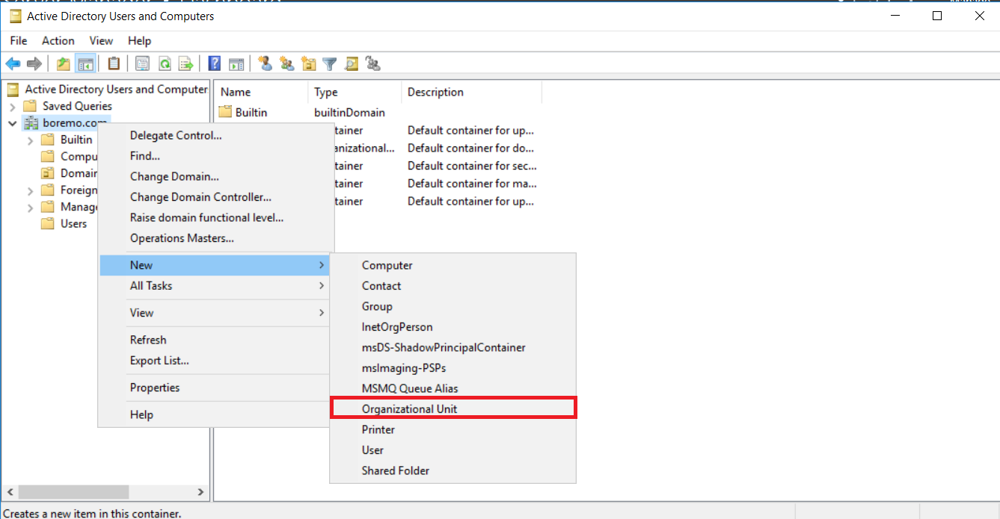
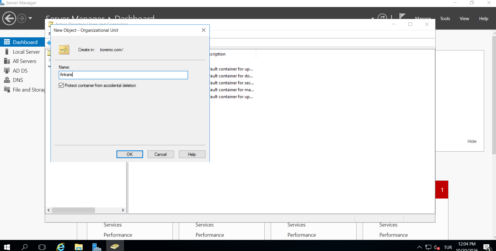
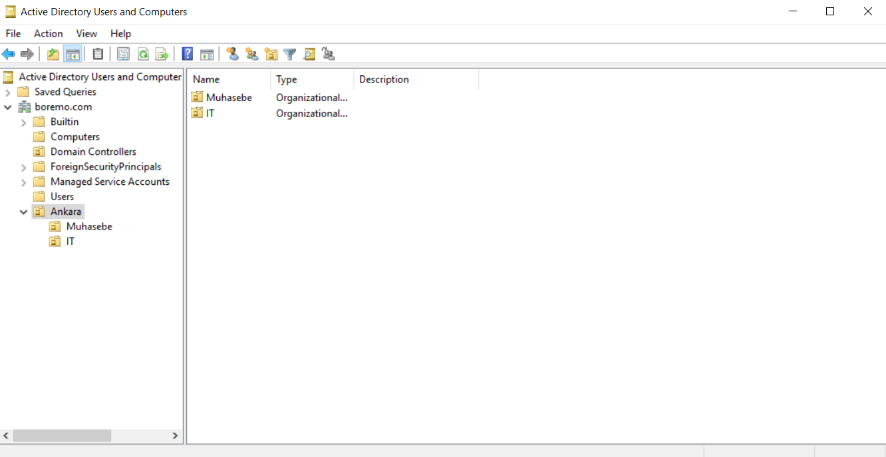
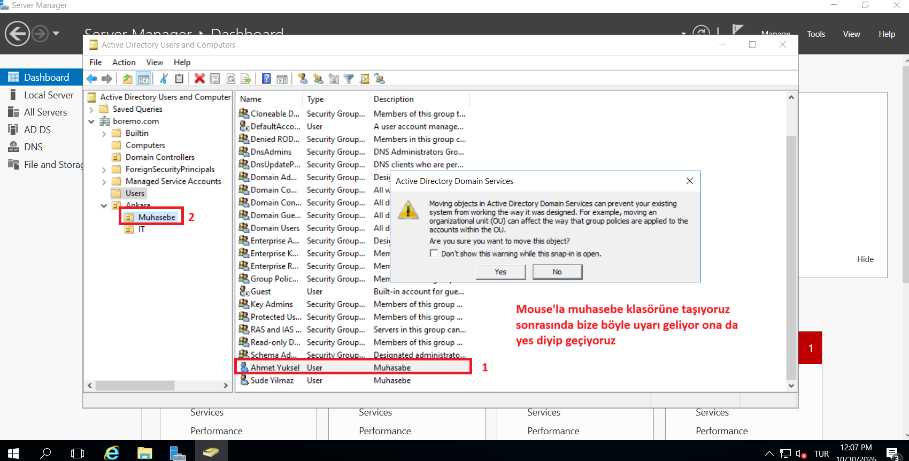
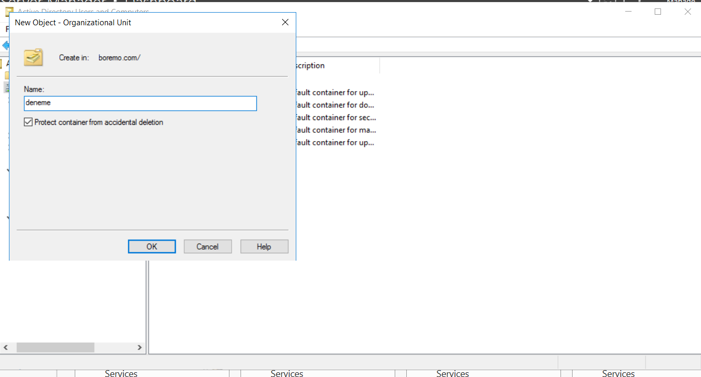
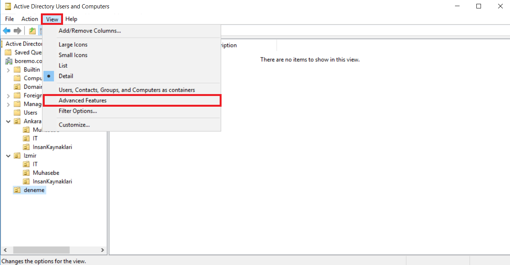
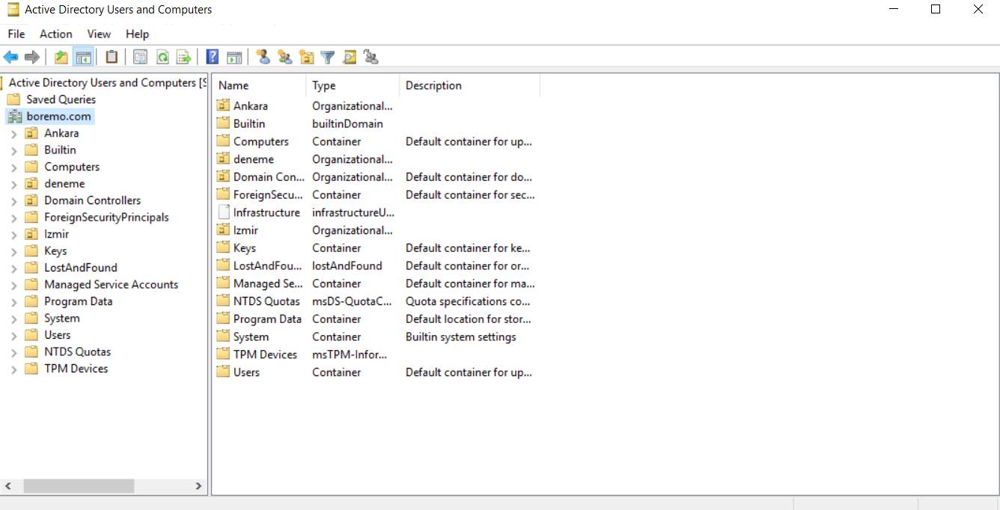
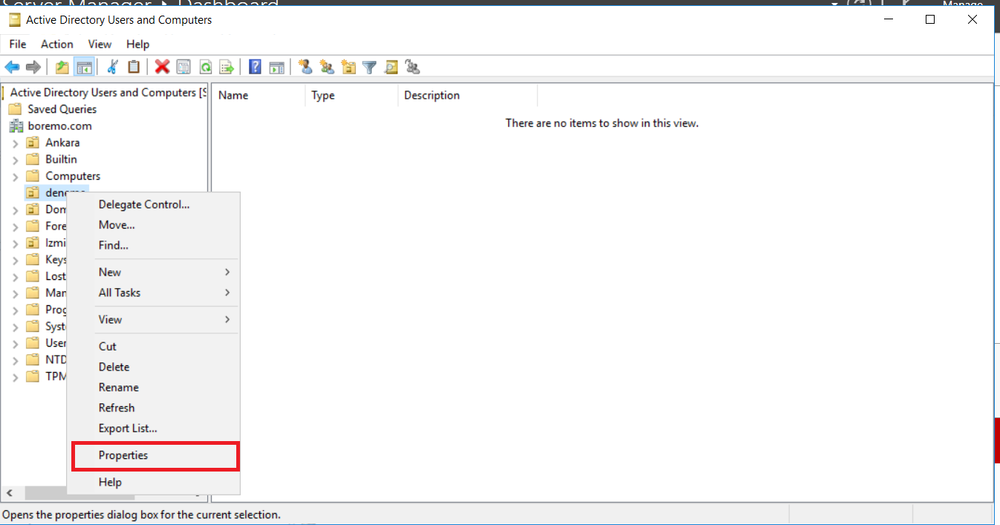
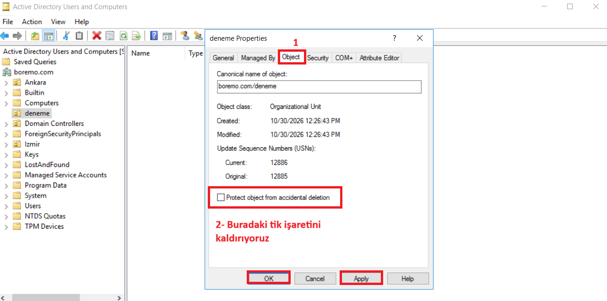

# WS 2016 — OU Yapılandırması

[← Modül içindekiler](README.md) · [Tüm laboratuvar notları](../LAB-INDEX.md)

## 🗂️ Organizational Unit (OU) – Organizasyon Birimi

### 📌 Ne?

- OU, Active Directory içerisinde kullanıcıları, bilgisayarları ve grupları düzenlemek için kullanılan mantıksal klasördür.
- Şirketin departmanlarına göre OU oluşturulabilir: IT, Muhasebe, İnsan Kaynakları gibi.

### ⚙️ Neden?

- Active Directory'yi düzenli tutmak.
- Group Policy (GPO) ile belirli kullanıcılara veya bilgisayarlara kurallar uygulamak.
- Belirli OU'ların yönetimini farklı IT personellerine devretmek.

### 💡 Nerede Kullanılır?

Örneğin, şirkette `Muhasebe` adında bir OU oluşturduk.

- Muhasebe çalışanlarının hesaplarını bu OU'ya taşıdık.
- OU'ya bir GPO bağlayarak çalışanların Denetim Masası'na erişimini kısıtladık.
- Böylece ilgili politika yalnızca kapsamına giren kullanıcıları etkiler.

---

### **ORGANIZATIONAL  UNIT OLUŞTURMA**

→ Ankara klasörünün içinde de OU oluşturabiliriz.Aşağıdaki fotoğrafta yaptık aynı yöntemle yapılıyor

---

### **KULLANICIYI OLUŞTURDUĞUMUZ OU’YA AKTARMA**

---

### **ORGANIZATIONAL UNIT SİLME İŞLEMİ**

1. İlk baş deneme adında ou oluşturuyoruz

**→ “Protect container from accidental deletion” bunu işaretlediğimizde hemen silinmiyor nasıl sileceğimizi göstericem**

→ Görünüm bu şekilde oluyor gizli dosyalar da gözüküyor

→ Sonrasında deneme klasörüne gelip sağ tıklayıp delete kısmına bastığımızda klasörümüz siliniyor
