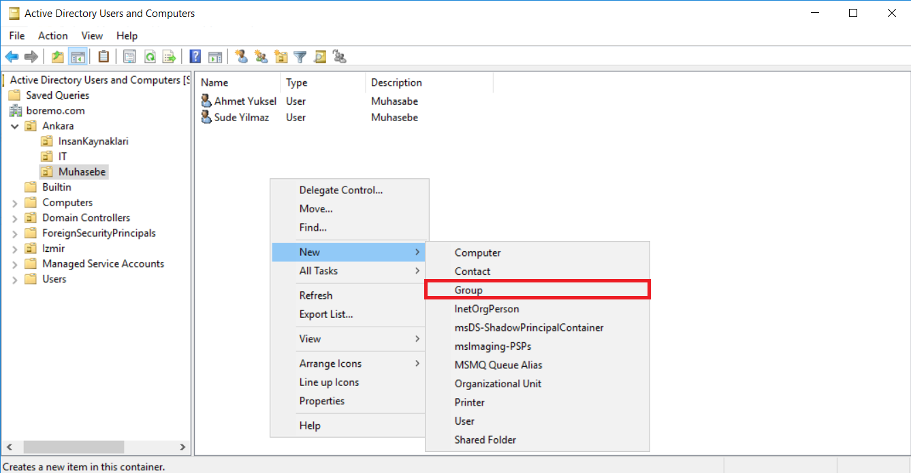
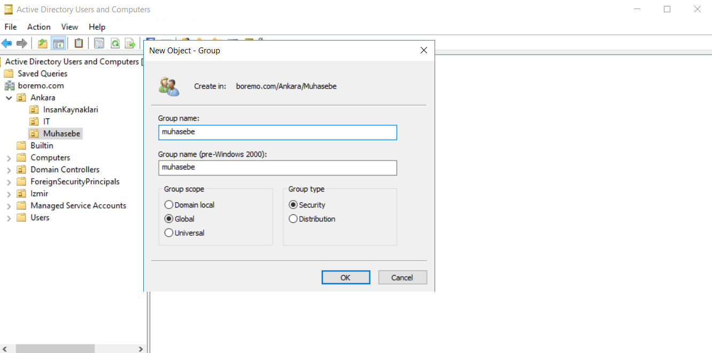
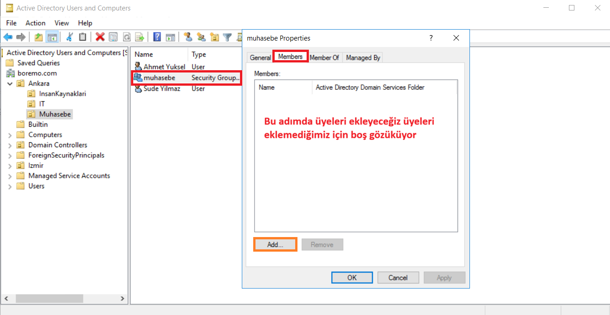
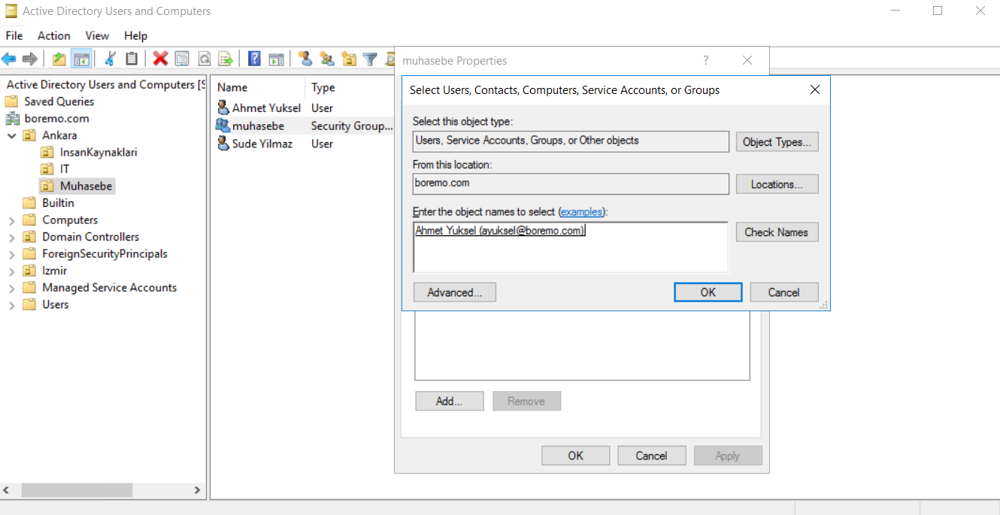
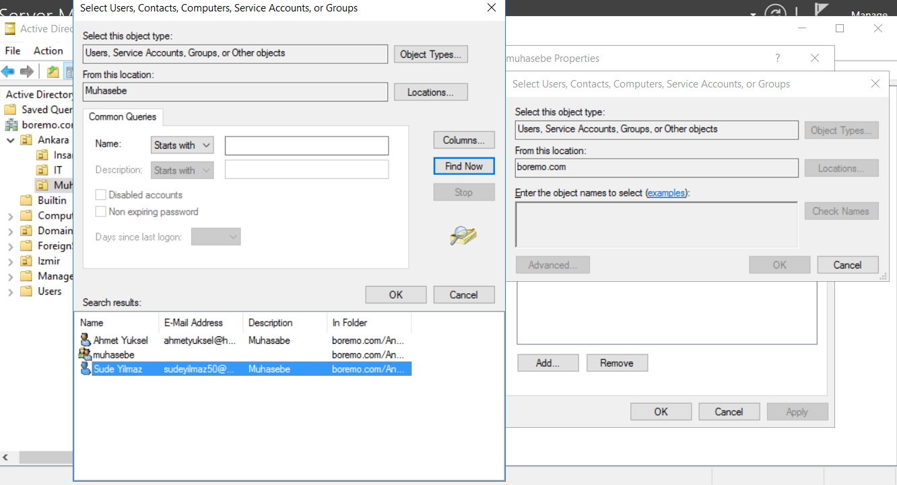

# WS 2016 — Kullanıcı Grupları Oluşturmak ve Grup Üyelikleri

[← Modül içindekiler](README.md) · [Tüm laboratuvar notları](../LAB-INDEX.md)

### 📌 Ne?

- **Group (Grup):** Active Directory'de birden fazla kullanıcıyı tek bir yapı altında toplamak için kullanılır.
- **Group Membership (Grup Üyeliği):** Bir kullanıcının hangi gruplara dahil olduğunu belirtir.
- Gruplar sayesinde kullanıcılara tek tek izin vermek yerine toplu şekilde yetki verebiliriz.

### ⚙️ Neden Kullanılır?

- Kolay yönetim: 50 çalışana tek tek yetki vermek yerine bir gruba yetki tanımlarız.
- Güvenlik: Kullanıcıların yalnızca ihtiyaç duydukları kaynaklara erişmesini sağlarız.
- Zaman tasarrufu: Yeni işe başlayan çalışanı ilgili gruba eklemek yeterli olabilir.
- Merkezi yetkilendirme: Dosya, klasör ve diğer ağ kaynaklarına erişim grup üzerinden yönetilebilir.

### 💡 Gerçek İş Hayatından Örnekler

Örnek 1 – Muhasebe Departmanı

Şirketimizde 20 muhasebe çalışanı var.

1. AD üzerinde `Muhasebe_Users` adında bir grup oluşturduk.
2. 20 çalışanı bu gruba ekledik.
3. Muhasebe klasörüne bu grup için okuma ve yazma izni verdik.
4. Yeni çalışan geldiğinde gruba ekleyerek aynı erişim yetkilerini sağlayabiliriz.

---

### **GRUP OLUŞTURMA**

### Group Scope (Grup Kapsamı)

Gruba kimlerin üye olabileceğini ve grubun nerelerde yetkilendirilebileceğini belirler.

| Seçenek | Ne işe yarar? |
| --- | --- |
| Domain Local | Farklı güvenilir domainlerden üye alabilir; izinleri kendi domainindeki kaynaklarda kullanılır. |
| Global | Aynı domaindeki kullanıcıları gruplamak için kullanılır. Farklı güvenilir domainlerdeki kaynaklara da yetkilendirilebilir. |
| Universal | Aynı forest içindeki farklı domainlerden kullanıcıları bir araya getirebilir. |

Senin için: Tek bir `boremo.com` domain'inde Muhasebe çalışanlarını gruplandıracağın için Global uygun seçimdir

### 🔐 Group Type (Grup Türü)

| Seçenek | Ne işe yarar? |
| --- | --- |
| Security (Güvenlik) | Dosya, klasör, yazıcı gibi kaynaklara erişim izni vermek için kullanılır. |
| Distribution (Dağıtım) | Exchange gibi e-posta sistemlerinde toplu e-posta göndermek için kullanılır. Erişim yetkisi vermez. |

### 🏢 Gerçek İş Hayatında Örnek

Muhasebe departmanında Ayşe ve Burak çalışıyor olsun.

Senin için: Muhasebe çalışanlarının dosyalara erişimini yönetmek istiyorsan **Security** seçmelisin.

1. `GG_Muhasebe` adında Global + Security grubu oluşturursun.
2. Ayşe ve Burak'ı bu gruba üye yaparsın.
3. Muhasebe dosyalarına erişim için bu grubu doğrudan yetkilendirebilir veya daha büyük ortamlarda bir Domain Local kaynak izin grubuna ekleyebilirsin.
4. Yeni bir çalışan geldiğinde uygun gruba eklersin; herkese ayrı ayrı izin tanımlaman gerekmez.

### ⚠️ OU ile Group Arasındaki Fark

- OU (Organizational Unit): Kullanıcıları ve bilgisayarları düzenler; GPO bağlamak için kullanılır.
- Group (Grup): Kullanıcıları bir araya getirir; özellikle erişim izinlerini yönetir.

Önemli: Bir kullanıcının Muhasebe OU'sunda bulunması, otomatik olarak Muhasebe güvenlik grubuna üye olduğu anlamına gelmez.

---

### **GRUBA ÜYE EKLEME**

→ Burada **“Enter the object names to select”** kısmına Ahmet ismini yazdım ve daha sonrasında check names butonuna tıkladığımda Ahmet Yüksel adlı kullanıcımı oraya yazdı ve sonrasında OK tuşuna basıp ekledim.

→ Milyonlarca kullanıcımız varsa bunu tek tek eklemek yerine **“ADVANCED”** kısmına tıklıyoruz

→ Burada “Locations” kısmından muhasebe klasörünü buluyorum ve tıklıyorum.Sonrasında “Find Now” seçeneğine tıklayarak kullanıcılarımı getirmesini sağlıyorum

→ Burada çıkan kullanıcıları shift + yukarı veya aşağı ok’a basarak kullanıcıları seçiyorum.Yalnız oradaki **muhasebe kısmını almayacağız** onu da ctrl + mouse sol click yardımıyla çıkarıyorum ve diğerlerini ekliyorum.

---
