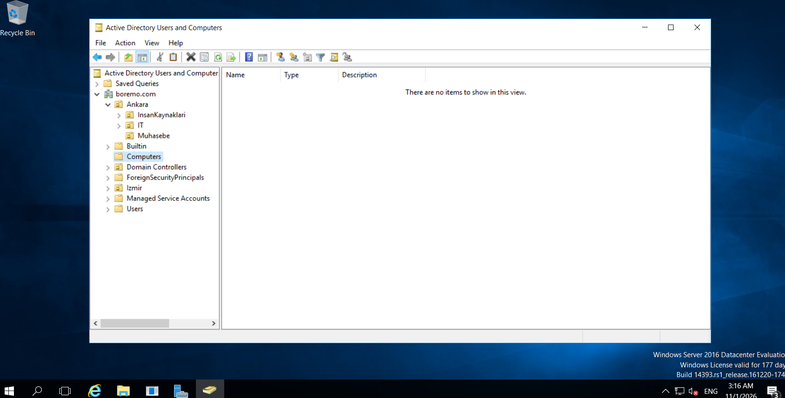
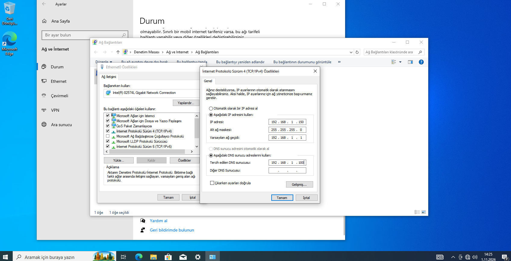
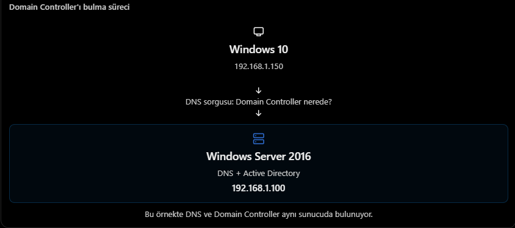
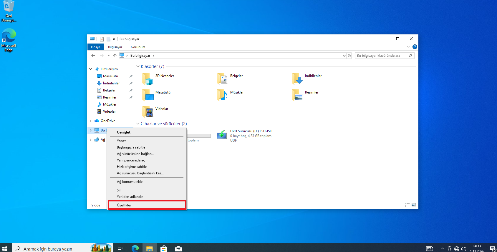
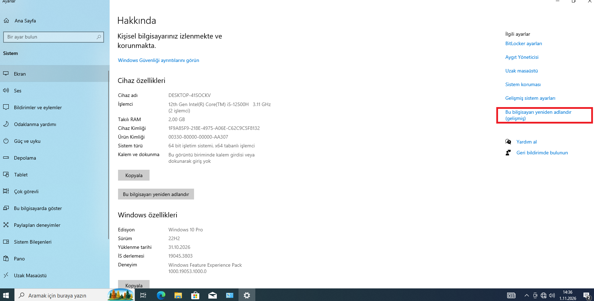
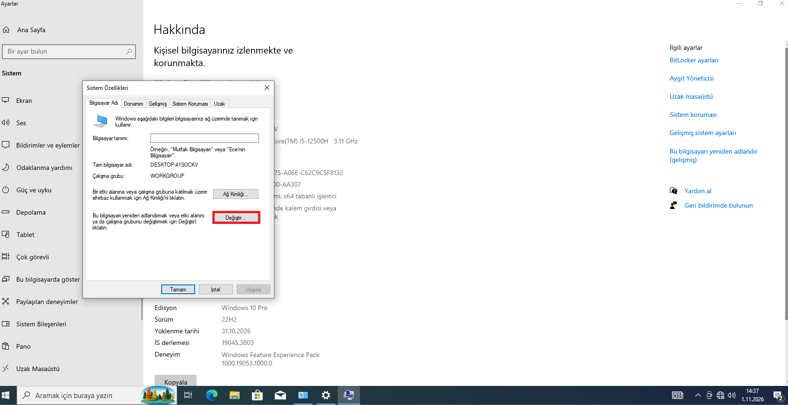
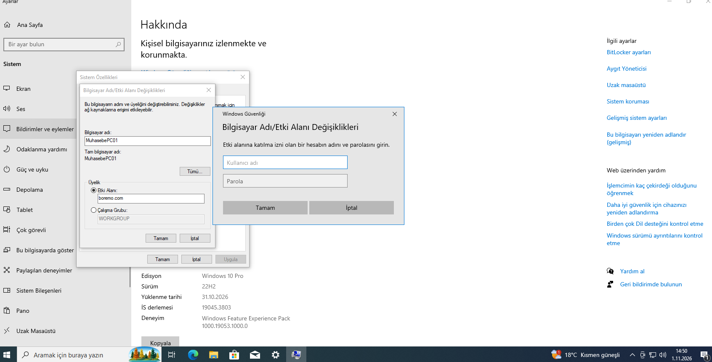
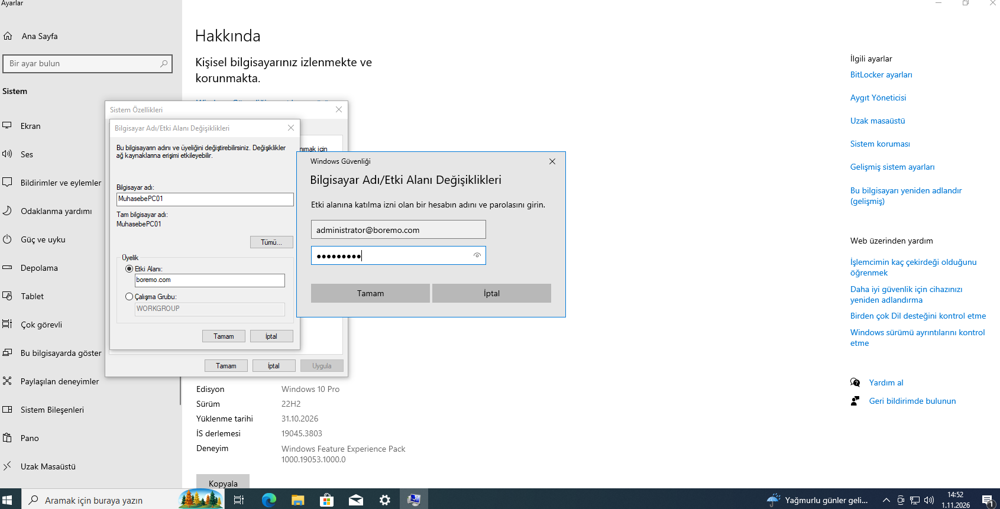
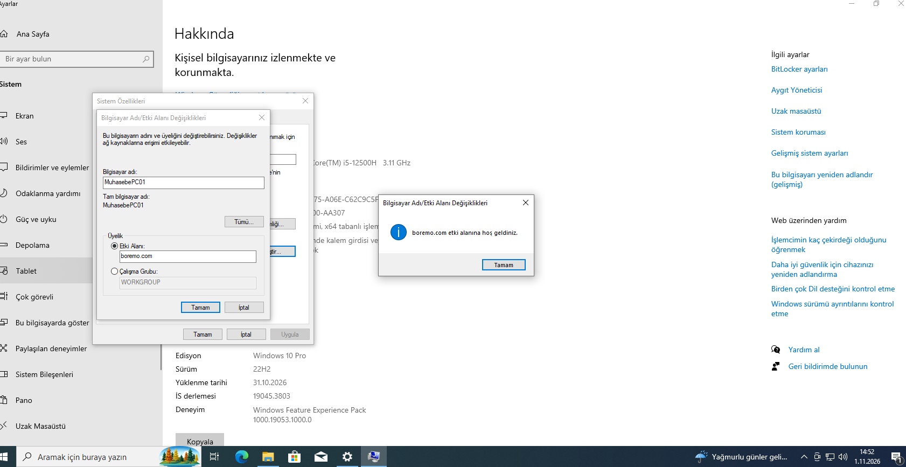
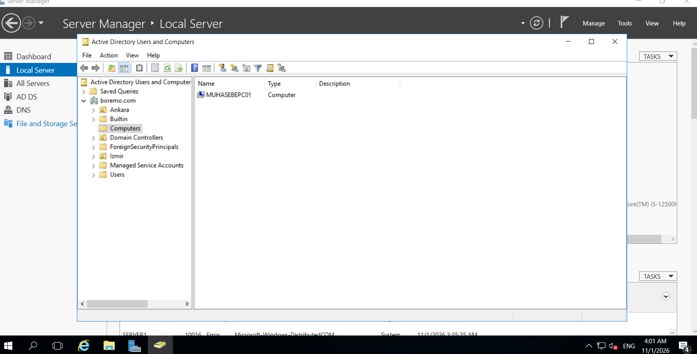

# WS 2016 — Domaine bir bilgisayar nasıl dahil edilir ?

[← Modül içindekiler](README.md) · [Tüm laboratuvar notları](../LAB-INDEX.md)

Windows Server 2016 ‘da Active Directory Users and Computers ekranından Computers klasörüne bastığımızda orada domainde olan bilgisayarlar gözükür biz eklemediğimiz için gözükmüyor.

Şimdi biz ekleme işlemini yapacağız.

## IP ve DNS Ayarları

### 📌 Ne?

Windows 10 bilgisayarımızı Windows Server 2016 üzerindeki Active Directory Domain'ine dahil etmek için ağ ayarlarını yapılandırıyoruz.

Ekran görüntündeki ayarlar:

| Ayar | IP Adresi | Görevi |
| --- | --- | --- |
| IP Address | `192.168.1.150` | Windows 10 bilgisayarının adresi |
| Subnet Mask | `255.255.255.0` | Yerel ağın sınırını belirler |
| Default Gateway | `192.168.1.1` | Diğer ağlara çıkışı sağlar |
| Preferred DNS | `192.168.1.100` | Windows Server 2016 DNS sunucusu |

### ⚙️ Neden Windows Server'ın IP Adresini DNS Olarak Girdik?

Çünkü Active Directory, Domain Controller'ı bulmak için DNS kullanır.

1. Windows 10 bilgisayarı `192.168.1.150` IP adresiyle ağa bağlanır.
2. Kullanıcı bilgisayarı domain'e katmak istediğinde Windows, DNS sunucusuna domain'in hangi sunucular tarafından yönetildiğini sorar.
3. DNS sunucusu (`192.168.1.100`), Active Directory'ye ait DNS kayıtları sayesinde Domain Controller'ın bulunmasını sağlar.
4. Windows 10, Domain Controller ile iletişim kurarak domain'e katılma işlemini gerçekleştirir.

### 💡 Nerede Kullanılır?

Şirkete yeni bir bilgisayar geldiğini düşün.

- IT uzmanı bilgisayarı şirket ağına bağlar.
- DNS ayarını şirketin Active Directory DNS sunucusuna yönlendirir.
- Bilgisayarı domain'e dahil eder.
- Artık çalışan, domain hesabıyla bilgisayarda oturum açabilir.

Önemli: Windows 10'a statik IP vermek zorunlu değildir; DHCP ile de IP alabilir. Asıl önemli olan doğru DNS sunucusunun kullanılmasıdır.

### 🧠 Günlük Hayattan Benzetme

Bir şirkete yeni gelen çalışanın müdürün odasını bilmediğini düşün. Danışmaya (DNS) sorar, danışma ona müdürün (Domain Controller) yerini gösterir.

---

### 🔐 Active Directory – Bilgisayarı Domaine Katarken Neden Administrator Kullanıyoruz?

### 🧠 Günlük Hayattan Benzetme

> Bir şirkete yeni çalışan geldiğini düşün. Çalışan binaya gelip istediği gibi personel sistemine kendisini kaydedemez. Önce İnsan Kaynakları veya yetkili bir yönetici kayıt işlemini onaylar.
> Active Directory'de de bir bilgisayarı domaine eklemek için bu işlemi yapmaya yetkili bir hesap gerekir.
### 📌 1. Ekranda Ne Yapıyoruz?

Windows 10 bilgisayarımızı (`MuhasebePC01`), Windows Server üzerinde oluşturduğumuz `boremo.com` domain'ine dahil ediyoruz.

Ekrandaki bilgiler:

- Domain: `boremo.com`
- Bilgisayar: `MuhasebePC01`
- Yetkili hesap: `administrator@boremo.com`

Önemli: Burada Administrator hesabıyla Windows 10'a giriş yapmıyoruz. Bilgisayarı domaine katma işlemini yetkili bir hesapla onaylıyoruz.

### ⚙️ 2. Neden Administrator Kullanıyoruz?

Domain Controller üzerinde bulunan Administrator hesabı, varsayılan olarak geniş yönetim yetkilerine sahiptir.

Bu hesapla:

- Bilgisayarın domaine katılmasını sağlayabiliriz.
- Active Directory'de bilgisayar hesabı oluşturulabilir veya mevcut hesap kullanılabilir.
- Bilgisayar ile domain arasında güvenli bir ilişki (Secure Channel) kurulmasına yönelik işlemler gerçekleştirilir.

İşlem başarılı olduğunda bilgisayar artık Active Directory üzerinden merkezi olarak yönetilebilir.

### 👤 3. Başka Bir Kullanıcıyla Domaine Katılabilir miydik?

Evet, Administrator kullanmak zorunda değiliz. Yeterli yetkisi olan başka bir domain hesabı da kullanılabilir.

| Hesap | Domaine bilgisayar ekleyebilir mi? |
| --- | --- |
| Domain Administrator | Evet |
| Yetkilendirilmiş IT personeli | Evet |
| Normal domain kullanıcısı | Varsayılan ayarlarda sınırlı olarak mümkün olabilir |
| Yetkisi kısıtlanmış kullanıcı | Hayır |

Windows Server'da varsayılan olarak kimliği doğrulanmış kullanıcılar en fazla 10 bilgisayarı domaine ekleyebilir. Ancak güvenlik nedeniyle Microsoft, bu hakkın yalnızca yetkili IT personeline verilmesini öneriyor.

### 🏢 4. Gerçek İş Hayatından Örnek

Bir şirkette IT Support personeli olarak çalıştığını düşün.

Muhasebe departmanına yeni bir bilgisayar geldi:

1. Bilgisayara Windows 11 kurdun.
2. IP ve DNS ayarlarını yaptın.
3. `boremo.com` domain'ine katılmak istedin.
4. Şirketin sana verdiği domain'e bilgisayar ekleme yetkili IT hesabını girdin.
5. Bilgisayar domaine katıldı ve yeniden başlatıldı.
6. Muhasebe çalışanı kendi domain hesabıyla bilgisayarda oturum açtı.

Böylece çalışan Administrator parolasını bilmeden bilgisayarı kullanabilir.

### ⚠️ 5. Sistem Yöneticisi Olarak Bilmen Gerekenler

- Gerçek şirketlerde her IT çalışanına Domain Admin yetkisi verilmez.
- Bunun yerine belirli OU'larda bilgisayar oluşturma gibi gerekli izinler devredilebilir (Delegation of Control).
- Bilgisayar domaine katıldıktan sonra varsayılan olarak `Computers` container'ında oluşabilir. Daha sonra ilgili OU'ya taşınarak GPO uygulanabilir.
- Domaine katma işlemini başlatan kişinin bilgisayar üzerinde de yeterli yerel yönetici yetkisi bulunmalıdır.
    
    ---
    

**Windows Server 2016’da Computers kısmına baktığımızda bilgisayarın başarılı bir şekilde eklendiğini görüyoruz.**

---
