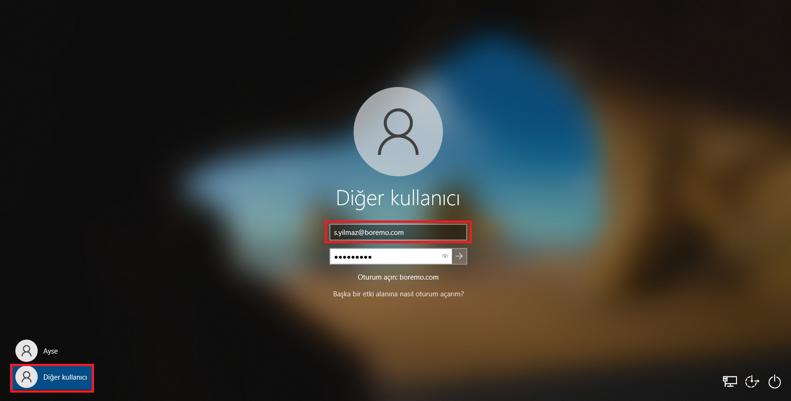

# Active Directory – Domain Kullanıcıları ve Yerel Kullanıcılar

[← Modül içindekiler](README.md) · [Tüm laboratuvar notları](../LAB-INDEX.md)

### 🧠 Benzetme

> **Yerel Kullanıcı (Local User):** Sadece kendi evinin anahtarına sahip kişidir.
> **Domain Kullanıcısı (Domain User):** Şirketin merkezi kimlik sistemi tarafından tanınan, yetkisi olan farklı odalara girebilen çalışandır.
### 📌 Ne?

1. Yerel Kullanıcı (Local User)

- Kullanıcı hesabı doğrudan bilgisayar üzerinde oluşturulur.
- Kullanıcı bilgileri bilgisayarın kendi veritabanında **(Local SAM)** tutulur.
- Active Directory'ye ihtiyaç duymaz.
- Örnek: Kişisel bilgisayarındaki `Bora` hesabı.

2. Domain Kullanıcısı (Domain User)

- Active Directory üzerinde oluşturulan kullanıcı hesabıdır.
- Hesap bilgileri **Domain Controller (DC)** üzerinde tutulur.
- Kullanıcı, izin verilen domain bilgisayarlarında aynı hesapla oturum açabilir.
- Örnek: Şirket çalışanının `bora@boremo.com` hesabı.

### ⚙️ Aralarındaki Farklar

| Özellik | Yerel Kullanıcı | Domain Kullanıcısı |
| --- | --- | --- |
| Hesap nerede oluşturulur? | Bilgisayarda | Active Directory'de |
| Hesabı kim yönetir? | Yerel yönetici | Yetkili domain yöneticisi |
| Birden fazla PC'de oturum | Her PC'de ayrı hesap gerekir | Aynı hesap kullanılabilir |
| Şifre yönetimi | Bilgisayar üzerinde | Merkezi |
| GPO yönetimi | Yerel ilkeler | Domain ilkeleri |
| Kullanım alanı | Ev, bağımsız bilgisayar | Şirket, kurum |

### 💡 Gerçek İş Hayatından Örnekler

Örnek 1 – Yerel Kullanıcı

Evindeki Windows 11 bilgisayarında `Bora` adında yerel hesap oluşturdun.

- Bu hesap yalnızca o bilgisayarda tanımlıdır.
- Başka bilgisayarda aynı hesap otomatik olarak bulunmaz.

Örnek 2 – Domain Kullanıcısı

Bir şirkette IT uzmanı olarak Active Directory üzerinden `Ahmet` hesabını oluşturdun.

- Ahmet şirketin 1. bilgisayarında hesabıyla oturum açar.
- Daha sonra 2. bilgisayara geçer.
- Yetkisi varsa aynı domain hesabıyla orada da oturum açabilir.
- IT uzmanı, Ahmet'in şifresini merkezi olarak sıfırlayabilir.

### 🛠️ Nerede Oluşturulur?

- Yerel Kullanıcı: `Computer Management → Local Users and Groups → Users`
- Domain Kullanıcısı: `Server Manager → Tools → Active Directory Users and Computers → New → User`

---

## **Windows 10 — Domain ile Oturum Açma**

**Windows Server 2016 Active Directory’de oluşturduğumuz herhangi bir kullanıcıdan giriş yapıyoruz**
