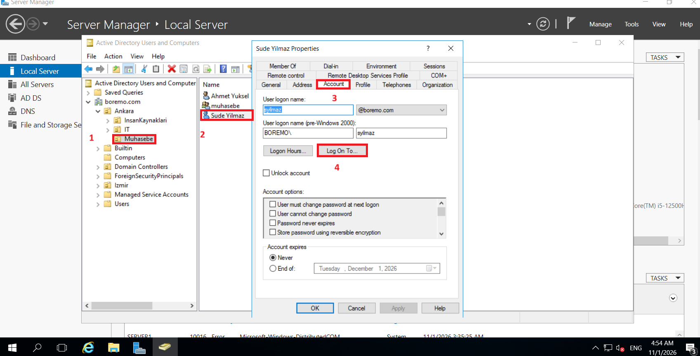
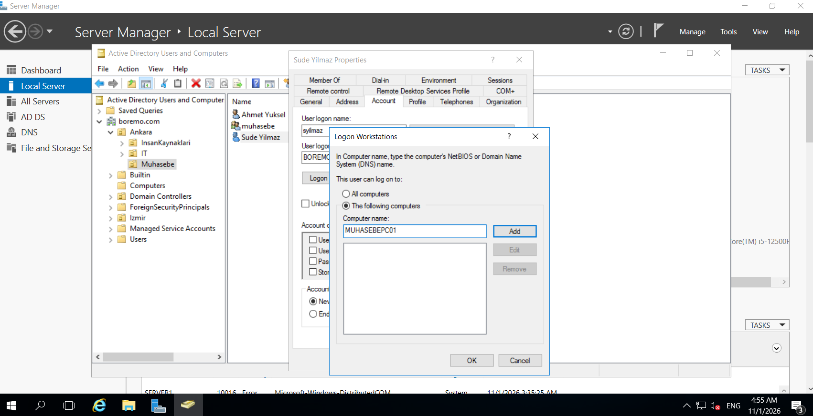
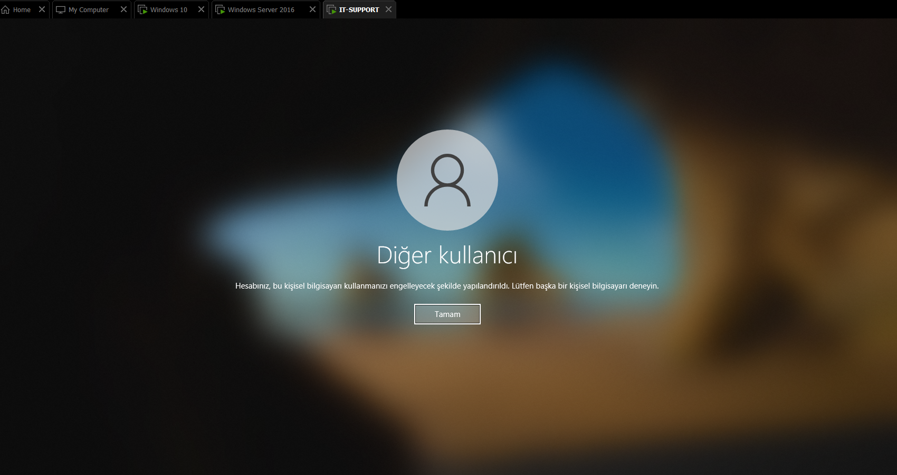

# WS 2016 — Domain Kullanıcılarına Bilgisayar Kullanma Yasağı Koymak

[← Modül içindekiler](README.md) · [Tüm laboratuvar notları](../LAB-INDEX.md)

### 📌 Ne?

- **Logon Workstations (Oturum Açılabilecek Bilgisayarlar):** Domain kullanıcısının hangi bilgisayarlarda oturum açabileceğini belirleyen Active Directory ayarıdır.
- Kullanıcının belirli bilgisayarlarda oturum açmasına izin verirken diğerlerinde oturum açmasını engelleyebiliriz.
- Bu kısıtlama bilgisayara değil, kullanıcı hesabına uygulanır.

### ⚙️ Neden Kullanılır?

- Güvenlik: Çalışanın yetkisi olmayan bilgisayarlarda oturum açmasını engellemek.
- Erişim kontrolü: Kullanıcının sadece kendisine tahsis edilen bilgisayarları kullanmasını sağlamak.
- Yetkisiz kullanımı önleme: Örneğin muhasebe çalışanının domain hesabıyla başka departmanın bilgisayarına girişini kısıtlamak.

### 💡 Ekran Görüntüsündeki İşlem

Hocanın yaptığı işlem:

1. Active Directory Users and Computers açılıyor.
2. `Sude Yılmaz` kullanıcısına çift tıklanıyor.
3. Account → Log On To seçiliyor.
4. The following computers işaretleniyor.
5. Bilgisayar adı olarak `MUHASEBEPC01` yazılıyor.
6. Add → OK → Apply/OK ile ayar kaydediliyor.

### 💡 Gerçek Hayattan Örnek

Şirkette Sude Yılmaz, Muhasebe departmanında çalışıyor.

| Bilgisayar | Sude'nin giriş izni |
| --- | --- |
| MUHASEBEPC01 | İzin var |
| MUHASEBEPC02 | İzin yok |
| IKPC01 | İzin yok |

Bu örnekte Sude, domain hesabıyla yalnızca `MUHASEBEPC01` bilgisayarında oturum açabilir.

### ⚠️ Altın Kural

- Bu ayar bilgisayarı tamamen kilitlemez; sadece ilgili domain kullanıcısının oturum açabileceği bilgisayarları sınırlar.
- Microsoft, yeni yapılandırmalarda bu eski ayar yerine GPO üzerinden Allow/Deny log on locally (Yerel oturum açmaya izin ver/engelle) haklarının kullanılmasını öneriyor.

### 🧠 Benzetme

Şirket çalışanının giriş kartının yalnızca kendi departmanındaki bilgisayarlarda geçerli olması gibi düşünebilirsin.

---

**→ SUDEYİ SADECE MUHASEBEPC01 ÜZERİNDEN GİRİŞ YAPABİLECEK ŞEKİLDE AYARLADIK ŞİMDİ BAŞKA PC ÜZERİNDEN DOMAİN GİRİŞİ YAPIYORUZ VE KABUL ETMİYOR** 

**(KULLANDIĞIMIZ PC : ITPC01)**

---
