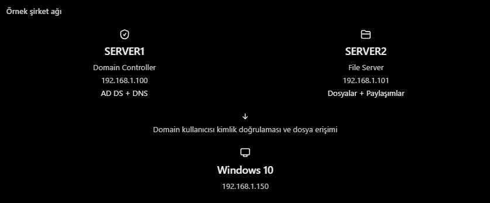

# Windows Server – Ağda Dosya ve Klasör Paylaşımı (File Server)

[← Modül içindekiler](README.md) · [Tüm laboratuvar notları](../LAB-INDEX.md)

### 🧠 Benzetme

> Domain Controller şirketin insan kaynakları ve güvenlik merkezi, File Server ise şirketin dosya arşividir. Personelin kimliğini kontrol eden merkezle bütün önemli belgeleri aynı yerde tutmak güvenlik riskini artırır.
### 📌 Ne?

- **File Server (Dosya Sunucusu):** Şirket çalışanlarının ağ üzerinden dosyalara ve klasörlere erişmesini sağlayan sunucudur.
- Dosyalar merkezi olarak saklanır ve yetkili kullanıcılarla paylaşılır.
- Windows ağlarında dosya paylaşımı için genellikle SMB (Server Message Block) protokolü kullanılır.

### ⚙️ Neden File Server ve Domain Controller Ayrı Olmalı?

Hocanın söylediği güvenlik açısından doğru bir yaklaşımdır.

- **Domain Controller (DC):** Kullanıcı hesaplarını, kimlik doğrulamayı ve Active Directory'yi yönetir.
- **File Server:** Şirketin belgelerini, ortak klasörlerini ve dosya erişimlerini yönetir.
- İkisi aynı sunucuda bulunursa dosya paylaşım hizmetindeki bir güvenlik açığı, kritik Domain Controller'ı da riske atabilir.
- Ayrı sunucular kullanmak güvenlik risklerini ve hizmetlerin birbirini etkilemesini azaltır

### 🛠️ Dosya ve Klasörler Nasıl Paylaşılır?

Windows Server 2016 üzerinde:

1. Ayrı bir Windows Server kur ve File Server olarak yapılandır.
2. Sunucuyu mevcut domain'e dahil et.
3. `D:\Paylasim\Muhasebe` adında klasör oluştur.
4. Klasöre sağ tıkla → Properties → Sharing → Advanced Sharing.
5. Share this folder seçeneğini işaretle.
6. Permissions (Paylaşım İzinleri) ve Security (NTFS İzinleri) üzerinden erişim haklarını ayarla.
7. Windows 10 bilgisayarından `\\SERVER2\Muhasebe` adresiyle bağlan.

### 💡 Gerçek İş Hayatından Örnek

Şirkette 20 muhasebe çalışanı var.

- Active Directory üzerinde `Muhasebe_Users` güvenlik grubu oluşturulur.
- Muhasebe çalışanları bu gruba eklenir.
- File Server üzerindeki `Muhasebe` klasörüne bu grup için erişim izni verilir.
- İnsan Kaynakları çalışanlarına bu klasör için erişim izni verilmez.

Önemli: Ağ üzerinden erişimde hem Share Permissions hem de NTFS Permissions değerlendirilir. Daha kısıtlayıcı olan etkin izin belirleyici olur.

---
