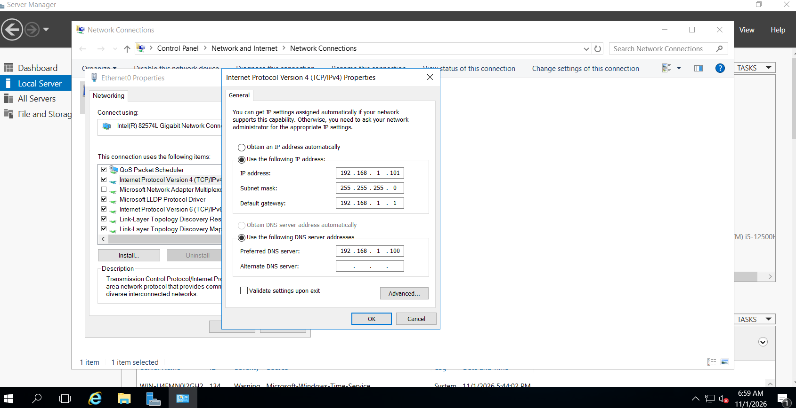
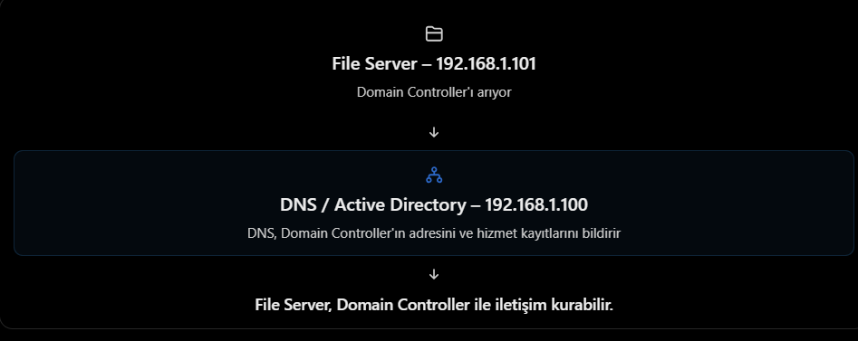
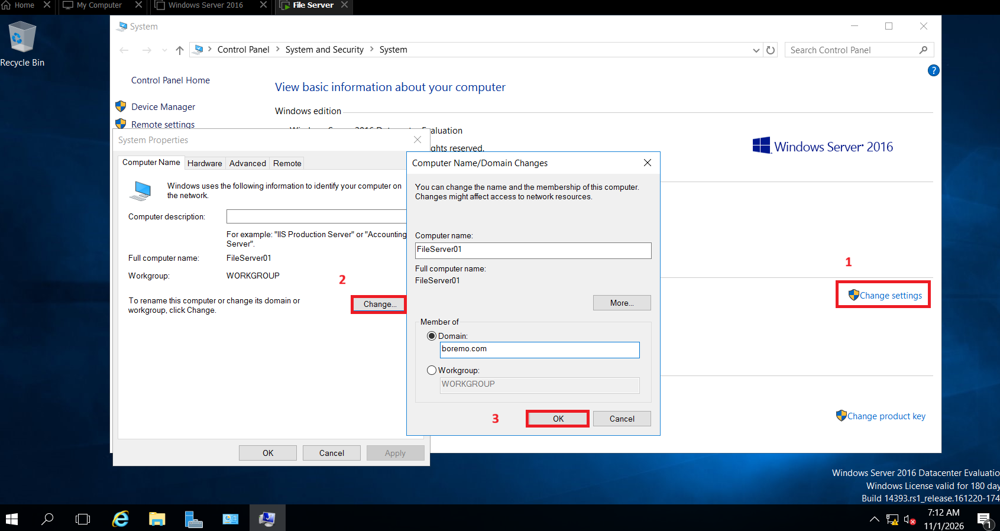

# WS 2016  —  File Server IPv4 ve DNS Yapılandırması & Domain Bağlama

[← Modül içindekiler](README.md) · [Tüm laboratuvar notları](../LAB-INDEX.md)

### 🧠 Günlük Hayattan Benzetme

> Bir şirketin dosya arşivi (File Server) ve personel kayıt merkezi (Active Directory) olduğunu düşün.
> Çalışanlar arşive erişmek istediğinde kimliklerinin doğrulanması gerekir. File Server, kullanıcıların hangi merkezi sistem üzerinden doğrulanacağını DNS yardımıyla bulur.
### 📌 1. Ne Yapıyoruz?

File Server olarak kullanacağımız Windows Server'a statik IP (Sabit IP) tanımlıyoruz.

| Ayar | Değer | Görevi |
| --- | --- | --- |
| IP Address | 192.168.1.101 | File Server'ın sabit adresi |
| Subnet Mask | 255.255.255.0 | Yerel ağ sınırını belirler |
| Default Gateway | 192.168.1.1 | Diğer ağlara çıkışı sağlar |
| Preferred DNS | 192.168.1.100 | Active Directory DNS sunucusu |
| Alternate DNS | Boş | İkinci DNS sunucusu tanımlanmamış |

Neden statik IP? Kullanıcıların ve diğer sunucuların File Server'a sürekli aynı adresten ulaşabilmesi için.

### ⚙️ 2. Neden DNS Olarak Active Directory Sunucusunu Seçtik?

Çünkü File Server'ı ileride `boremo.com` domain'ine bağlayacağız.

Active Directory ortamında DNS, Domain Controller'ın bulunmasını sağlar.

Önemli ayrım: DNS kullanıcıların şifrelerini kontrol etmez. DNS, Domain Controller'ı bulmaya yardımcı olur; kimlik doğrulama ise örneğin Kerberos üzerinden yapılır.

### 🏢 3. Gerçek İş Hayatında Nasıl Kullanılır?

Muhasebe çalışanı, şirketin paylaşılan klasörüne erişmek istiyor:

`\\FileServer01\Muhasebe`

- DNS, `FileServer01` adını IP adresine çözümler.
- File Server, kullanıcının domain kimliğinin doğrulanmasını sağlar.
- Dosya ve klasör izinlerine göre erişim verilir veya reddedilir.

### ⚠️ 4. Dikkat Edilecekler

- File Server ile Domain Controller'ı ayrı sunucularda çalıştırmak daha güvenli ve yönetilebilir bir yapıdır.
- File Server'ın DNS adresi, AD kayıtlarını çözebilen DNS sunucusu olmalıdır. Bu nedenle `8.8.8.8` yerine `192.168.1.100` yazdık.
- VMware ağları birbiriyle iletişim kurabilmeli ve IP adresleri çakışmamalıdır.

### ✅ Akılda Tut

Domain Controller = Kimlik yönetimi

File Server = Dosya paylaşımı

DNS = Sunucuların birbirini bulmasını sağlayan sistem

İki sunucu farklı görevler yapıyor ama aynı Active Directory altyapısıyla birlikte çalışıyor.

---

### **DOMAİN BAĞLAMA İŞLEMİ**

