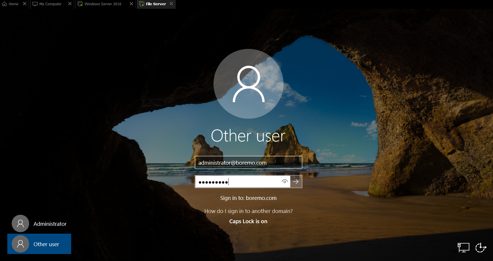
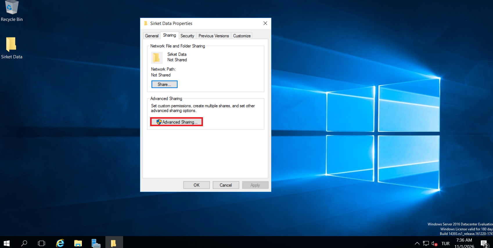
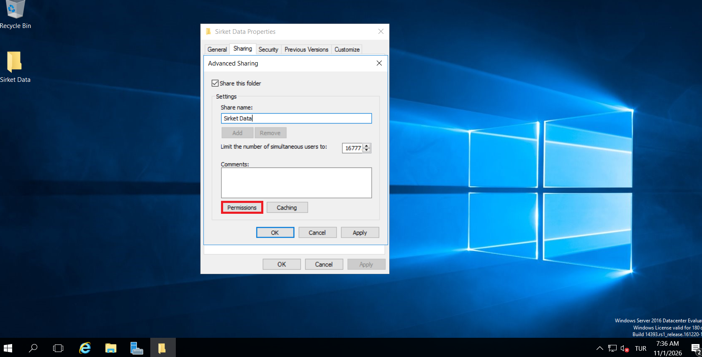
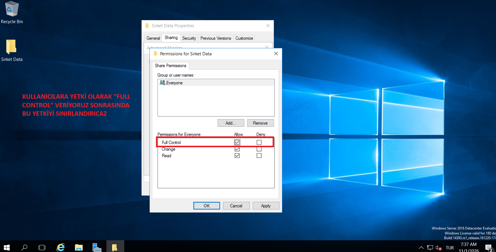
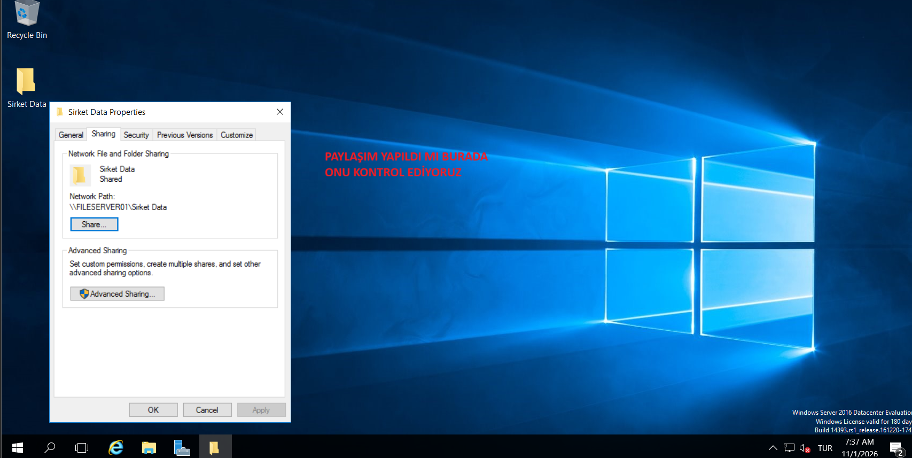

# WS 2016 — Dosya Paylaşımı Nasıl Yapılır ?

[← Modül içindekiler](README.md) · [Tüm laboratuvar notları](../LAB-INDEX.md)

**İlk adım olarak file server’a local admin olarak giriş yapıyoruz**

**→ Herhangi bir klasör oluşturup paylaşıma başlıyoruz**

