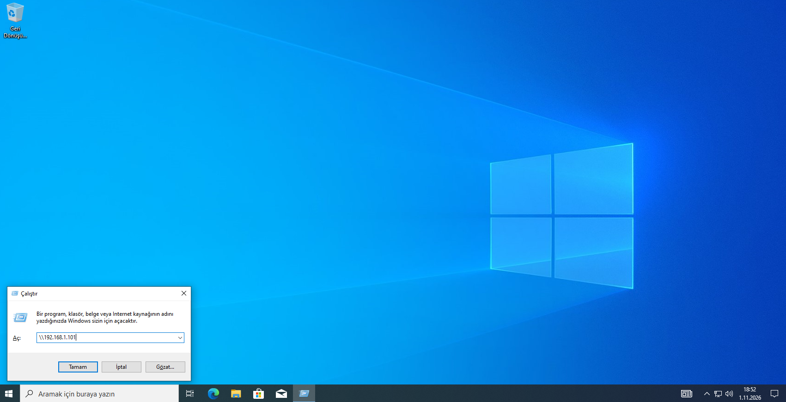
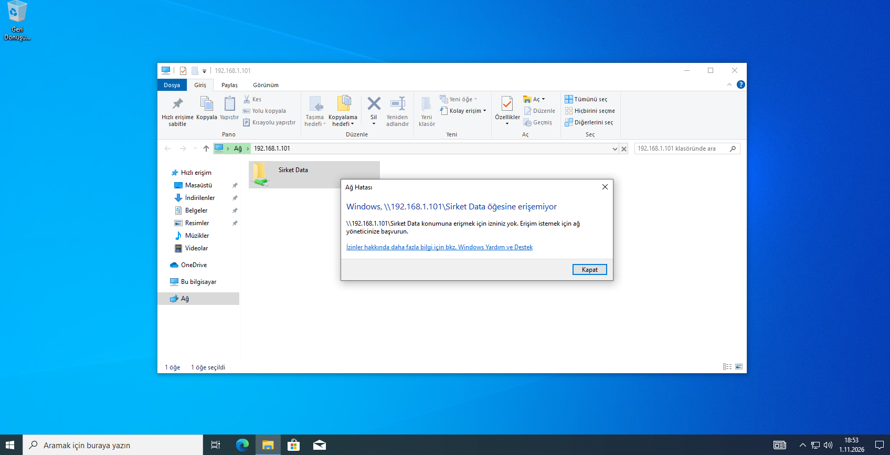
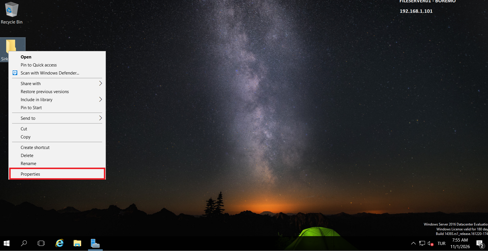
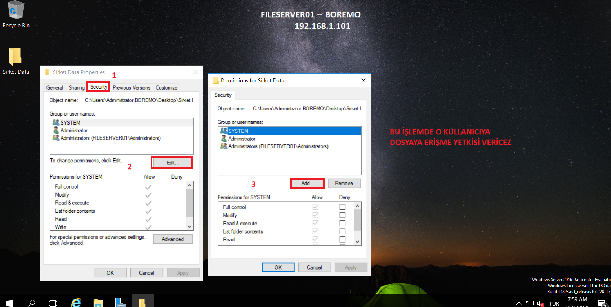
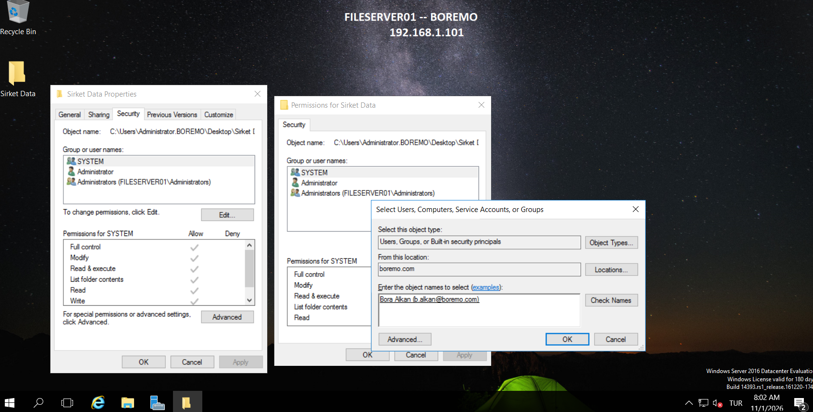
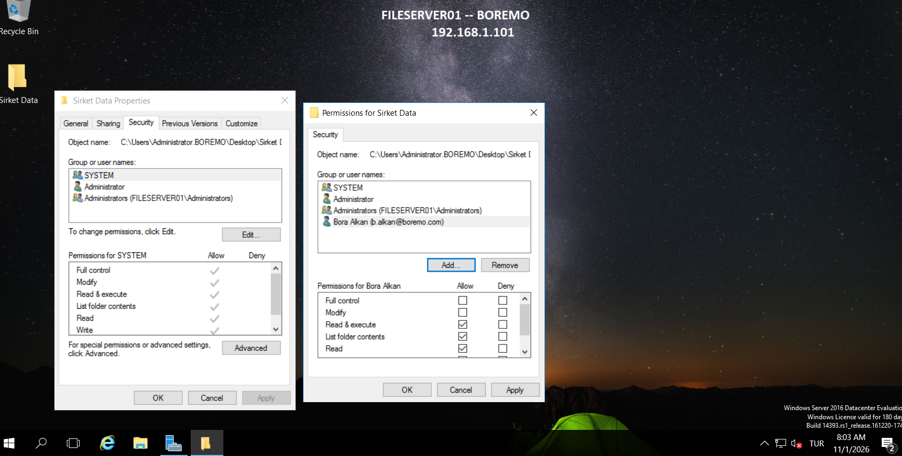
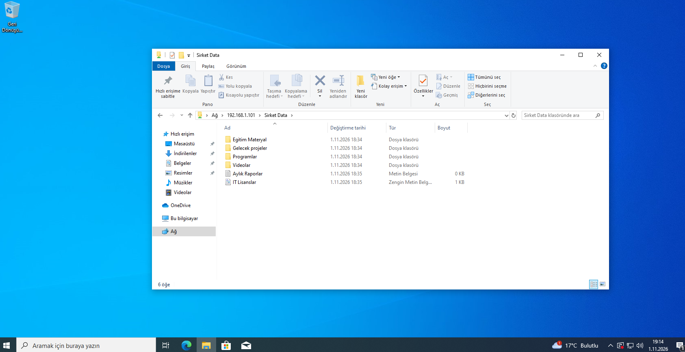

# WS 2016 — Domaindeki paylaştırılmış bir kaynağa nasıl ulaşılır?

[← Modül içindekiler](README.md) · [Tüm laboratuvar notları](../LAB-INDEX.md)

→ Domainde bir kullanıcı seçip giriş yaptık ve sonrasında file server’a bağlanmak için bu komutu çalıştırdık

→ File Server’ın paylaştığı klasör çıktı ama o klasöre iznimiz olmadığı için açamadık şimdi o ayarlarını yapıcaz

---

→ Burada IT ekibinden olan “Bora Alkan” ı ekliyoruz birden fazla kişi ekliceksek daha öncesinde domainde oluşturduğumuz grupları ekleyebiliriz örnek : insankaynaklari gibi..

→ Burada o kullanıcıya belirli yetkiler veriyoruz genellikle bu yetkiler önerilir.Diğer yetkiler çok yüksektir sadece admine verilmesi tavsiye edilir.

→ Sonrasında “Bora Alkan” kullanıcısı bu klasöre erişim sağlayabiliyor :

---
