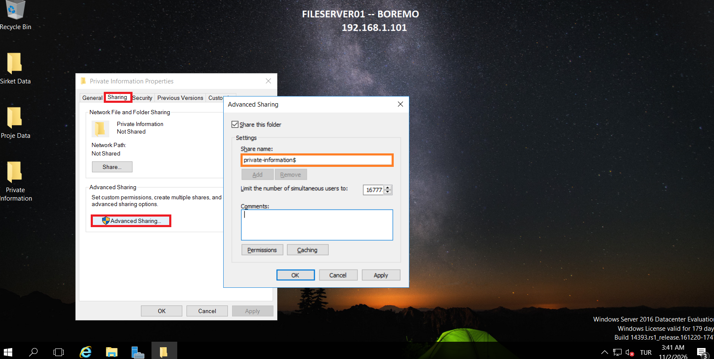
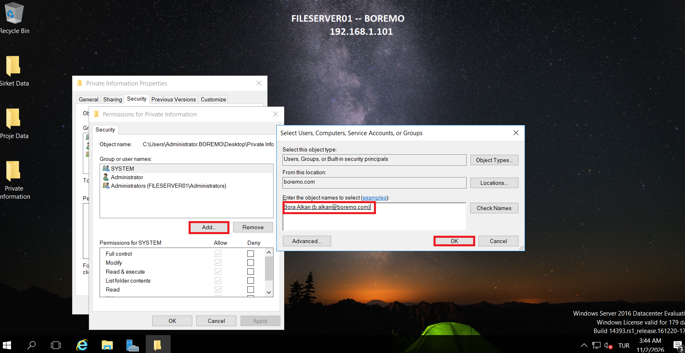
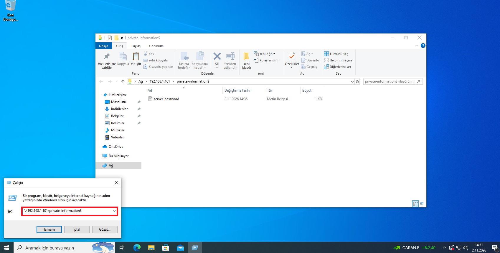

# WS 2016 – Gizli Ağ Paylaşımları ve Bu Paylaşımlara Erişim

[← Modül içindekiler](README.md) · [Tüm laboratuvar notları](../LAB-INDEX.md)

### 🧠 Benzetme

> Şirkette herkesin bildiği ortak bir arşiv odası var. Ancak IT departmanına ait özel bir oda daha bulunuyor. Bu odanın adı kapıda yazmıyor; yerini bilen kişiler bile yalnızca yetkileri varsa içeri girebiliyor.
### 📌 Ne?

- **Hidden Share (Gizli Paylaşım):** File Server üzerinde oluşturulan, normal ağ paylaşımı listesinde görünmeyen klasör paylaşımıdır.
- Paylaşım adının sonuna `$` (dolar işareti) eklenerek oluşturulur.
- Paylaşımın tam ağ adresini bilen kullanıcılar bağlantı kurmayı deneyebilir.
- Klasöre erişebilmek için gerekli kullanıcı izinlerine sahip olmak gerekir.

Örnek:

Normal paylaşım:

```
\\SERVER2\IT-Dosyalar
```

Gizli paylaşım:

```
\\SERVER2\IT-Gizli$
```

`\\SERVER2` adresindeki paylaşım listesinde `IT-Gizli$` normalde görünmez. Ancak tam adresi yazılarak erişim denenebilir.

---

### 🛠️ Windows Server 2016 – Gizli Paylaşım Oluşturma





→ Şimdi oluşturma işlemi bitti o klasöre “Bora Alkan” kullanıcısından erişim sağlıcaz.



---
