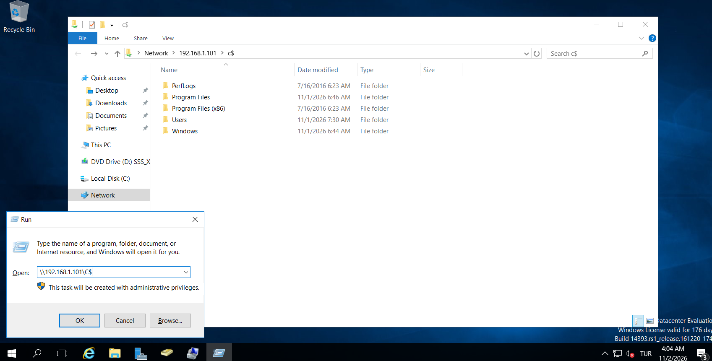
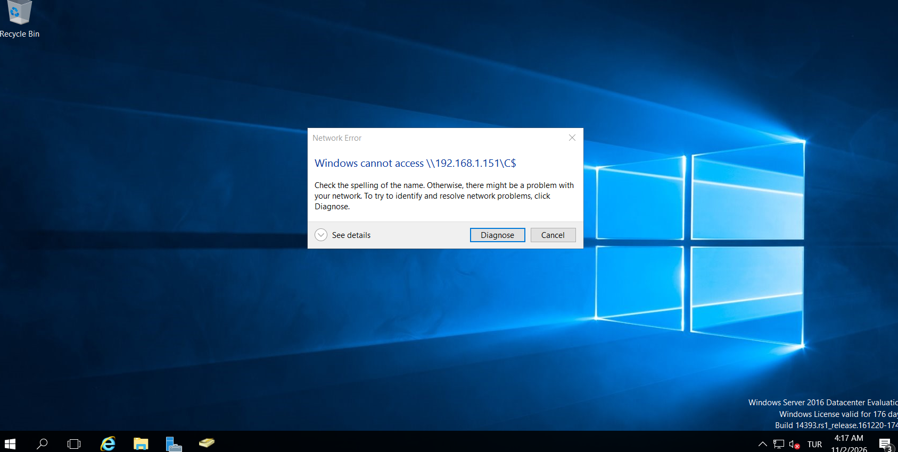
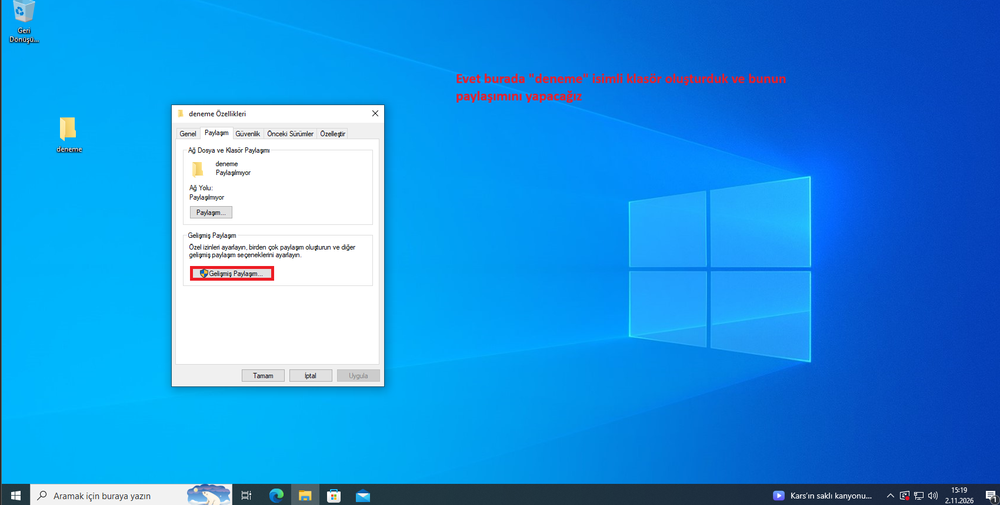
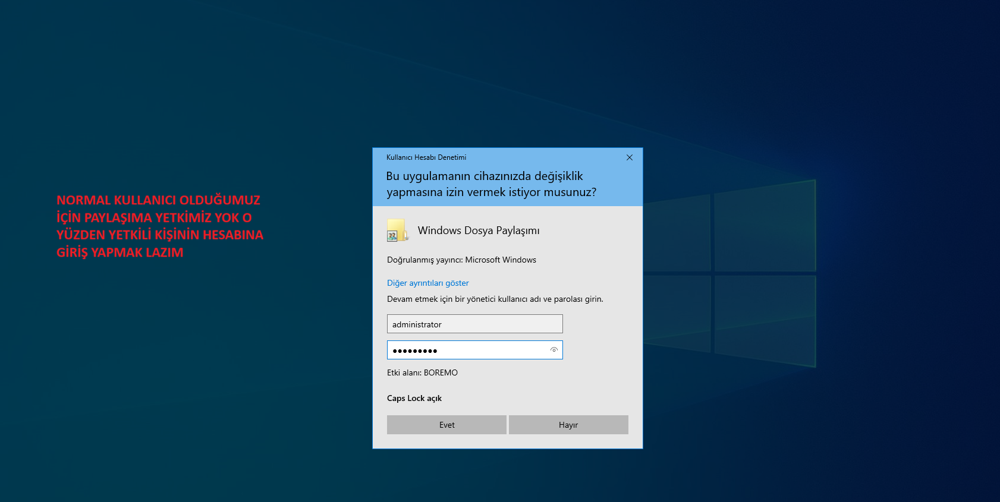
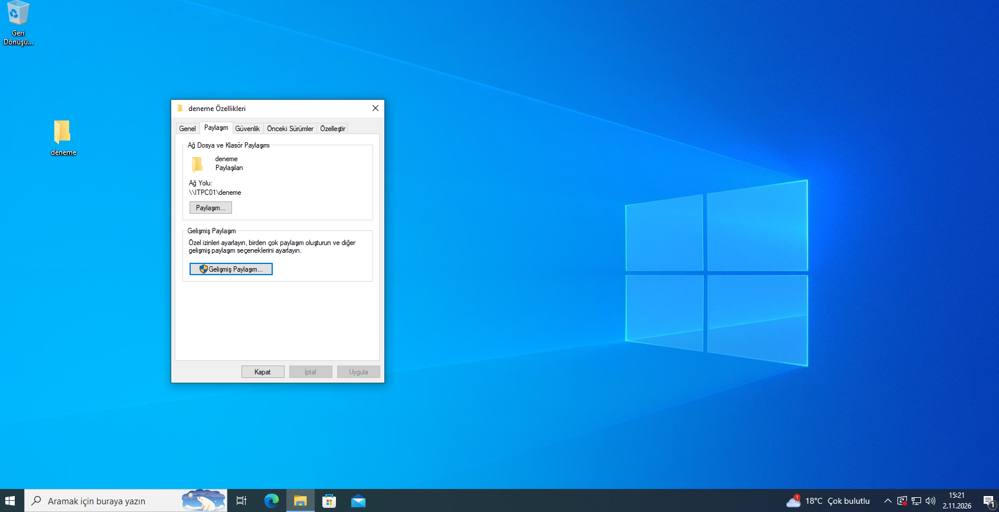
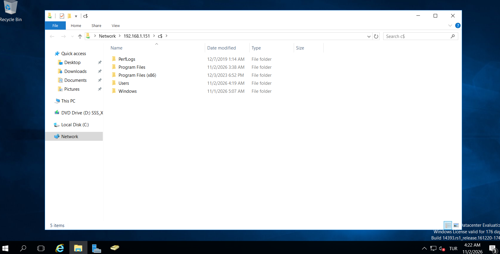
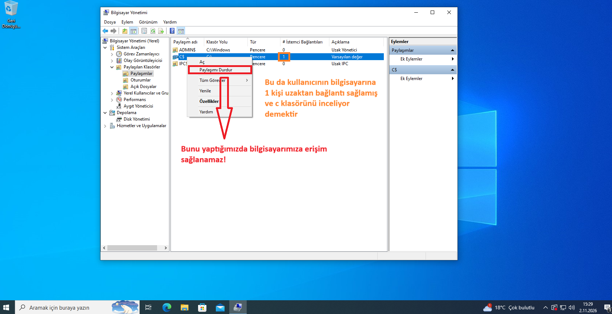

# WS 2016 — Ağdaki bir bilgisayarın tüm sürücülerine gizli erişim nasıl gerçekleştirilir ?

[← Modül içindekiler](README.md) · [Tüm laboratuvar notları](../LAB-INDEX.md)



### 🧠 Benzetme

> Şirkette her odanın normal giriş kapısı vardır. Ancak sistem yöneticilerinin kullanabildiği özel bir servis kapısı da bulunur. Bu kapı herkesin görebildiği listede yer almaz ve yalnızca yetkili kişiler kullanabilir.
### 📌 Ne?

**Administrative Shares (Yönetimsel Paylaşımlar)**, Windows'un sistem yöneticilerinin uzaktan yönetim yapabilmesi için otomatik oluşturduğu gizli ağ paylaşımlarıdır.

Örneğin, Windows Server üzerindeki `C:` sürücüsüne ağ üzerinden erişmek için:

```powershell
\\192.168.1.101\C$
```

Bu adrese bağlanan yetkili yönetici, sunucunun C: sürücüsündeki dosya ve klasörleri izinleri kapsamında görüntüleyebilir ve yönetebilir.

### ⚙️ Ekran Görüntüsünde Ne Yapılıyor?

Hocanın kullandığı ağ yapısı:

| Cihaz | IP adresi | Görevi |
| --- | --- | --- |
| Domain Controller | `192.168.1.100` | Domain yönetimi |
| File Server | `192.168.1.101` | Dosya sunucusu |
| Windows 10 | `192.168.1.151` | İstemci bilgisayar |
- Domain yöneticisi, `Win + R` üzerinden `\\192.168.1.101\C$` adresini açıyor.
- File Server'ın `C:` sürücüsüne erişebiliyor.
- Ekran görüntüsündeki `Windows`, `Users`, `Program Files` gibi klasörler uzaktaki sunucuya ait.

Önemli düzeltme: `C$` paylaşımını kullanmak için önceden manuel olarak klasör paylaşmak gerekmez. Desteklenen Windows sürümlerinde bu yönetimsel paylaşım varsayılan olarak otomatik oluşturulur.

### 📌 Yönetimsel Paylaşım Türleri

| Paylaşım | Görevi |
| --- | --- |
| `C$` | C: sürücüsüne erişim |
| `D$` | D: sürücüsüne erişim (varsa) |
| `ADMIN$` | Windows sistem dizinine uzaktan yönetim erişimi |
| `IPC$` | Sistemler arası iletişim |
| `SYSVOL` | Domain Controller üzerindeki GPO ve ilgili domain dosyaları |

Bu paylaşımlar Windows'un yönetim altyapısında kullanılır

---

### 🖥️ Windows 10 (ITPC01)– C$ Yönetimsel Paylaşımına Erişememe



**→ Bunun kısa bir çözümü var o bilgisayarda klasör paylaşımı yapıyoruz ve daha sonrasında istediğimiz klasöre erişim sağlayabiliyoruz şimdi adımları gösteriyorum :**







**→ Klasör paylaşımı yapıldı şimdi windows server üzerinden tekrar bir bağlantı sağlayalım bakalım**



**→ Başarılı bir şekilde bağlantı sağladık artık o bilgisayarın klasörlerine uzaktan erişim sağlayabiliriz.**

**→ Bu deneme klasörü silebiliriz illa ki durmasına gerek yok paylaşımı yapmak için oluşturduk** 

---

**EĞER BU GİZLİ BAĞLANTILARI KAPATMAK VE TESPİT ETMEK İSTİYORSAK KULLANICININ BİLGİSAYARINDA BU AYARA GİRERİZ :**


