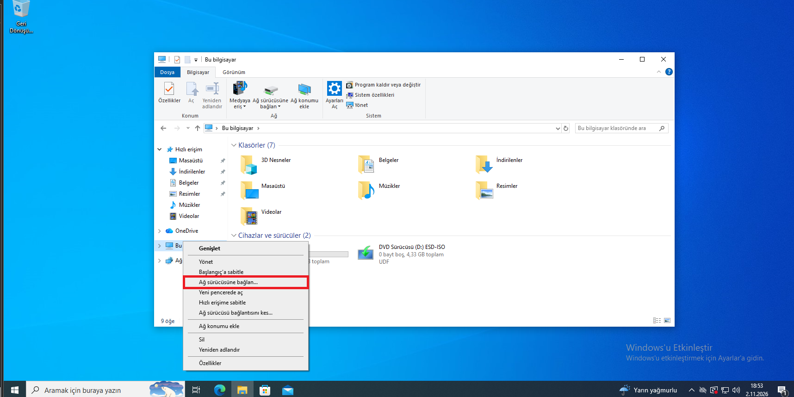
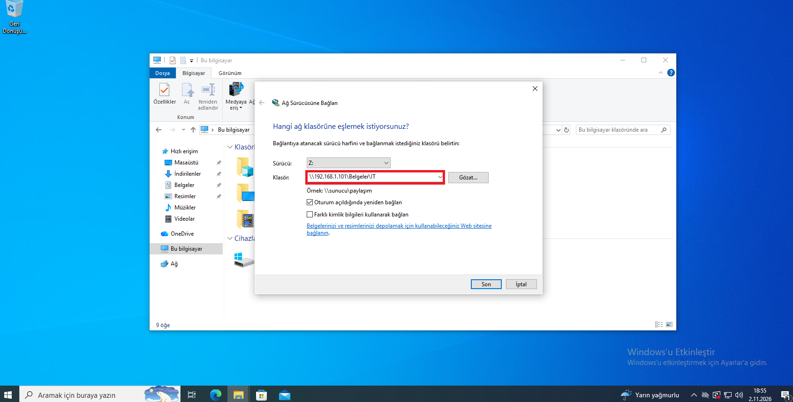
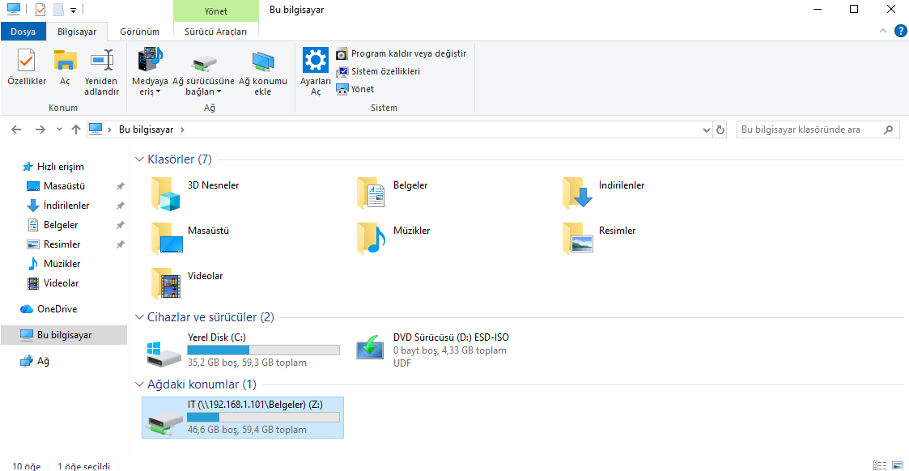

# W 10 — Network Sürücüleri Nasıl Oluşturulur?

[← Modül içindekiler](README.md) · [Tüm laboratuvar notları](../LAB-INDEX.md)

→ Bunu oluşturmamızın amacı bize kolaylık sağlaması 

→ Normalde Win + R yapıp “\\192.168.1.101” yazıyoruz ve karşımıza paylaşılan klasörler çıkıyor.Onların arasında bizi ilgilendireni bulmaya çalışıyoruz bu network sürücüsü onun kısayolu gibi düşünebiliriz

---
