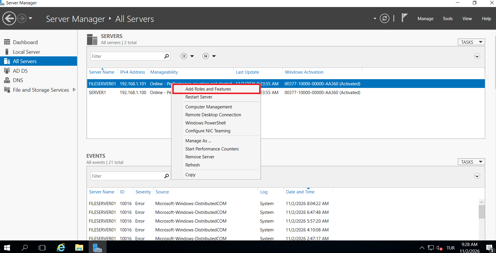
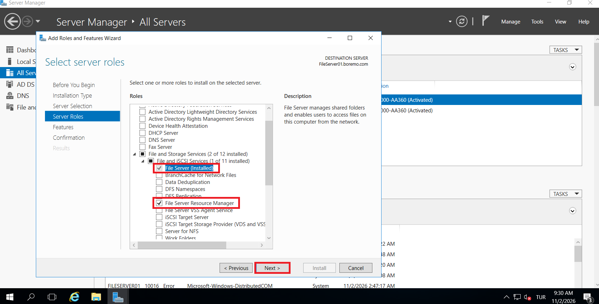

# WS 2016 — File Server Olarak Yapılandırma

[← Modül içindekiler](README.md) · [Tüm laboratuvar notları](../LAB-INDEX.md)

→ Bu şekilde uzaktan yönetim ile file serverımıza ekstra özellik ekliyoruz
