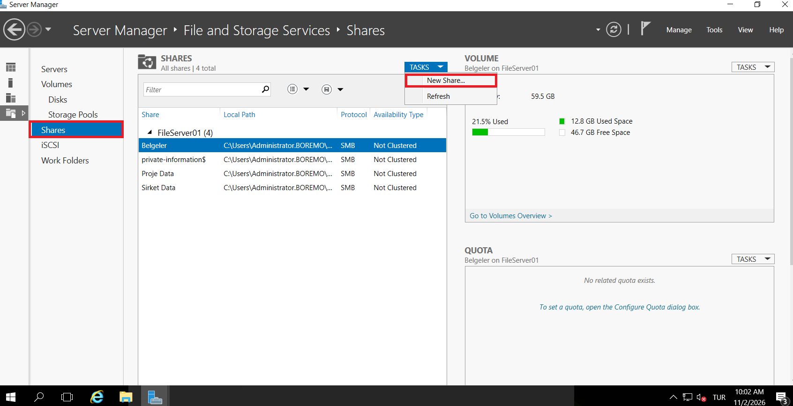
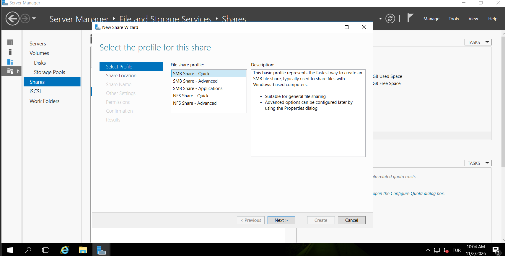
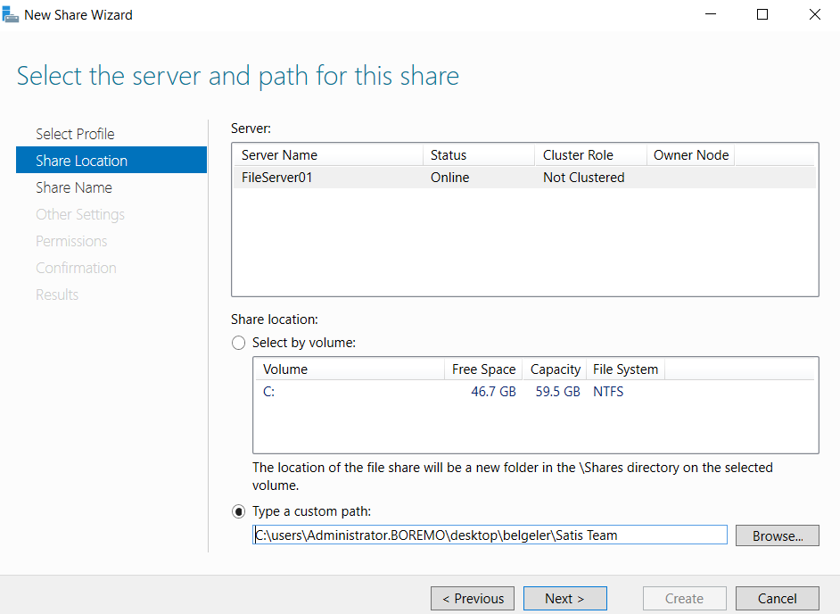
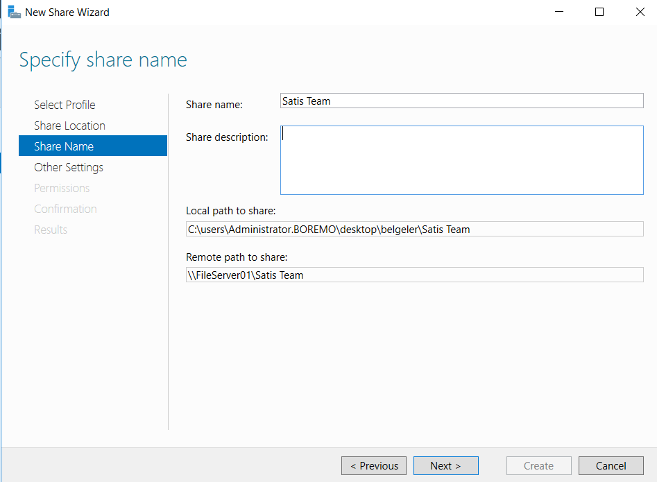
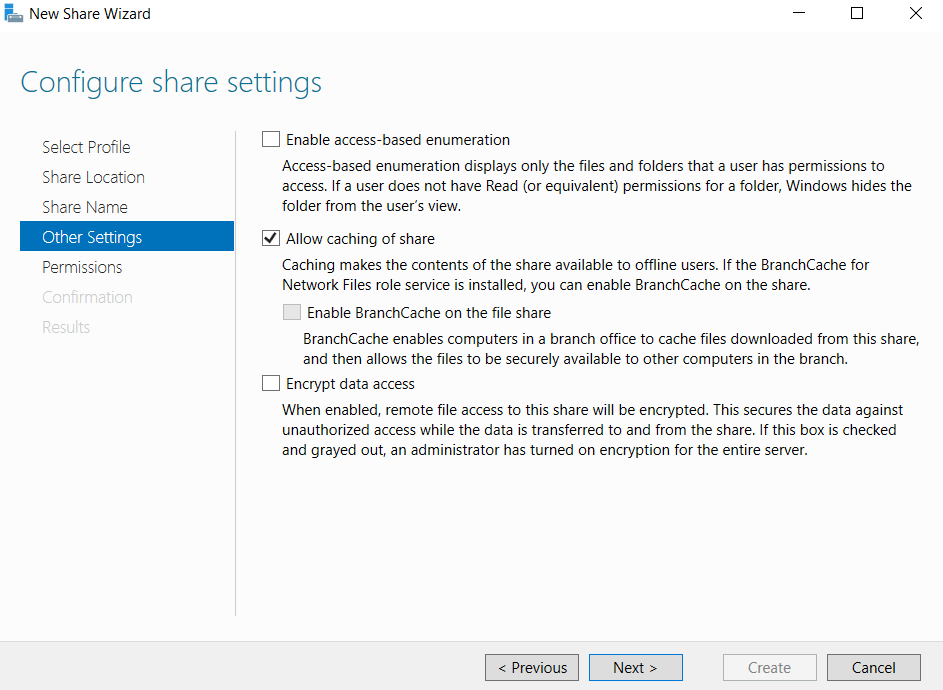
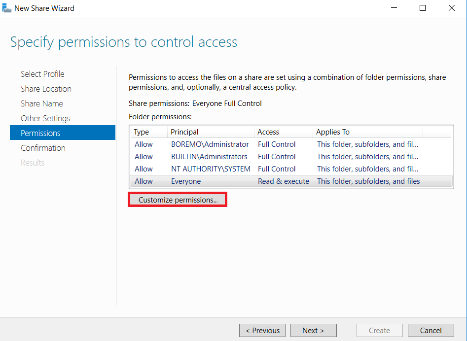
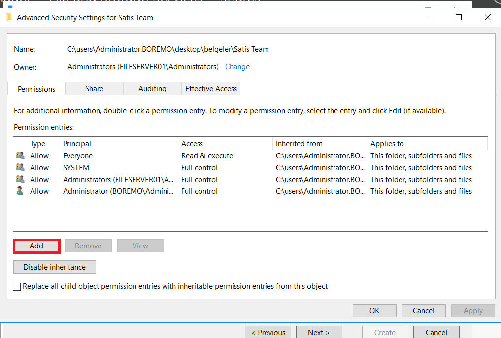
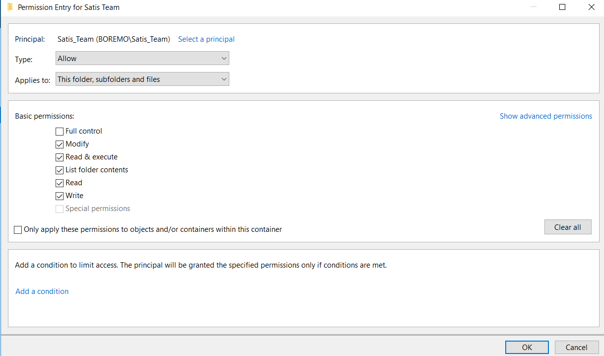

# WS 2016 — File Server Paneliyle Klasör Paylaşımı Yapma

[← Modül içindekiler](README.md) · [Tüm laboratuvar notları](../LAB-INDEX.md)

### 📌 Ne?

File Share Profile, Windows Server üzerinde ağ paylaşımı oluştururken hangi paylaşım yönteminin ve özelliklerinin kullanılacağını belirler.

Ekran görüntüsünde 5 farklı profil bulunuyor:

| Profil | Ne işe yarar? |
| --- | --- |
| SMB Share – Quick | Windows bilgisayarları arasında standart klasör paylaşımı |
| SMB Share – Advanced | Dosya sınıflandırma ve gelişmiş dosya yönetimi özellikleriyle paylaşım |
| SMB Share – Applications | Hyper-V, SQL Server gibi uygulamaların verilerini ağda saklama |
| NFS Share – Quick | Genellikle Linux/Unix sistemlerle standart dosya paylaşımı |
| NFS Share – Advanced | Linux/Unix sistemleri için gelişmiş dosya yönetimi özellikleriyle paylaşım |

### ⚙️ Neden Farklı Profiller Var?

**1. SMB Share – Quick**

- Şirketlerde en sık kullanılan standart Windows dosya paylaşım yöntemidir.
- Share ve NTFS izinleri yapılandırılabilir.
- Muhasebe, IT ve İnsan Kaynakları klasörlerini paylaşmak için uygundur.

**2. SMB Share – Advanced**

- Quick özelliklerine ek olarak File Server Resource Manager (FSRM) ile gelişmiş yönetim sağlar.
- Dosya sınıflandırma gibi özelliklerden yararlanılabilir.
- Örneğin hassas şirket belgelerini belirli kurallarla yönetmek için kullanılır.

**3. SMB Share – Applications**

- Normal kullanıcı belgelerinden çok, sunucu uygulamalarının veri depolaması için tasarlanmıştır.
- Örneğin Hyper-V sanal makine dosyalarını bir File Server üzerinde saklamak.

**4. NFS Share – Quick / Advanced**

- NFS protokolü kullanır.
- Özellikle Linux ve Unix ortamlarında yaygındır.
- Advanced seçeneği FSRM ile ek dosya yönetimi özellikleri sunar.

---

**→ Burada satış personellerinin erişmesi için yetki veriyoruz**

---
