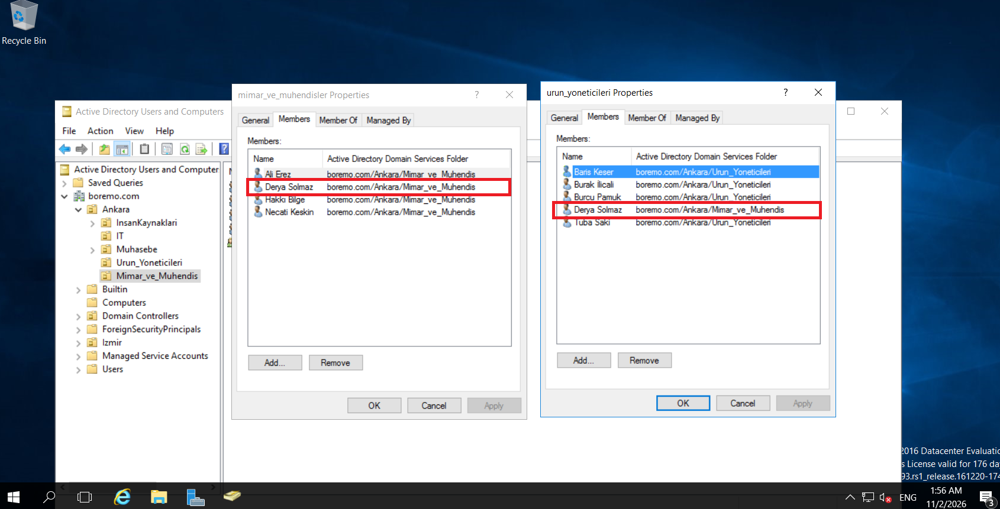
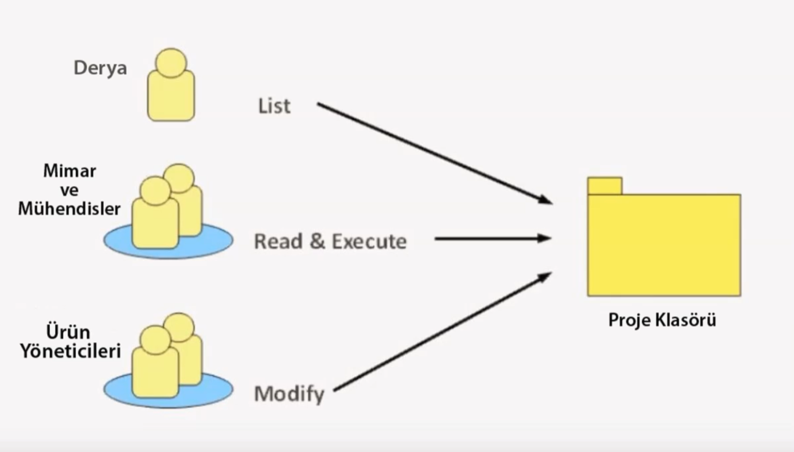
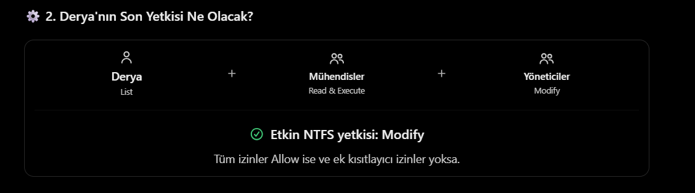
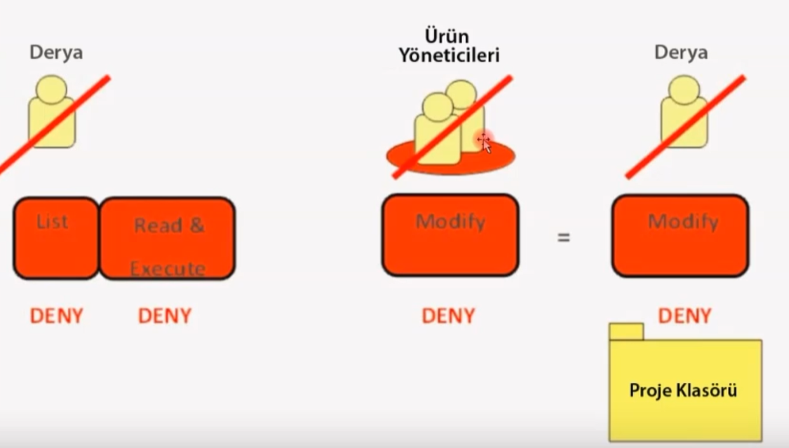
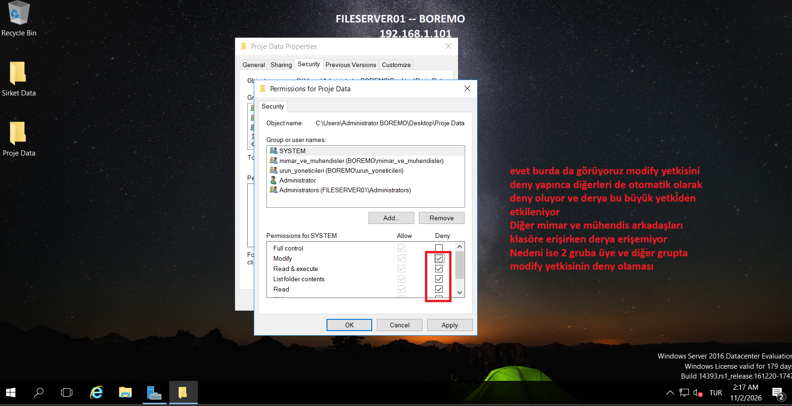
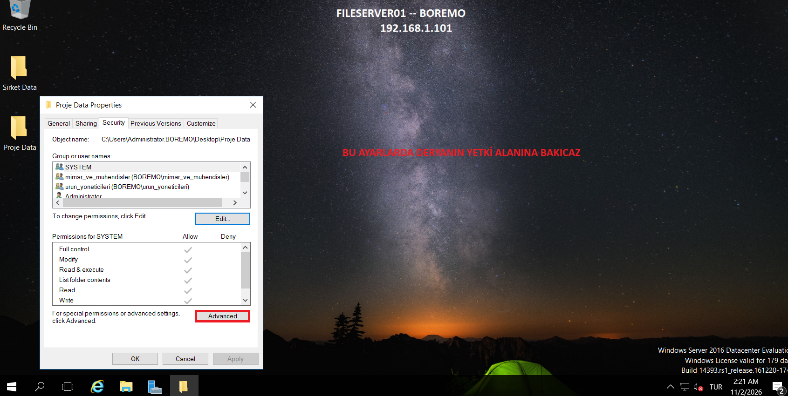
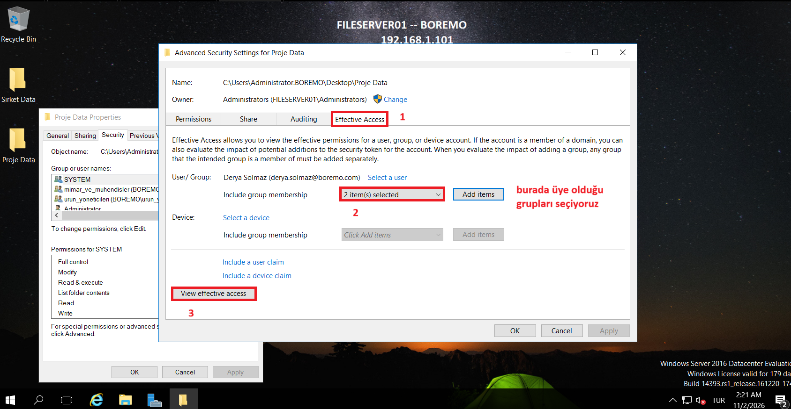
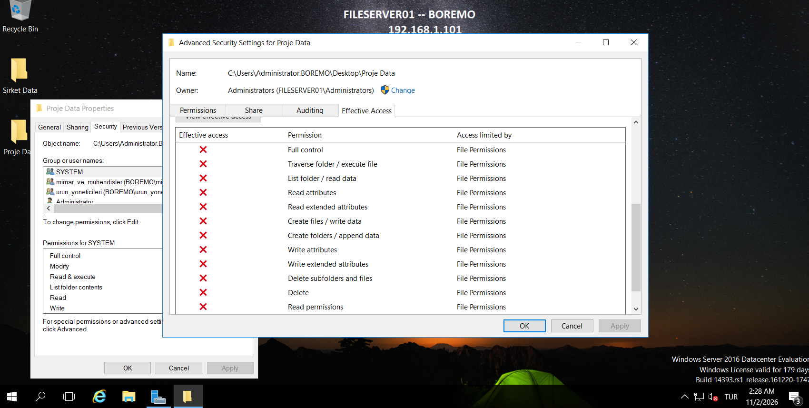
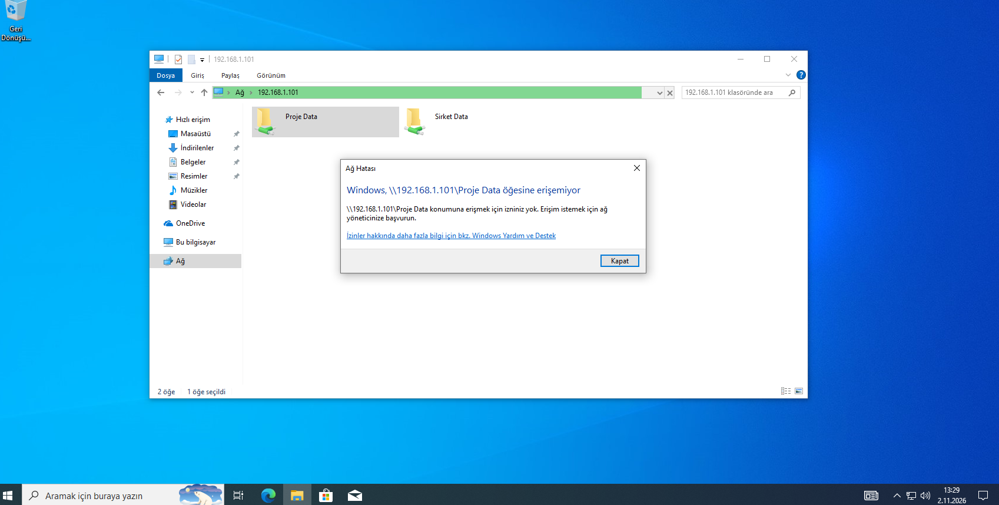

# Active Directory – Kullanıcı Yetkilerinin Çakışması (Effective Permissions)

[← Modül içindekiler](README.md) · [Tüm laboratuvar notları](../LAB-INDEX.md)

### 🧠 Günlük Hayattan Benzetme

> Derya bir şirkette hem mühendis hem de ürün yöneticisi olsun.
> Mühendis olduğu için proje dosyalarını sadece okuyabiliyor. Ürün yöneticisi olduğu için aynı dosyaları düzenleyebiliyor.
> İki gruba da üye olduğu için, izinler birbirini iptal etmez. Derya düzenleme yetkisini de kullanabilir.
### 📌 1. Ekranda Ne Yapılıyor?

Derya Solmaz kullanıcısı iki Active Directory güvenlik grubuna üye:

- mimar_ve_muhendisler
- urun_yoneticileri

Hocanın örneğinde Proje Klasörü için şu NTFS izinleri tanımlanıyor:

| Kullanıcı / Grup | Verilen izin |
| --- | --- |
| Derya (bireysel) | List |
| Mimar ve Mühendisler | Read & Execute |
| Ürün Yöneticileri | Modify |

#### **Neden Modify?**

Windows, farklı gruplardan gelen **Allow (İzin Ver)** yetkilerini birleştirir.

Modify yetkisi zaten okuma, çalıştırma, düzenleme ve silme işlemlerini kapsar.

Dolayısıyla Derya, Proje Klasörü'ndeki dosyaları okuyabilir, değiştirebilir ve silebilir.

### ⚠️ 3. Peki Yetki Çakışması Ne Zaman Sorun Olur?

Önemli iki kural vardır:

- **Allow + Allow:** İzinler birleşir. Derya'nın örneğindeki gibi Modify yetkisi kullanılabilir.
- **Allow + Deny:** Açıkça verilen Deny (Reddet) izni, normalde aynı erişim hakkı için Allow iznini engeller.

Örneğin Derya'ya başka bir gruptan Delete: Deny gelirse Modify yetkisi olsa bile dosyaları silmesi engellenebilir.

**→ En yüksek yetkiden yediği yasaktan dolayı hiçbir şeye erişemez !**

→ Burada hiç yetkisi olmadığını görüyoruz bide kendi bilgisayarındaki hatayı gösterelim :

---
