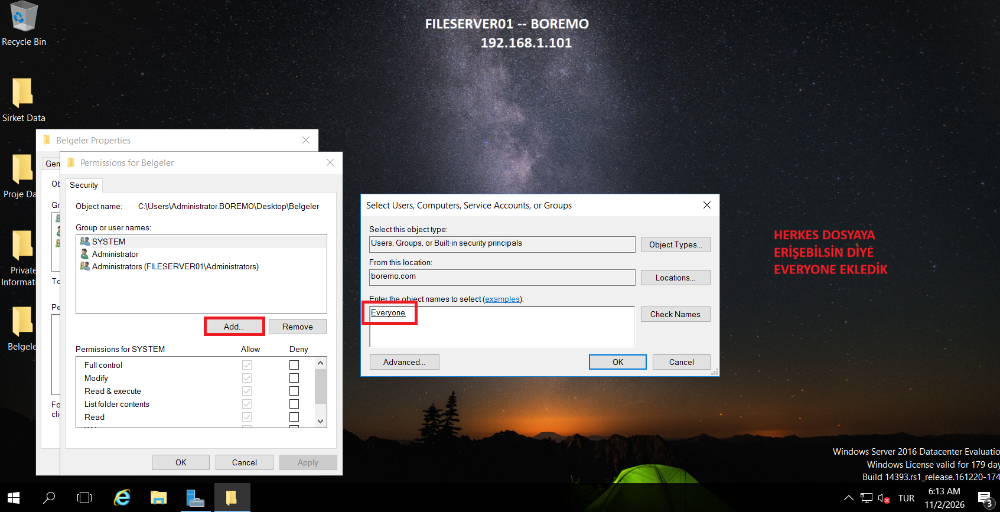
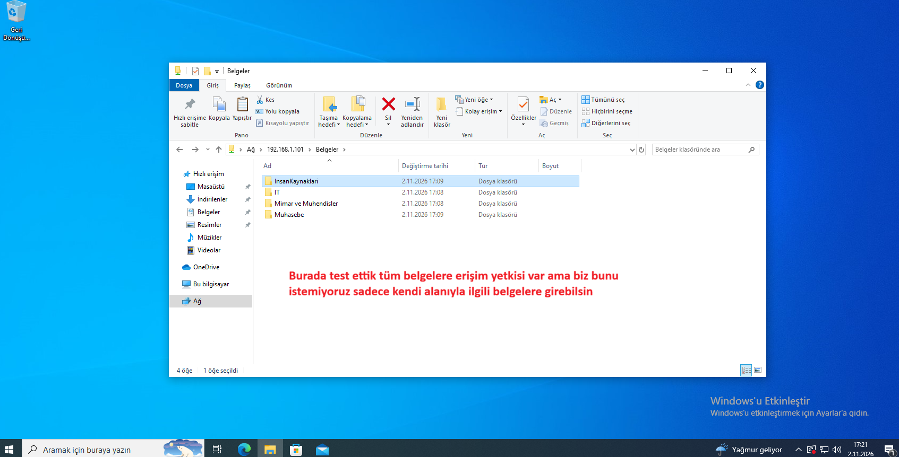
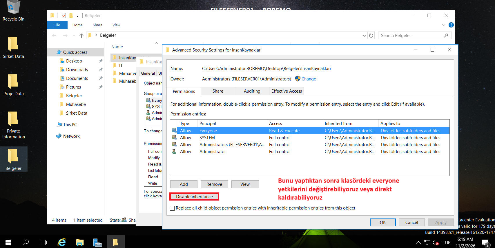
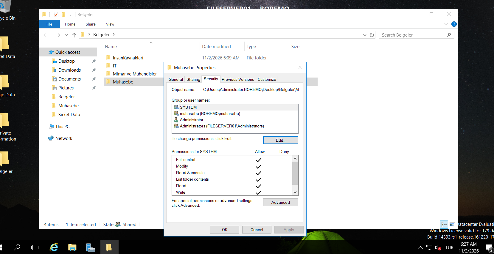
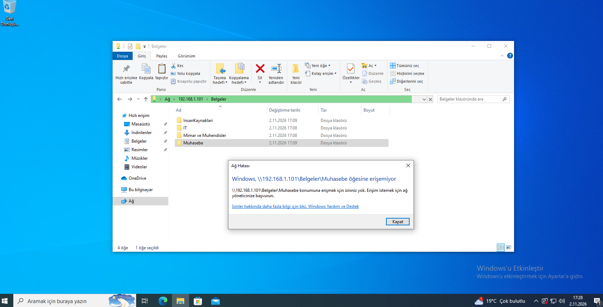

# WS 2016 — Kullanıcı İzinlerinde Hiyerarşi ve Miras (Inheritance)

[← Modül içindekiler](README.md) · [Tüm laboratuvar notları](../LAB-INDEX.md)

### 🧠 Benzetme

> Bir şirket binasında herkes ana giriş kapısından geçebilir. Ancak Muhasebe, IT ve İnsan Kaynakları odalarının anahtarları farklıdır. Her çalışan yalnızca yetkili olduğu odaya girebilir.
### 📌 Ne?

- **Hierarchy (Hiyerarşi):** Klasörlerin ana klasör ve alt klasörler şeklinde düzenlenmesidir.
- **Inheritance (İzin Mirası):** Bir klasörün, üst klasöründen erişim izinlerini otomatik olarak devralmasıdır.
- **NTFS Permissions (NTFS İzinleri):** Kullanıcıların klasörlerde okuma, yazma, değiştirme ve silme işlemlerinden hangilerini yapabileceğini belirler.

### ⚙️ Inheritance Nasıl Çalışır?

File Server üzerinde aşağıdaki klasör yapısını oluşturduğumuzu düşünelim:

Örnek sorun:

- Ana klasörde `Domain Users` grubuna okuma izni verdik.
- Alt klasörler bu izni miras alıyorsa diğer departman çalışanları da bu klasörleri okuyabilir.
- Biz ise her departmanın yalnızca kendi klasörüne erişmesini istiyoruz.

Bu nedenle departman klasörlerinin Inheritance (Miras) ayarlarını düzenlememiz gerekir.

Microsoft Learn

### 🛠️ Windows Server 2016 – Yetki Yapılandırması

1. Active Directory'de güvenlik grupları oluştur

- `IK_Users`
- `IT_Users`
- `Muhendis_Users`
- `Muhasebe_Users`

Çalışanları kendi departmanlarının grubuna ekle.

2. Alt klasörlerin mirasını düzenle

Örneğin `Muhasebe` klasörü için:

1. Klasöre sağ tık → Properties → Security.
2. Advanced seçeneğine gir.
3. Disable Inheritance **(Mirası Devre Dışı Bırak)** seçeneğine tıkla.
4. İki seçenek çıkar:

| Seçenek | Anlamı |
| --- | --- |
| Convert inherited permissions into explicit permissions | Miras alınan izinleri korur, bağımsız hale getirir |
| Remove all inherited permissions | Miras alınan izinleri kaldırır |

Önerilen yöntem: İlk seçeneği kullanıp gereksiz izinleri kontrollü şekilde kaldırmak.

1. `Domain Users` gibi tüm çalışanlara erişim veren gereksiz izinleri kaldır.
2. Add → Select a principal üzerinden `Muhasebe_Users` grubunu ekle.
3. Gruba Modify yetkisi ver.
4. `SYSTEM` ve gerekli yönetici izinlerini koru.

Artık Muhasebe klasörünün izinleri ana klasörden bağımsız olarak yönetilebilir.

Microsoft Learn

### 💡 Gerçek İş Hayatında Sonuç

| Kullanıcı | IT | Muhasebe | İnsan Kaynakları |
| --- | --- | --- | --- |
| IT çalışanı | + |  |  |
| Muhasebe çalışanı |  | + |  |
| İK çalışanı |  |  | + |

Tablo, yalnızca departman grubu üyeliği olan normal kullanıcılar için hedeflediğimiz erişim düzenini gösterir.

### ⚠️ IT Support İçin Kritik Bilgiler

- **Inheritance açık:** Alt klasör, üst klasördeki miras verilebilir izinleri devralır.
- **Inheritance kapalı:** Üst klasörden yeni izin mirası alınmaz; ancak mevcut izinler korunmuşsa ayrıca düzenlenmelidir.
- **Share Permissions + NTFS Permissions:** Ağ erişiminde her ikisi de geçerlidir. Daha kısıtlayıcı etkin izin erişimi sınırlar.
- **Deny (Reddet):** Gereksiz yere kullanma. İstenmeyen erişimi çoğunlukla ilgili Allow izinlerini kaldırarak engelle.
- **Access-Based Enumeration (ABE):** Yetkisiz kullanıcıların erişemedikleri alt klasörleri ağ paylaşımı listesinde görmemesini sağlar. Tek başına erişim güvenliği sağlamaz.

---

### **EKRAN FOTOĞRAFLARI :**

→ Burada security kısmında “Everyone” ı kaldırdım ve onun yerine sadece muhasebe grubunu ekledim ve şimdi bunu kullanıcıdan test ediyoruz (IT Personeli - Bora Alkan)

→ Evet burada erişemediğini görüyoruz kullanıcılar artık kendi alanına göre klasörlere giriş yapıcak bunu her klasör için yapıyoruz.
