# WS 2016 — Klasör Paylaşımında Özel Kota Uygulamaları

[← Modül içindekiler](README.md) · [Tüm laboratuvar notları](../LAB-INDEX.md)

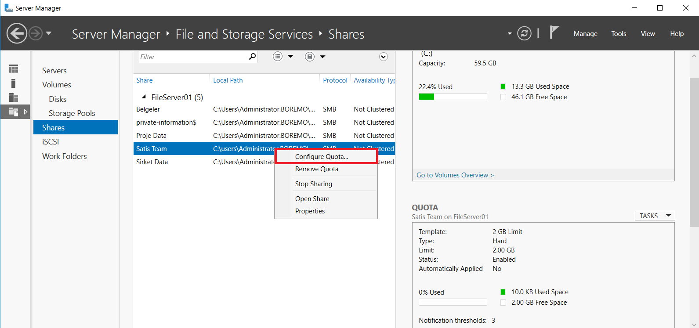

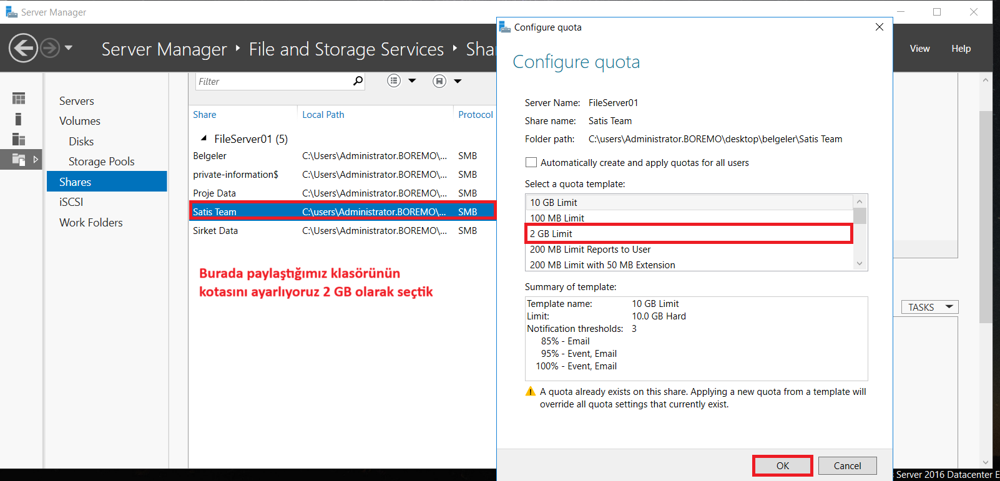

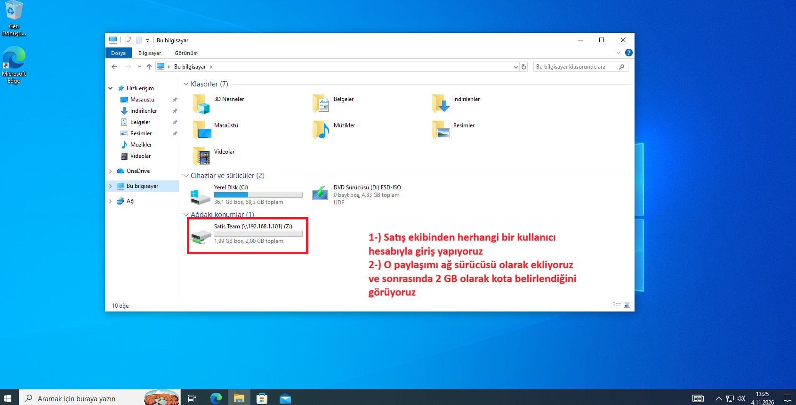

---

→ Şimdi farklı bir uygulama yapalım mesela bizim kotamız yetmedi ve bize 8 GB kota lazım ama “Configure quota” bölümünde 8 GB kota yok belirli kotalar var ama onlar işimizi görmez şimdi onun ayarını yapıcaz

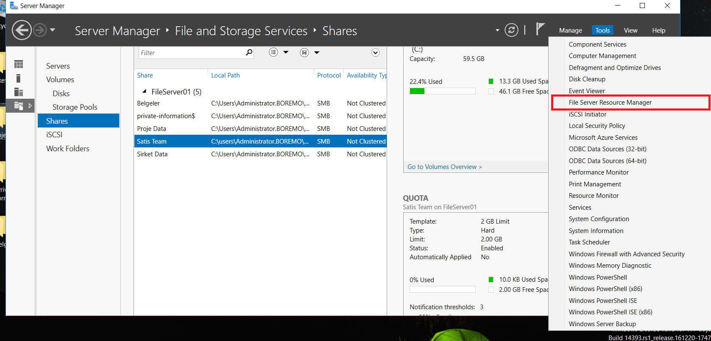

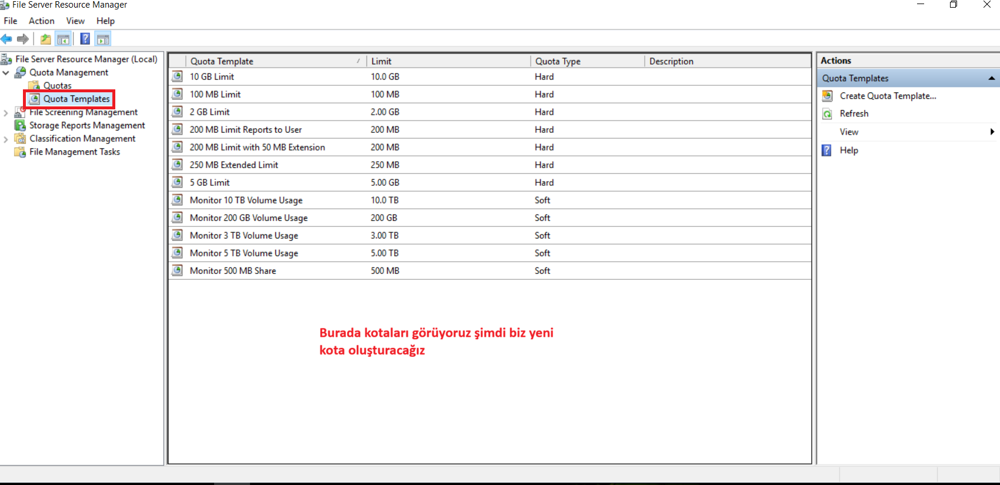

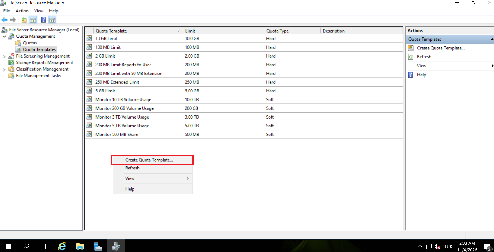

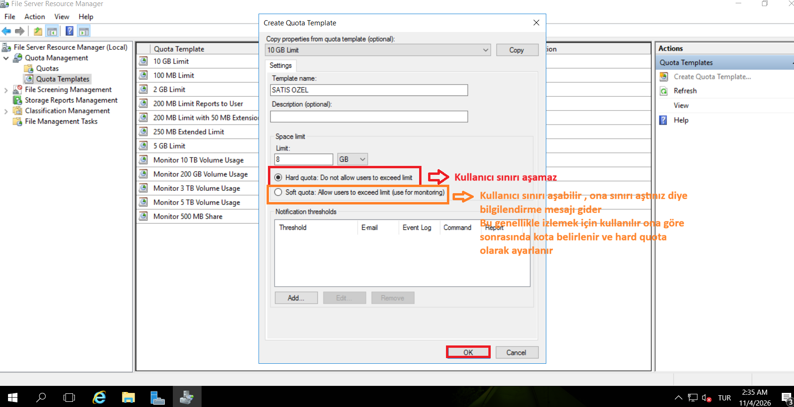

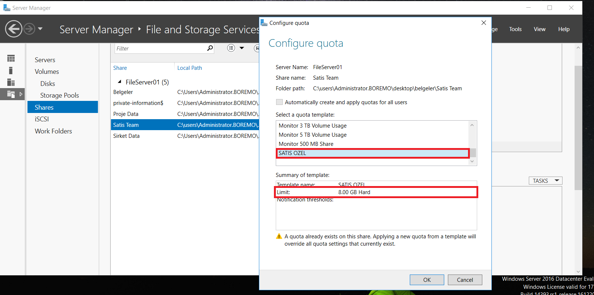

---

### **THRESHOLD AYARLAMA**

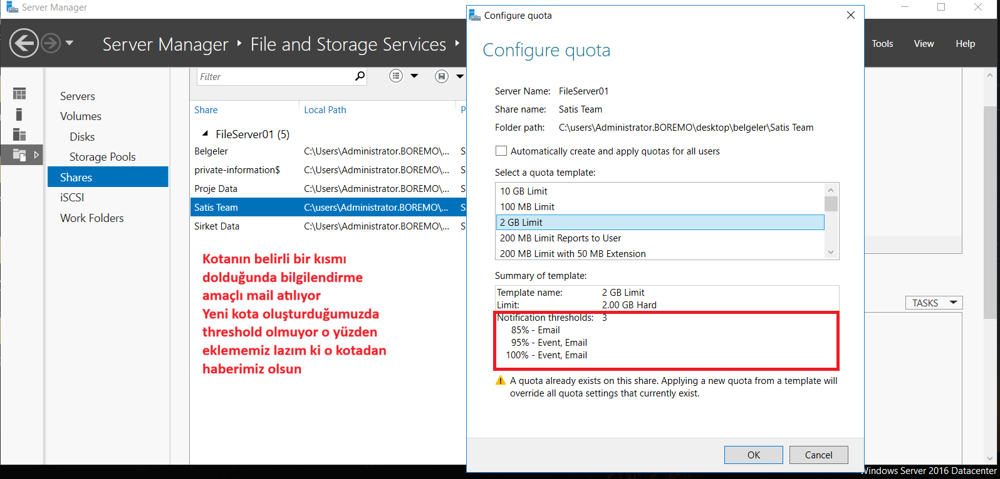

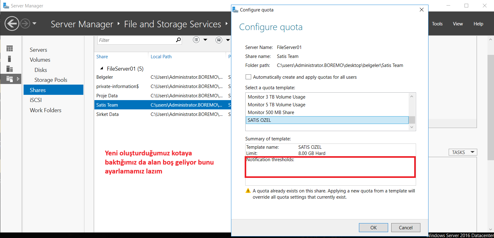

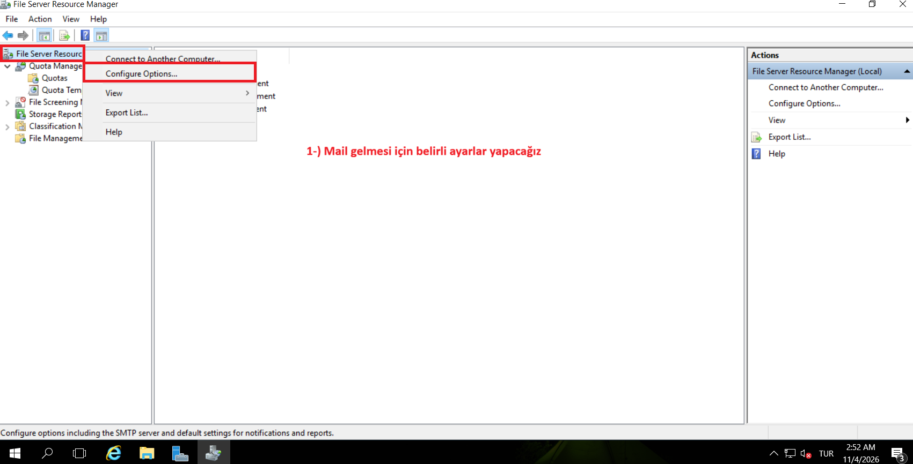

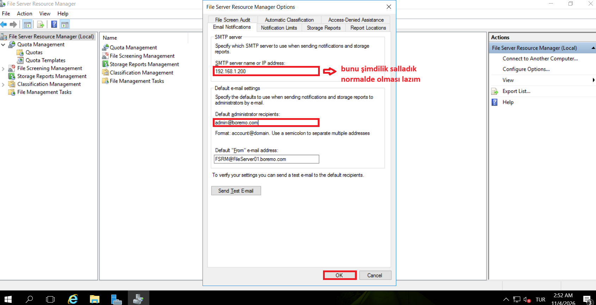

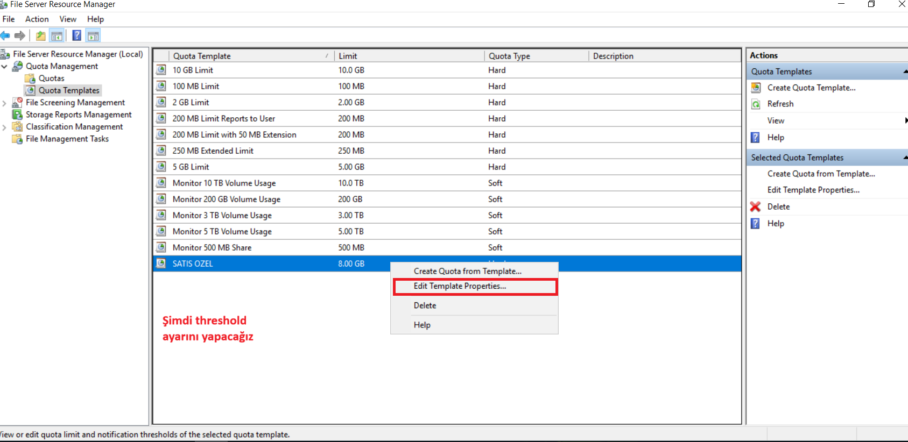

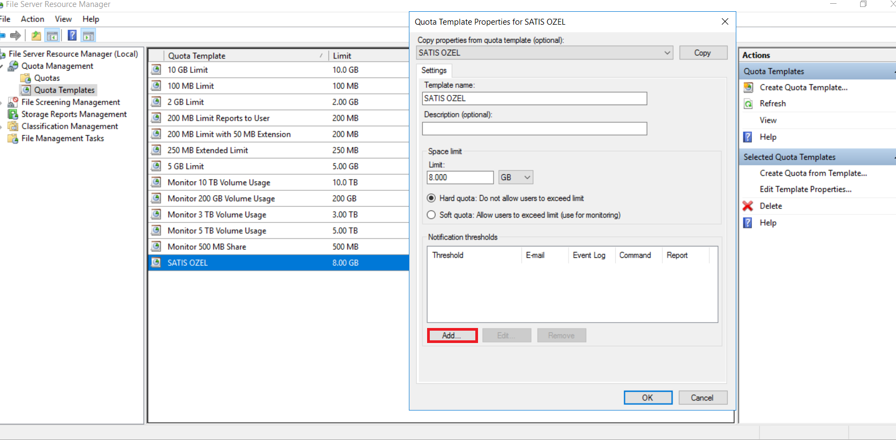

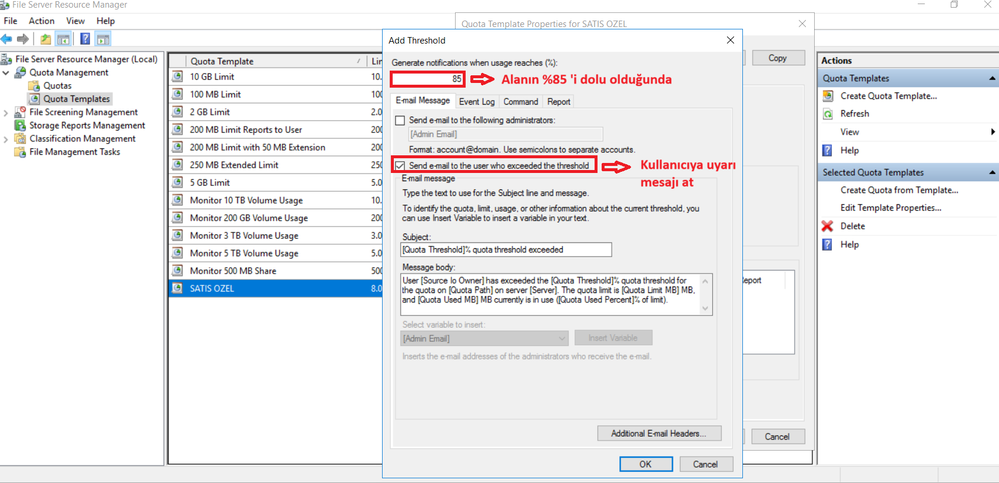

**%90 ‘ ı dolduğunda** → Hem admine hem de kullanıcıya mail at kısmını işaretliyoruz bide bunun event log’a kaydedilmesini istiyoruz (Event Log kısmından ayarlanıyor)

**%100 ‘ü dolduğunda** → Sadece admine mail atıyoruz ve event log’a kaydediyoruz

→ IT kısmında önemlidir kota dolduğunda ayar çekilmesi lazım

---
