# WS 2016 — File Server kaynaklarına istemediğimiz verilerin girişi nasıl engellenir?

[← Modül içindekiler](README.md) · [Tüm laboratuvar notları](../LAB-INDEX.md)

### 🧠 Benzetme

> Şirkette bütçe belgelerinin saklandığı bir arşiv düşün. Bu arşive Excel ve PDF belgeleri kabul edilirken müzik dosyaları ve programlar kabul edilmiyor. File Screening de bu kontrolü otomatik yapar.
### 📌 Ne?

- **File Screening (Dosya Türü Filtreleme):** File Server üzerinde belirli dosya türlerinin klasörlere kaydedilmesini engelleyen özelliktir.
- **FSRM (File Server Resource Manager):** Windows Server'da dosya türlerini, depolama kotalarını ve dosya yönetimi kurallarını yönetmek için kullanılan araçtır.
- Örneğin `Butce` klasörüne `.mp3` ve `.exe` dosyalarının yüklenmesini engelleyebiliriz.

### ⚙️ Neden Kullanılır?

- Şirket sunucusuna gereksiz dosyaların yüklenmesini önlemek.
- Depolama alanının verimli kullanılmasını sağlamak.
- Çalışanların yalnızca işle ilgili dosyaları saklamasını sağlamak.
- Belirli dosya türleri için kurallar ve bildirimler oluşturmak.

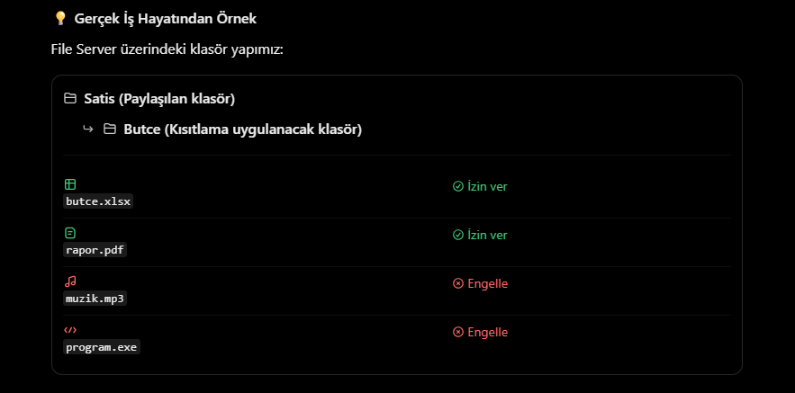

Sonuç: Satış çalışanı `Butce` klasörüne Excel dosyası yükleyebilir ancak MP3 veya EXE dosyası yüklemeye çalıştığında işlem engellenir.

---

### 🛠️ Windows Server 2016 – Nasıl Yapılandırılır?

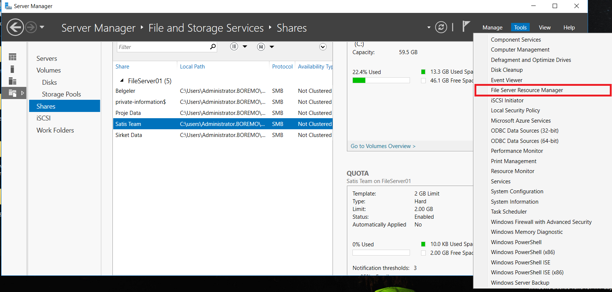

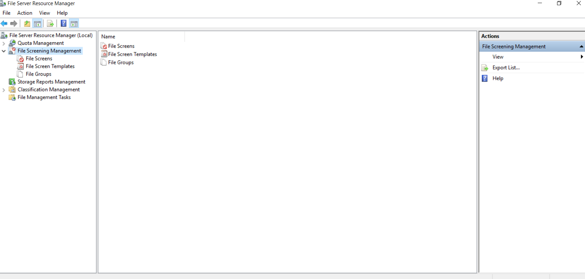

### 1. File Groups (Dosya Grupları)

Ne?

- Engellenecek veya kontrol edilecek dosya uzantılarını gruplandırır.
- Örneğin `Yasakli-Dosyalar` grubu oluşturup `.mp3`, `.exe`, `.mp4` uzantılarını ekleyebiliriz.

Neden?

- Her dosya uzantısına ayrı kural yazmak yerine hepsini tek grupta yönetmek için kullanılır.

### 2. File Screen Templates (Dosya Filtreleme Şablonları)

Ne?

- Dosya gruplarını kullanarak hazır filtreleme kuralları oluşturur.
- **Active Screening:** Yasaklı dosyanın kaydedilmesini engeller.
- **Passive Screening:** Dosyayı engellemez, ihlali izler ve yapılandırılmışsa bildirim oluşturur.

Neden?

- Aynı kuralı birden fazla klasöre kolayca uygulamak için kullanılır.

### 3. File Screens (Dosya Filtreleri)

Ne?

- Oluşturulan filtreleme kurallarının hangi klasörlerde uygulanacağını belirler.
- Örneğin `D:\Satis\Butce` klasörüne MP3 ve EXE engellemesi uygulanır.

Neden?

- Belirli klasörlere özel dosya kısıtlamaları getirmek için kullanılır.

---

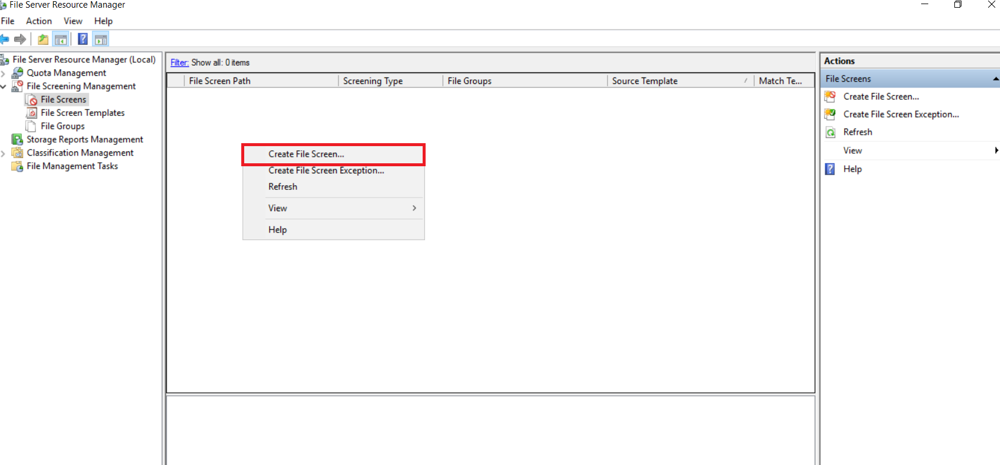

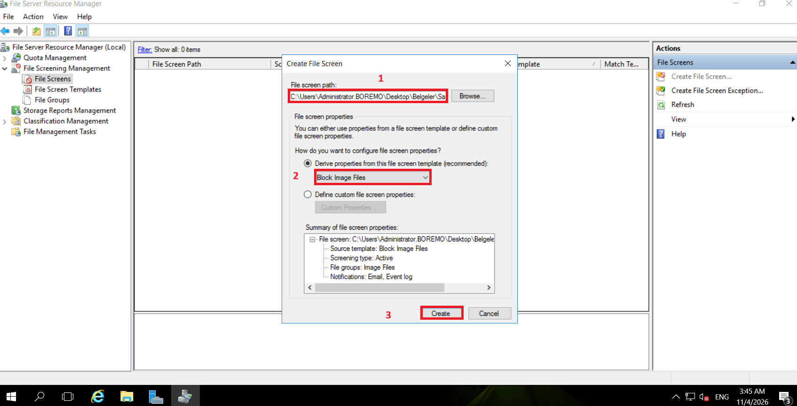

- Bu ayarı yaptıktan sonra satış ekibinden herhangi birinin hesabıyla giriş yapıyoruz ve bu özelliği test ediyoruz (Can Bakar — Satıs Team)

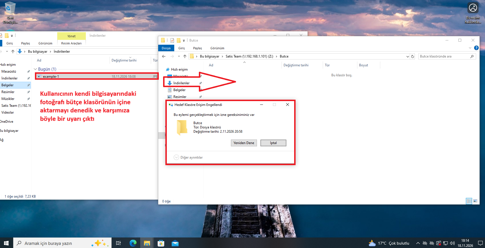

---

#### **ÖZEL FILE GROUPS OLUSTURMA**

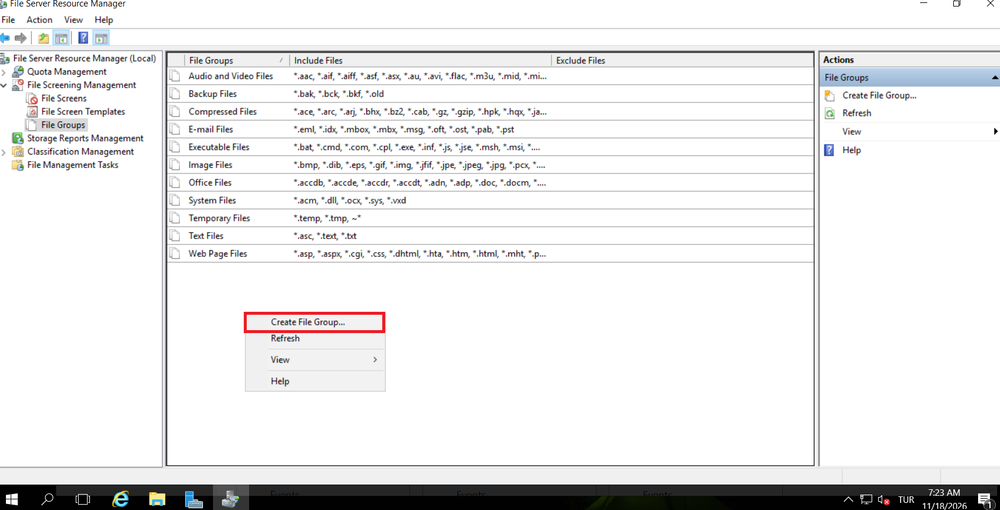

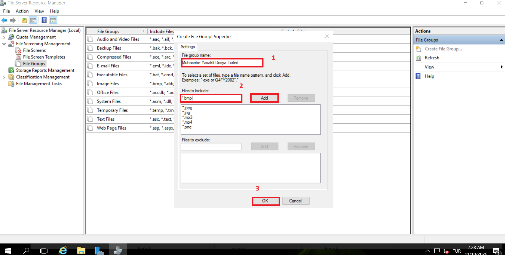

---

#### **EVENT LOG ÖZELLİĞİNİ AÇMA**

- Örnek satış ekibinden birisi ortak alana dosya yüklemeye çalışıyor ama bu yüklediği dosya türü yasaklanmış (jpg,png,bmp…)
- Bizde bu yüklemeyi kimin yaptığını görmek istiyoruz bu yüzden event log’u açıyoruz

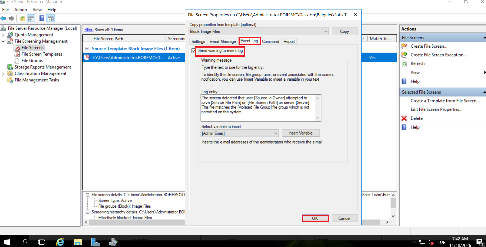

- Event Log (Olay Kaydı) özelliğini etkinleştirdikten sonra herhangi bir kullanıcı hesabıyla yasaklanan dosya türünü yüklemeyi deniyoruz. Ardından, engellenen işlemin File Server üzerindeki olay kayıtlarına yansıyıp yansımadığını kontrol ediyoruz.

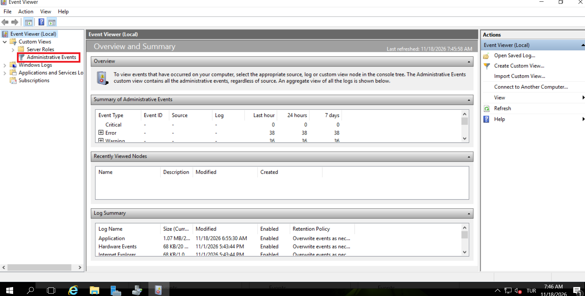

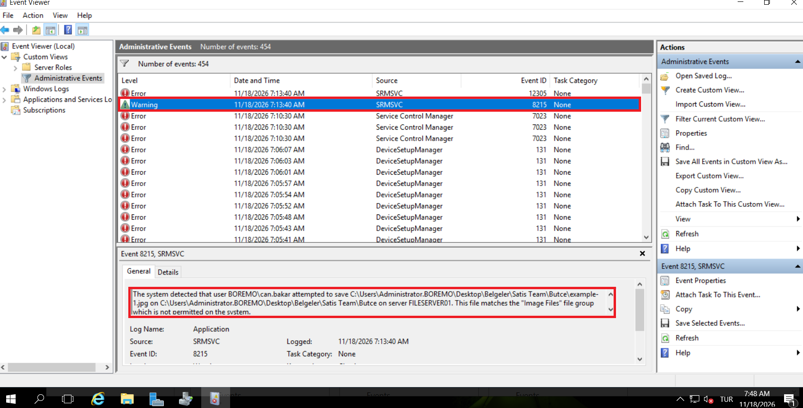

- “Can Bakar” isimli kullanıcı, yasaklanan dosya türlerinden birini yüklemeye çalışmış ancak File Screening politikası nedeniyle işlem engellenmiştir. Bu işlem, File Server üzerinde log (olay kaydı) olarak kaydedilmiştir.
