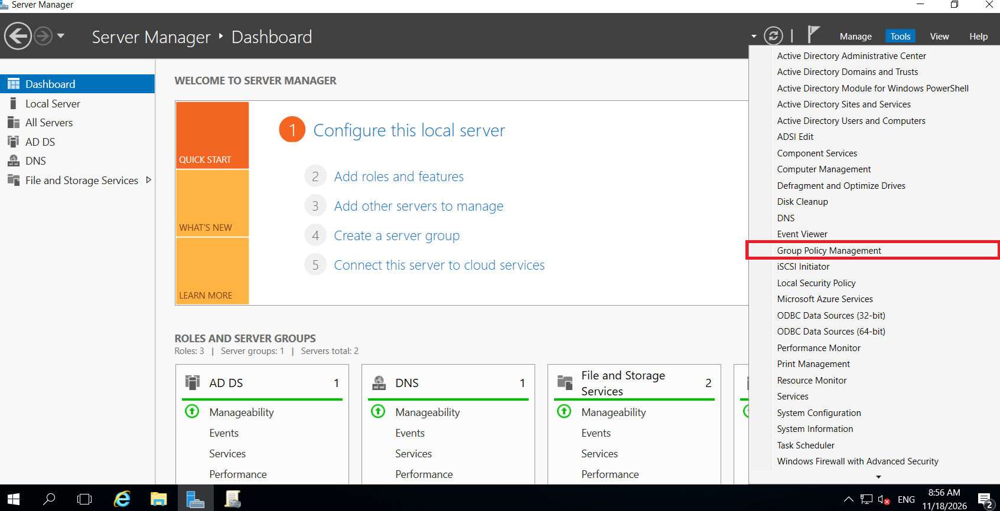
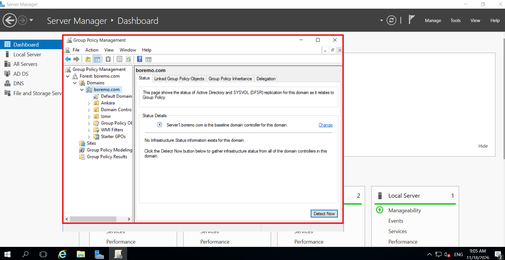
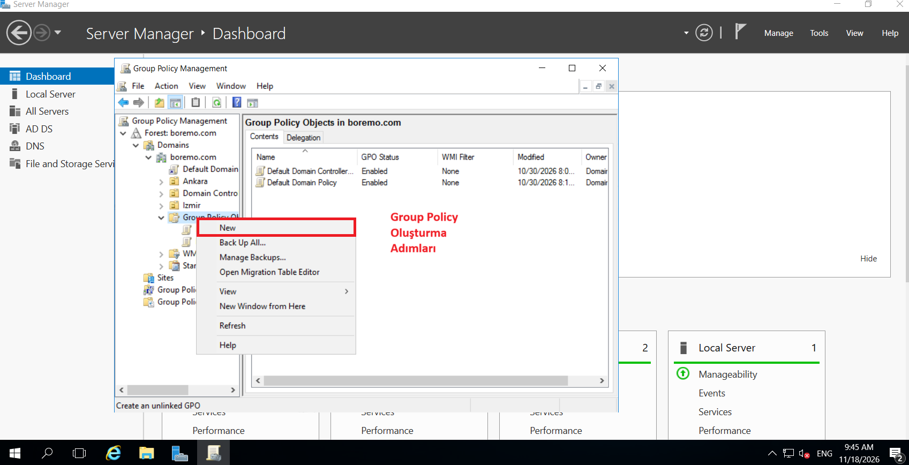
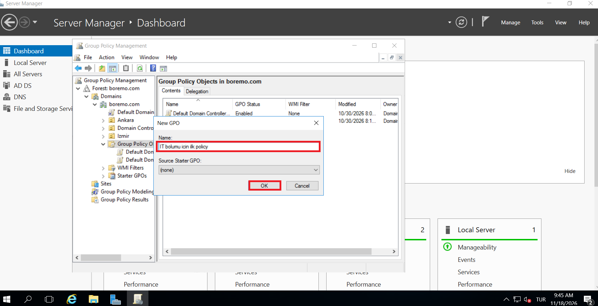
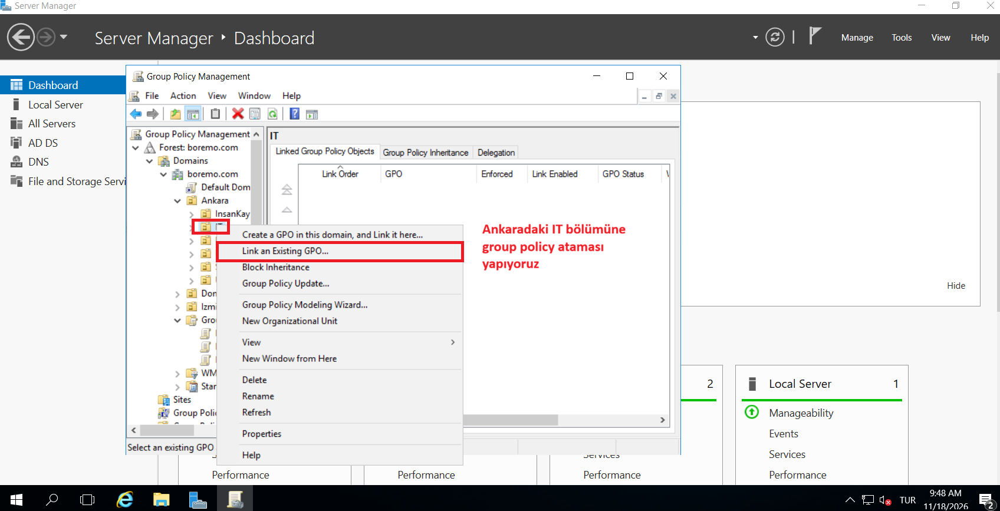
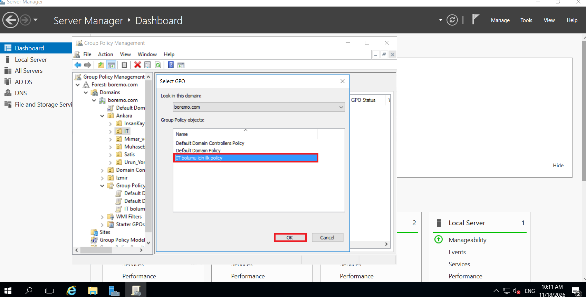

# WS 2016 — Group Policy Nedir - Nasıl Oluşturulur?

[← Modül içindekiler](README.md) · [Tüm laboratuvar notları](../LAB-INDEX.md)

## 🧠 Benzetme

> **Group Policy (Grup İlkesi)**, şirketin çalışanlara dağıttığı merkezi “kurallar kitabı” gibidir. IT ekibi bir kuralı bir kez yazar; yüzlerce bilgisayar ve kullanıcı bu kurala otomatik uyar.
## 📌 Nasıl Çalışır

### Group Policy Nedir?

**Group Policy**, Active Directory ortamındaki kullanıcı ve bilgisayarların ayarlarını **merkezi olarak yönetmeyi** sağlar.

Örneğin 300 bilgisayarda USB kullanımını kapatacaksan tek tek bilgisayarlara gitmek yerine bir politika oluşturursun:

```
Domain Controller
       ↓
     GPO
       ↓
PC1  PC2  PC3 ... PC300
```

Politika paketine **GPO — Group Policy Object (Grup İlkesi Nesnesi)** denir.

---

### GPO Nereye Uygulanabilir?

Bir GPO şu Active Directory yapılarına bağlanabilir:

- **Site (Site / Fiziksel Lokasyon)**
- **Domain (Etki Alanı)**
- **OU — Organizational Unit (Organizasyon Birimi)**

Örneğin:

```
boremo.com
│
├── IT OU          ← GPO: USB açık
├── Muhasebe OU    ← GPO: USB kapalı
└── IK OU          ← GPO: Control Panel kapalı
```

> OU kullanmanın önemli nedenlerinden biri, farklı departmanlara farklı Group Policy uygulayabilmektir.
---

### Computer Configuration ve User Configuration

Bir GPO'nun iki temel bölümü vardır.

**Computer Configuration (Bilgisayar Yapılandırması)**

Bilgisayarın kendisine uygulanır.

Örneğin:

- Windows Firewall ayarları
- USB engelleme
- Windows Update ayarları
- Güvenlik ayarları

**User Configuration (Kullanıcı Yapılandırması)**

Oturum açan kullanıcıya uygulanır.

Örneğin:

- Masaüstü arka planı
- Control Panel'i engelleme
- Start Menu ayarları
- Kullanıcıya özel kısıtlamalar

Kısaca:

```
Computer Configuration → Cihazı yönet
User Configuration     → Kullanıcıyı yönet
```

---

### Group Policy Hangi Sırayla Uygulanır?

Temel sıra **LSDOU** olarak bilinir:

```
L → Local
S → Site
D → Domain
OU → Organizational Unit
```

Yani önce **Local Policy (Yerel İlke)**, sonra Site, Domain ve en son ilgili OU politikaları işlenir.

Çakışan ayarlarda çoğu durumda daha sonra uygulanan politika etkili olur.

---

### Group Policy Ne Zaman Güncellenir?

Policy'ler:

- Bilgisayar açılırken
- Kullanıcı oturum açarken
- Belirli aralıklarla

yenilenebilir.

Elle güncellemek için:

```
gpupdate /force
```

Bu komut Group Policy'leri yeniden uygulatır.

Hangi politikaların uygulandığını görmek için:

```
gpresult /r
```

kullanılabilir.

---

### Security Filtering Nedir?

**Security Filtering (Güvenlik Filtreleme)** ile bir GPO'nun herkese değil, belirli kullanıcı veya gruplara uygulanması sağlanabilir.

Örneğin:

```
GPO: USB Engelle
        ↓
Sadece → Muhasebe-Users
```

Böylece aynı OU içinde bile daha kontrollü politika uygulanabilir.

---

### Group Policy Nereden Yönetilir?

Windows Server'da genellikle:

**GPMC — Group Policy Management Console (Grup İlkesi Yönetim Konsolu)**

kullanılır.

Buradan:

- GPO oluşturulur
- Düzenlenir
- OU/Domain'e bağlanır
- Uygulanıp uygulanmadığı kontrol edilir

---

## 💡 Örnekler

**Örnek 1 — IT Support:** Şirkette kullanıcıların Control Panel'e girmesi istenmiyor.

```
User Configuration
      ↓
GPO
      ↓
Control Panel erişimi kapatılır
```

**Örnek 2 — Ticket:** Kullanıcı “USB belleğim çalışmıyor.” diyor. Donanım sağlam olsa bile bilgisayarın bulunduğu OU'ya uygulanmış bir **GPO** USB kullanımını yasaklıyor olabilir.

Kontrol sırasında:

```
gpresult /r
```

ile hangi politikaların geldiğine bakabilirsin.

**Örnek 3:** 100 bilgisayarda aynı parola/güvenlik ayarını uygulamak için tek tek cihazlara gitmek yerine Domain üzerinden Group Policy uygulanır.

---












