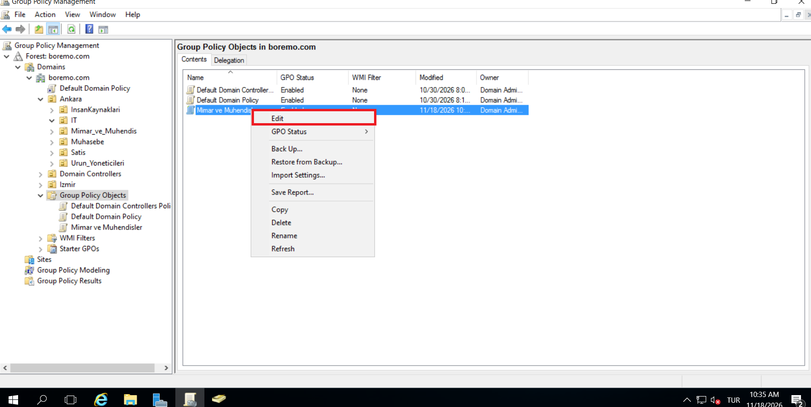
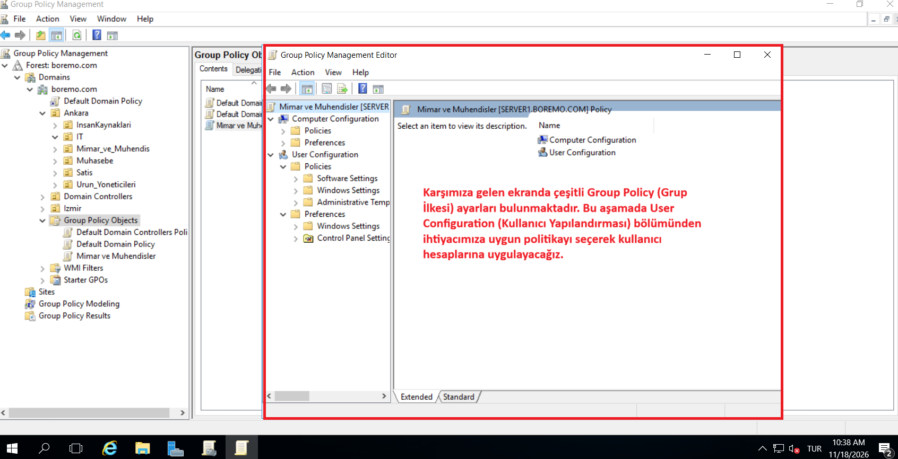
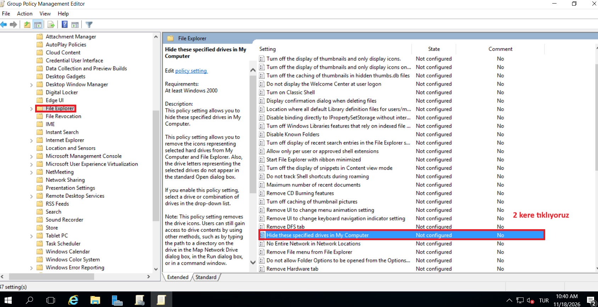
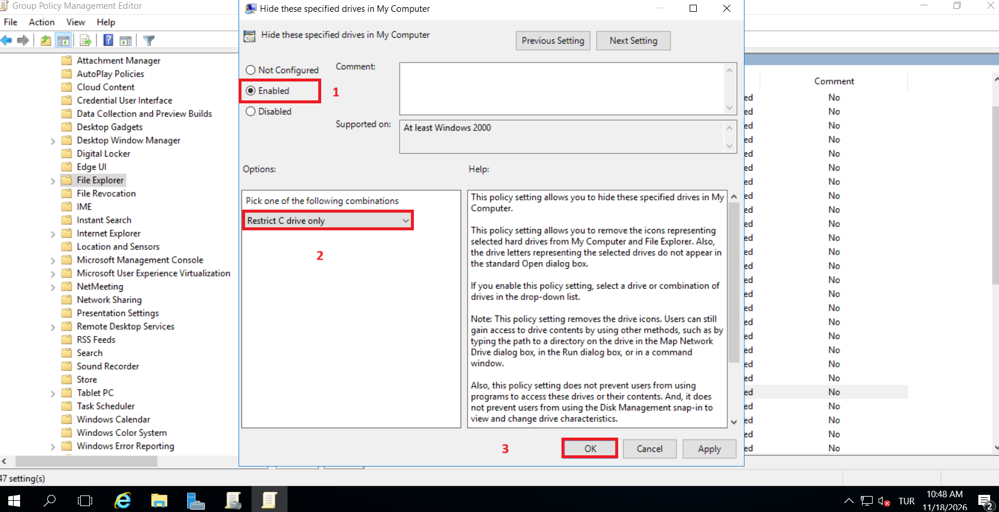
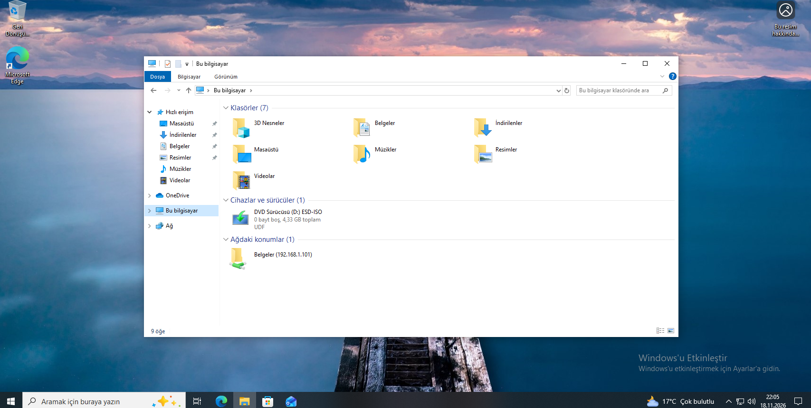

# WS 2016 — Group Policy ile kullanıcılara yasak atamak

[← Modül içindekiler](README.md) · [Tüm laboratuvar notları](../LAB-INDEX.md)

- Group Policy ayarını yapılandırdıktan sonra **Mimar ve Mühendisler** grubuna üye olan herhangi bir kullanıcı hesabıyla oturum açıyoruz. Ardından, uyguladığımız politikanın doğru çalıştığını doğrulamak için **C: sürücüsünün Dosya Gezgini'nde görünmediğini** kontrol ediyoruz.

---

- Group Policy ayarlarının uygulanmasında gecikme yaşanırsa ilgili bilgisayarda veya Windows Server 2016 üzerinde `gpupdate /force` komutunu çalıştırarak grup ilkelerinin yeniden uygulanmasını sağlıyoruz. Bu sayede yeni yapılandırmaların etkinleşmesini hızlandırıyoruz.
