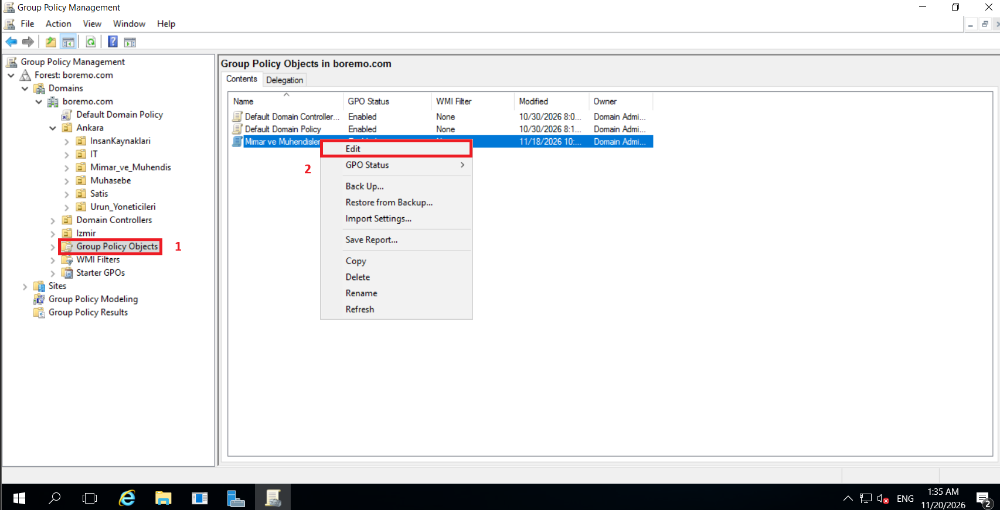
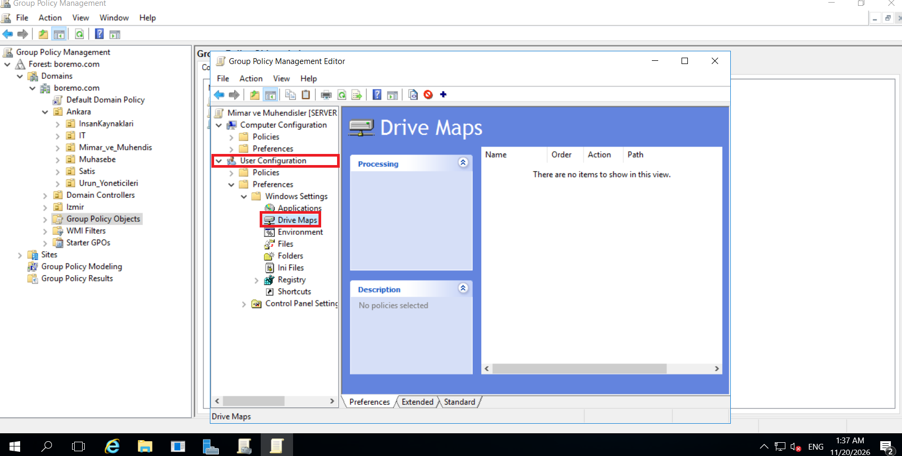
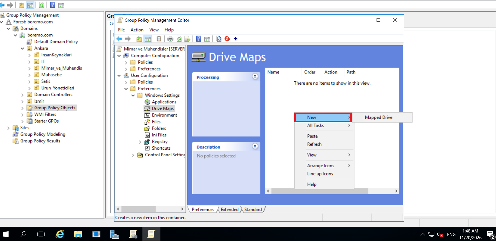
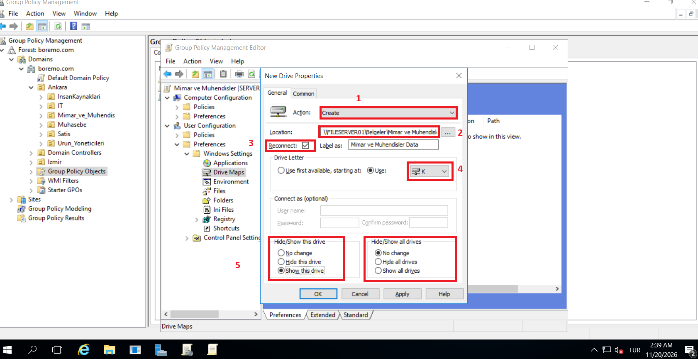
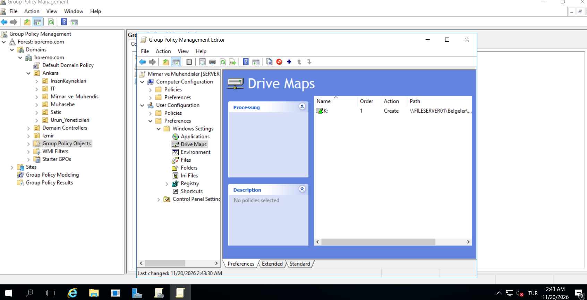
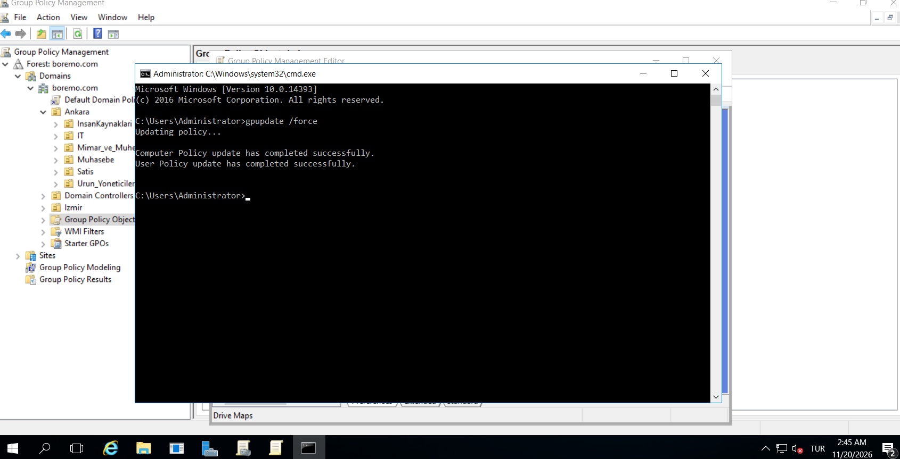

# WS 2016 — Group Policy ile  Merkezi Ağ Sürücüsü Oluşturma (Drive Mapping)

[← Modül içindekiler](README.md) · [Tüm laboratuvar notları](../LAB-INDEX.md)

### **🧠 Benzetme**

> Her çalışanın masasına tek tek arşiv dolabının anahtarını bırakmak yerine, merkezi bir sistemle bütün çalışanlara otomatik olarak anahtar dağıtmak gibidir.
### **📌 Ne?**

- **Drive Mapping (Ağ Sürücüsü Eşleme):** File Server üzerindeki paylaşılan klasörün, kullanıcı bilgisayarında `Z:` veya `S:` gibi bir sürücü harfiyle gösterilmesidir.
- Group Policy sayesinde ağ sürücüleri merkezi olarak oluşturulabilir.
- Kullanıcının bilgisayarına tek tek müdahale etmek gerekmez.

### **⚙️ Neden Kullanılır?**

- Çok sayıda kullanıcının ağ sürücülerini merkezi olarak yönetmek.
- Yeni çalışanlara ilgili departmanın ağ sürücüsünü otomatik tanımlamak.
- IT Support personelinin iş yükünü azaltmak.
- Departmanlara özel ağ sürücüleri oluşturmak.

### **🛠️ Nasıl Yapılır?**

Domain Controller üzerinden:

`Group Policy Management → İlgili OU → GPO → Edit`

Ardından:

`User Configuration → Preferences → Windows Settings → Drive Maps → New → Mapped Drive`

Örnek yapılandırma:

| Ayar | Değer |
| --- | --- |
| Action | Update |
| Location | `\\FILESERVER01\Muhasebe` |
| Label as | Muhasebe |
| Drive Letter | M: |

### **💡 Gerçek İş Hayatından Örnek**

100 çalışanı olan bir şirkette departmanlara özel ağ sürücüleri tanımlıyoruz.

| Departman | Ağ sürücüsü |
| --- | --- |
| Muhasebe | M: |
| İnsan Kaynakları | I: |
| IT | T: |
| Satış | S: |

Çalışan domain hesabıyla oturum açtığında ilgili ağ sürücüsü **This PC (Bu Bilgisayar)** bölümünde otomatik olarak görünür.

### **⚠️ IT Support İçin Kritik Bilgiler**

- GPO sürücüyü oluşturur, klasöre erişim yetkisi vermez.
- Share ve NTFS izinleri File Server üzerinden ayrıca yapılandırılmalıdır.
- Ayar uygulanmadıysa istemci bilgisayarda `gpupdate /force` çalıştırılabilir.

---

#### **Ağ Sürücüsü Oluşturma Adımları**

- Windows Server 2016 üzerinde **Domain Controller (DC)** rolünün kurulu olduğu sunucudan **Group Policy Management** konsolunu açıyoruz. Ardından **Group Policy Objects (GPO)** bölümüne gelerek ihtiyacımıza uygun grup ilkesini oluşturuyor ve gerekli yapılandırmaları gerçekleştiriyoruz.

### **⚙️ Ekrandaki Ayarlar ve Görevleri**

| Ayar | Seçilen değer | Açıklama |
| --- | --- | --- |
| Action | Create | Ağ sürücüsü mevcut değilse oluşturur. |
| Location | File Server klasör yolu | Bağlanılacak paylaşılan klasörü belirtir. |
| Reconnect | İşaretli | Sonraki oturum açılışlarında sürücünün yeniden bağlanmasını sağlar. |
| Label as | Mimar ve Muhendisler Data | Sürücünün kullanıcıya görünen adıdır. |
| Drive Letter | K: | Ağ sürücüsüne atanacak harftir. |
| Connect as | Boş | Oturum açan kullanıcının kendi kimlik bilgileri kullanılır. |
| Show this drive | Seçili | Sürücünün Dosya Gezgini'nde görünmesini sağlar. |
| Hide/Show all drives | No change | Diğer sürücülerin görünürlüğünü değiştirmez. |

- Yapılandırdığımız grup ilkesinin başarıyla oluşturulduğunu görüyoruz. Ardından, ilgili istemci bilgisayarda `gpupdate /force` komutunu çalıştırarak grup ilkelerinin güncellenmesini ve yeniden uygulanmasını sağlıyoruz.

