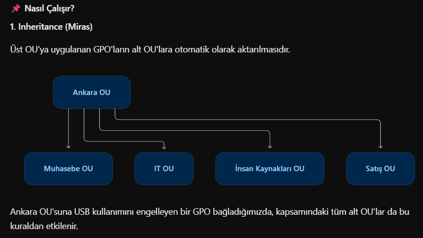

# Group Policy – Miras, Enforced ve Öncelik Kavramları

[← Modül içindekiler](README.md) · [Tüm laboratuvar notları](../LAB-INDEX.md)

### **🧠 Benzetme**

> Bir şirketin Ankara genel müdürlüğü bütün departmanlara kural koyabilir. Departmanlar kendi kurallarını da oluşturabilir ancak genel müdürlük bir kuralı zorunlu tutarsa departmanlar bu kuralı değiştiremez.

**2. Block Inheritance (Mirası Engelleme)**

- Alt OU'nun üst OU'lardan gelen normal GPO'ları almasını engeller.
- Örneğin IT OU'sunda Block Inheritance etkinleştirilirse Ankara OU'sundaki normal USB yasağı IT bölümüne aktarılmaz.
- IT OU'suna doğrudan bağlanan GPO'lar uygulanmaya devam eder.

**3. Enforced (Zorunlu Uygulama)**

- Üst OU'ya bağlı GPO ayarlarının alt OU'lardaki çakışan politikalar tarafından değiştirilmesini engeller.
- Block Inheritance kullanılsa bile uygulanır.
- Şirket genelinde zorunlu olması gereken güvenlik politikalarında kullanılır.

**4. Precedence (Öncelik)**

GPO'ların varsayılan uygulanma sırası **LSDOU** olarak adlandırılır:

1. Local (Yerel)
2. Site (Site)
3. Domain (Etki Alanı)
4. OU (Organizasyon Birimi)

Çakışma durumunda normal şartlarda son uygulanan ayar geçerli olur. Aynı OU içerisinde ise **Link Order 1** en yüksek önceliğe sahiptir.

### **💡 Örnek**

Ankara OU'sunda USB kullanımı yasaklanmış, IT OU'sunda ise izin verilmiş olsun.

| Senaryo | IT bölümünde USB |
| --- | --- |
| Normal miras | İzin verilir |
| Block Inheritance | İzin verilir |
| Ankara GPO'su Enforced | Yasaklanır |
| Enforced + Block Inheritance | Yasaklanır |

### **⚠️ IT Specialist İçin Kritik Bilgiler**

- Enforced seçeneği gereksiz yere kullanılmamalıdır.
- Enforced, Security Filtering ve WMI Filtering kısıtlamalarını geçersiz kılmaz.
- Uygulanan politikaları kontrol etmek için `gpresult /r` komutu kullanılır.

### **✅ Akılda Tut**

- **Inheritance:** Üstten gelen kuralları devral.
- **Block Inheritance:** Üstten gelen normal kuralları engelle.
- **Enforced:** Kuralın önceliğini koru ve miras engelini aş.
- **Precedence:** Çakışan kurallardan hangisinin geçerli olacağını belirle.
