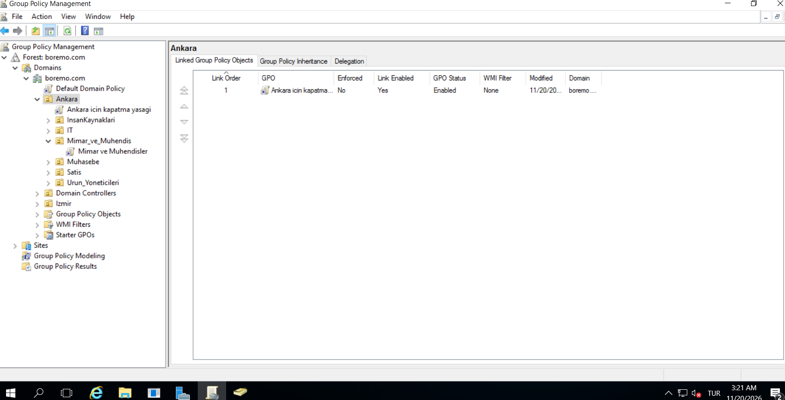
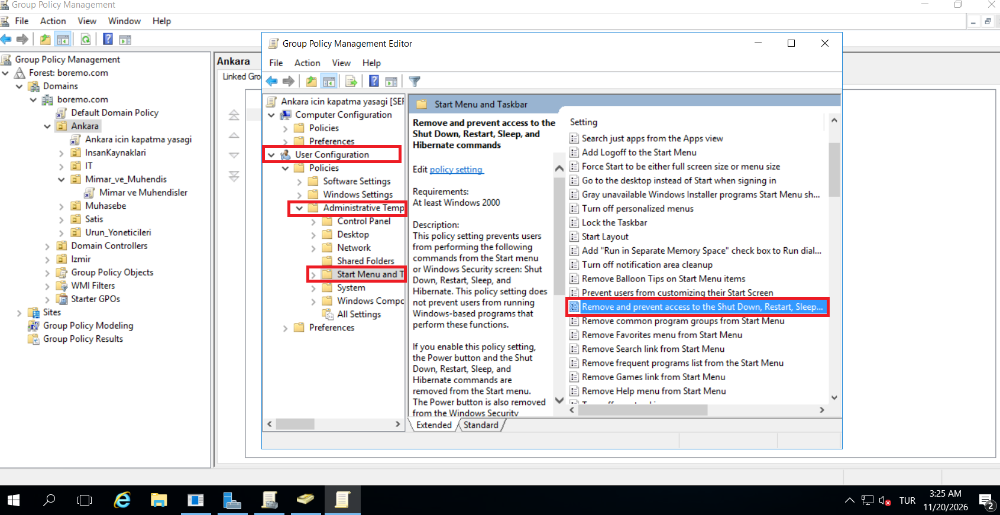
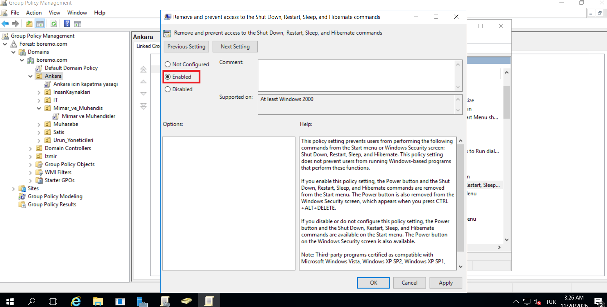
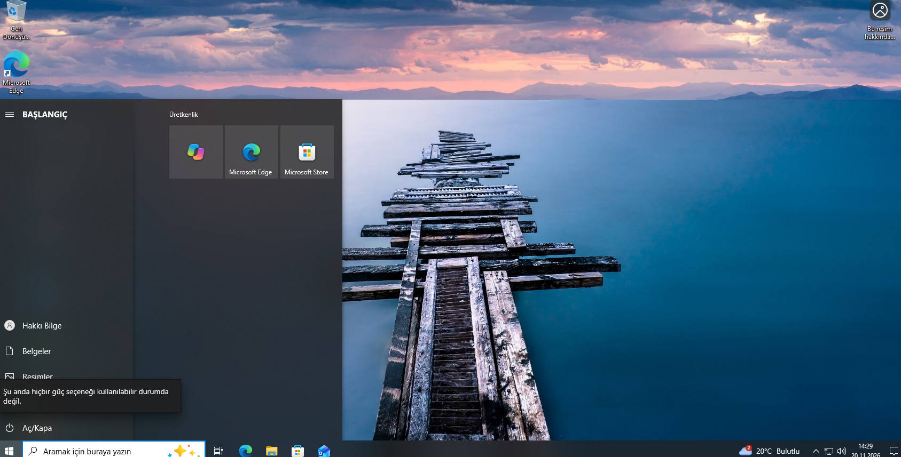
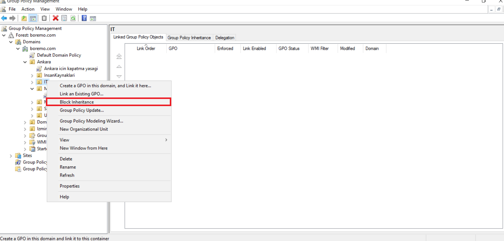
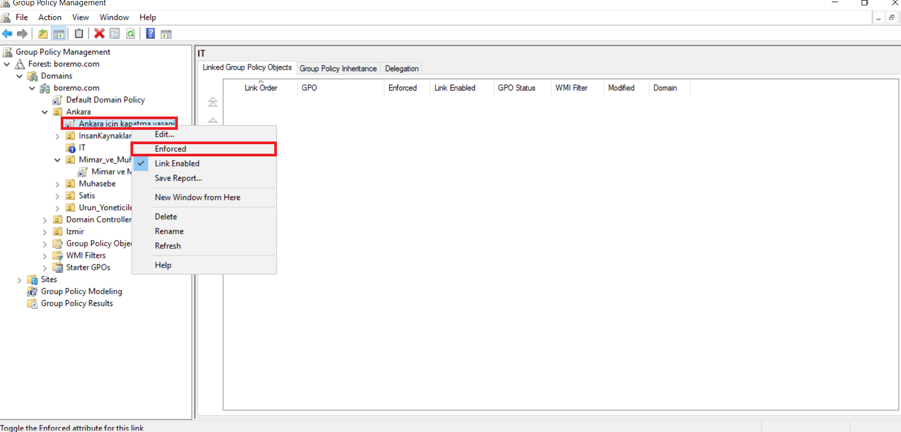

# WS 2016 — Group Policy Miras ve Enforced Uygulama

[← Modül içindekiler](README.md) · [Tüm laboratuvar notları](../LAB-INDEX.md)

- Ankara OU'su için oluşturduğumuz **Group Policy (GPO)** ile bilgisayarı kapatma (Shut Down) ve yeniden başlatma (Restart) seçeneklerini kısıtlayacağız. Bu politika, miras (Inheritance) yoluyla Ankara OU'su altında bulunan tüm alt birimlerdeki kullanıcılara uygulanacaktır.

- Group Policy yapılandırmasını tamamladıktan sonra Ankara OU'su altında bulunan herhangi bir kullanıcı hesabıyla oturum açıyoruz. Ardından, bilgisayarı kapatma (Shut Down) ve yeniden başlatma (Restart) seçeneklerinin kaldırıldığını kontrol ederek uyguladığımız politikanın doğru çalıştığını doğruluyoruz. (Hakkı Bilge — Muhendis)

---

Ankara OU'su altındaki IT biriminin üst birimden gelen grup ilkelerinden etkilenmemesi için ilgili **IT OU'suna** sağ tıklayarak **Block Inheritance (Mirası Engelle)** seçeneğini etkinleştiriyoruz.

Böylece üst birimlerden miras yoluyla gelen politikaların IT birimine uygulanmasını engelliyoruz.

**Not:** Enforced (Zorunlu) olarak işaretlenen GPO'lar, Block Inheritance özelliğinden etkilenmez.

---

- Oluşturduğumuz grup ilkesinin zorunlu olarak uygulanmasını ve **Block Inheritance (Mirası Engelle)** özelliğinden etkilenmemesini istiyorsak GPO bağlantısı üzerinde **Enforced (Zorunlu Uygulama)** seçeneğini etkinleştiriyoruz. Böylece ilgili politika, mirası engelleyen alt OU'larda da uygulanmaya devam eder.

---
