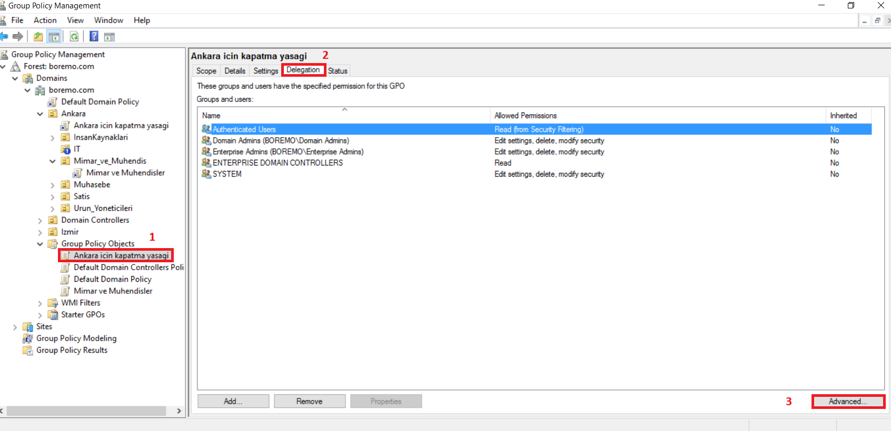
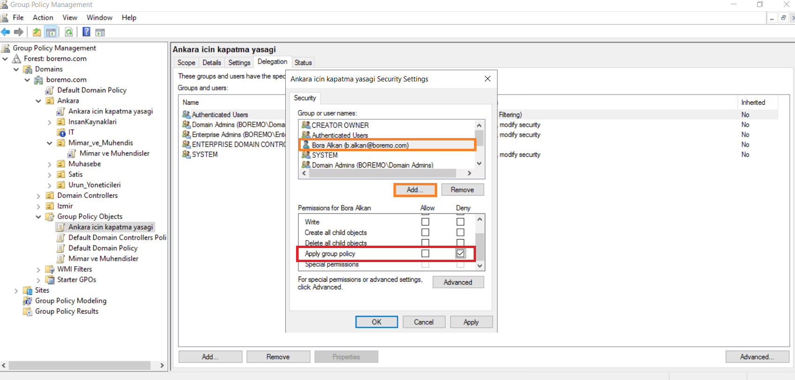
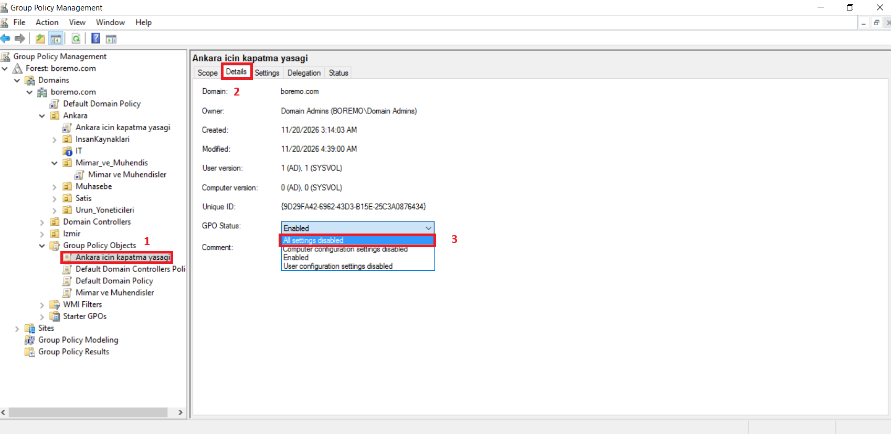
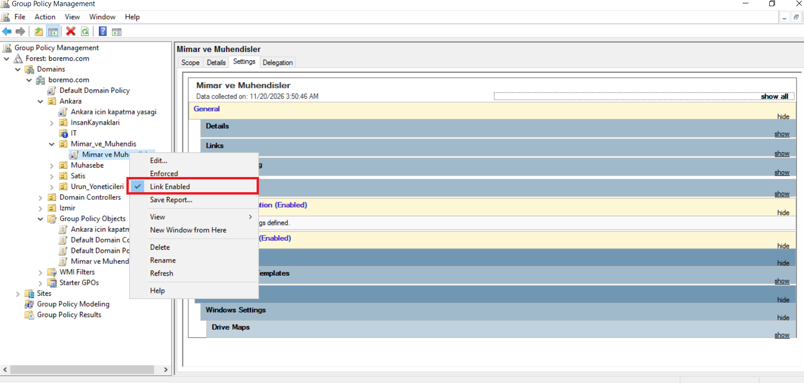
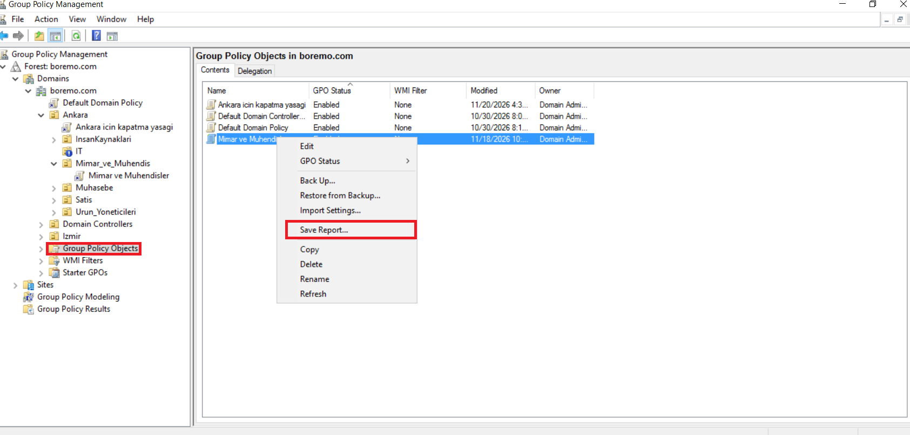

# WS 2016 — Group Policy’lerde önemli ayarlar,ayrıştırmalar ve raporlama işlemleri

[← Modül içindekiler](README.md) · [Tüm laboratuvar notları](../LAB-INDEX.md)

Belirli bir kullanıcının Ankara için oluşturduğumuz grup ilkesinden etkilenmesini istemiyorsak **Group Policy Objects** bölümünden ilgili GPO'yu seçiyoruz. Ardından **Delegation → Advanced** bölümüne girerek kullanıcıyı ekliyor ve **Apply Group Policy** iznini **Deny (Reddet)** olarak ayarlıyoruz. Böylece ilgili kullanıcı bu politikadan etkilenmezken diğer kullanıcılar etkilenmeye devam eder.

---

Ankara için oluşturduğumuz grup ilkesini geçici olarak devre dışı bırakmak için **Group Policy Objects** bölümünden ilgili GPO'yu seçiyoruz. Ardından **Details → GPO Status** bölümündeki ayarı **Enabled** durumundan **All Settings Disabled** durumuna getiriyoruz. Böylece grup ilkesini silmeden geçici olarak devre dışı bırakmış oluyoruz.

---

- Group Policy’de **Link Enabled** seçeneğini devre dışı bıraktığımızda, ilgili GPO’nun bağlantısı pasif hale gelir ve politika bağlı olduğu OU üzerinde uygulanmaz. GPO silinmez; yalnızca ilgili bağlantı devre dışı bırakılır.

---

Yöneticimiz belirli bir birime uygulanan grup ilkeleri hakkında rapor talep ettiğinde, **Group Policy Management** üzerinden ilgili GPO'ya sağ tıklayarak **Save Report (Raporu Kaydet)** seçeneğini kullanıyoruz. Böylece ilgili grup ilkesinin yapılandırılmış ayarlarını, kısıtlamalarını ve bağlantılarını HTML formatında raporlayabiliyoruz.

