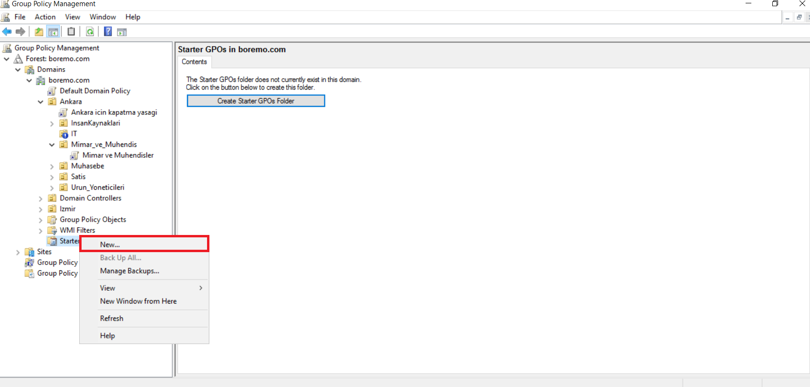
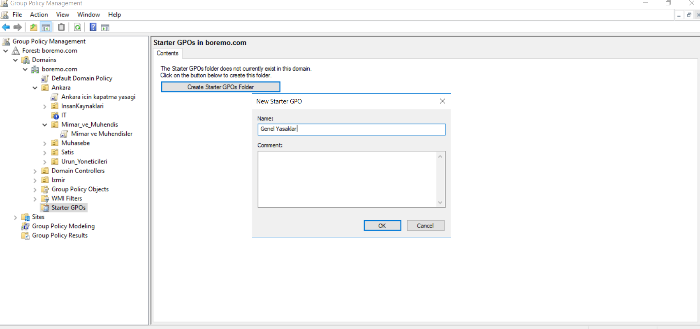
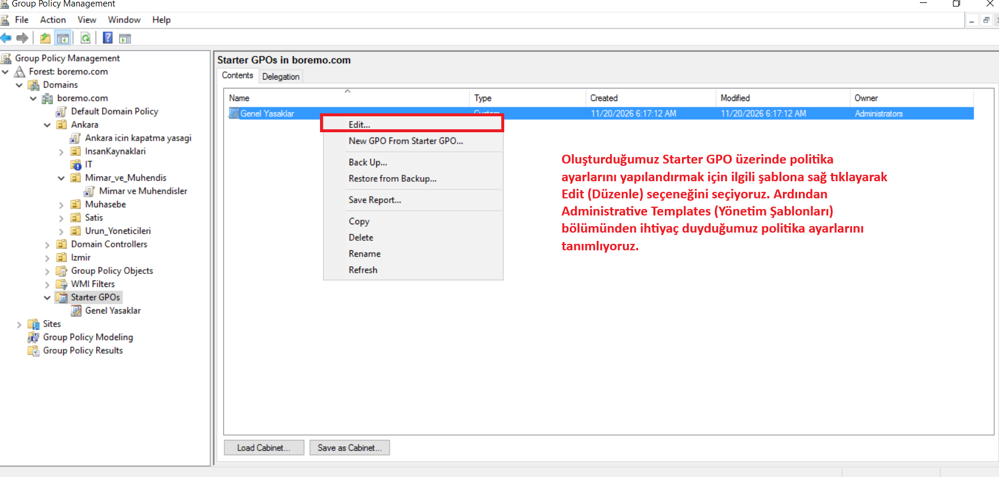
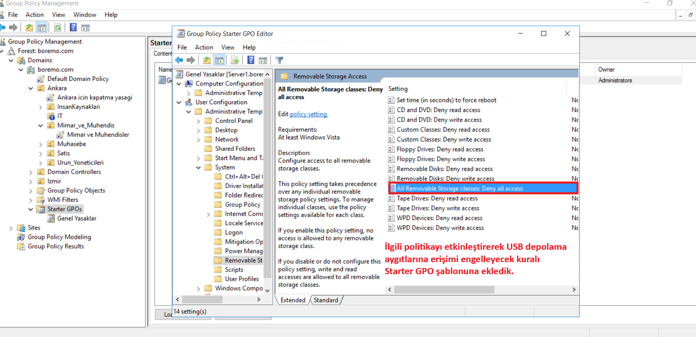
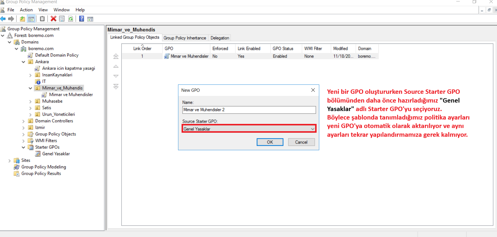

# WS 2016 — Starter GPO Nedir  & Nasıl Oluşturulur

[← Modül içindekiler](README.md) · [Tüm laboratuvar notları](../LAB-INDEX.md)

### **🧠 Benzetme**

> Her yeni çalışan için sıfırdan iş sözleşmesi hazırlamak yerine, önceden hazırlanmış bir sözleşme şablonunu kullanmak gibidir.
### **📌 Ne?**

- **Starter GPO**, önceden yapılandırılmış Group Policy ayarlarını içeren bir başlangıç şablonudur.
- Yeni GPO oluştururken aynı ayarları tekrar tekrar yapılandırmayı önler.
- Yalnızca **Administrative Templates (Yönetim Şablonları)** kapsamındaki politika ayarlarını içerir.
- Tek başına kullanıcılara veya bilgisayarlara uygulanamaz. Microsoft Learn

### **⚙️ Neden Kullanılır?**

- Zamandan tasarruf etmek.
- Şirket genelinde standart politikalar oluşturmak.
- Tekrarlanan yapılandırma işlemlerini azaltmak.

### **🛠️ Nasıl Oluşturulur?**

1. **Group Policy Management** panelini aç.
2. Domain altındaki **Starter GPOs** bölümüne gir.
3. İlk kullanımda **Create Starter GPOs Folder** seçeneğine tıkla.
4. Sağ tık → **New** ile şablon oluştur.
5. **Edit** seçeneğiyle gerekli politikaları yapılandır.
6. **Group Policy Objects → New** üzerinden yeni GPO oluştururken **Source Starter GPO** bölümünden hazırladığın şablonu seç.
7. Oluşturulan GPO'yu ilgili OU'ya bağla.

### **💡 Gerçek İş Hayatından Örnek**

Şirketin tüm şubeleri için `Standart-Yasaklar` isimli Starter GPO oluşturuyoruz:

- USB kullanımını engelleme.
- CMD erişimini engelleme.
- Denetim Masası erişimini kısıtlama.

Ankara, İstanbul ve İzmir şubeleri için yeni GPO oluştururken aynı şablonu kullanabiliriz.

### **⚠️ Kritik Bilgiler**

- Starter GPO sonradan değiştirilirse daha önce bu şablondan oluşturulan GPO'lar otomatik olarak güncellenmez.
- Group Policy Preferences ayarlarını içermez.

---

#### **Starter GPO Oluşturma Adımları**

