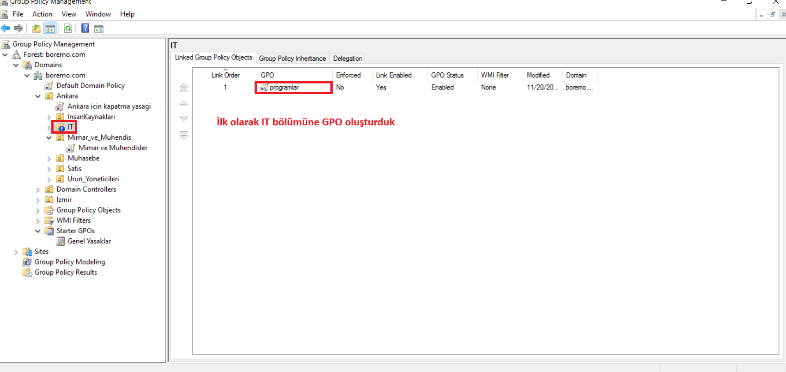
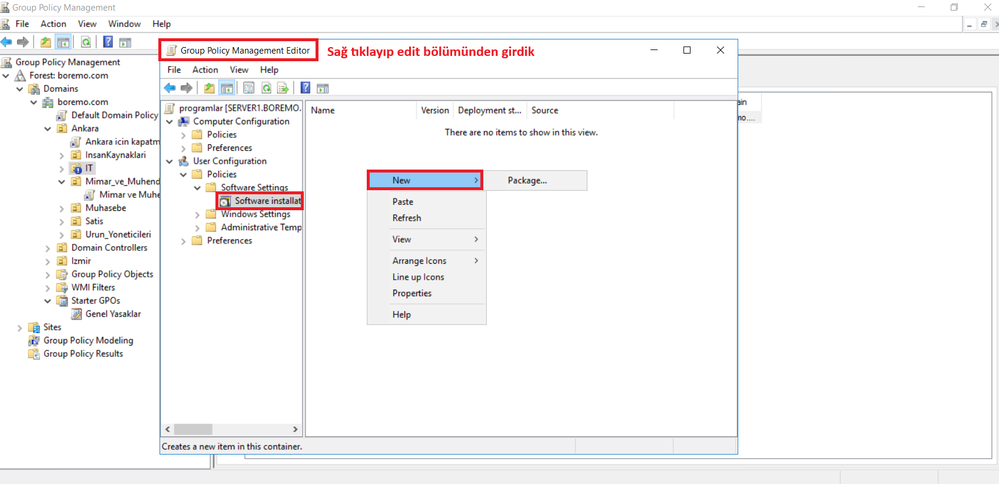
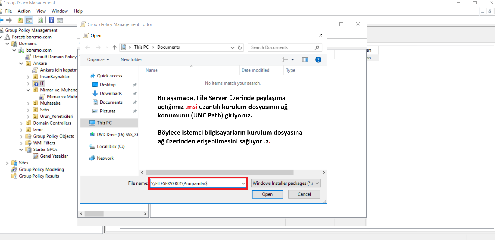
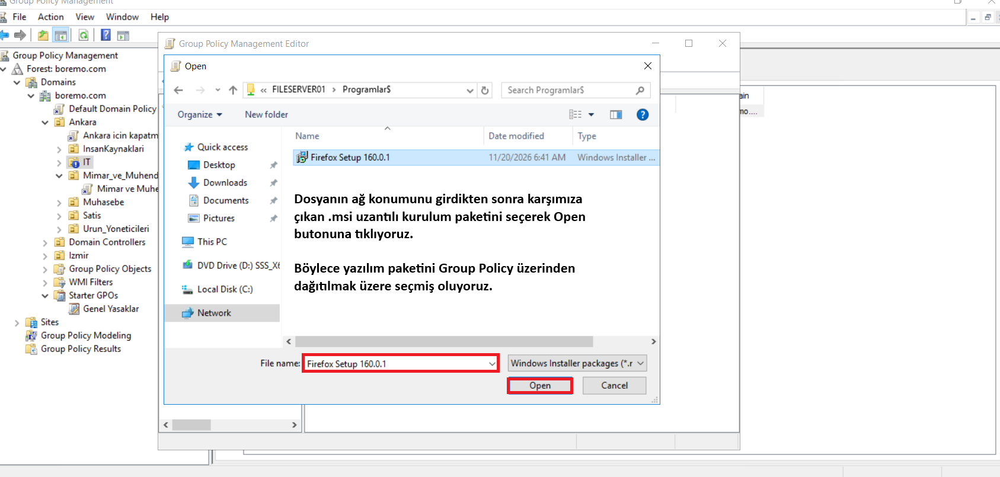
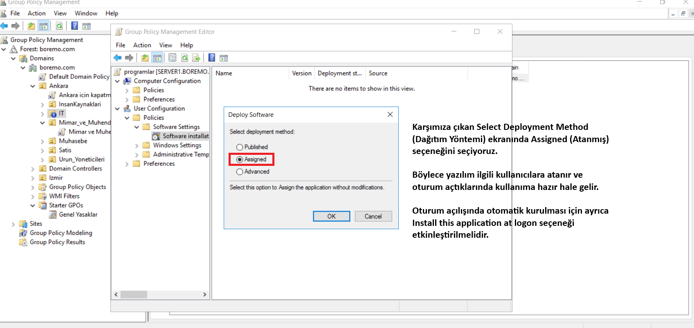
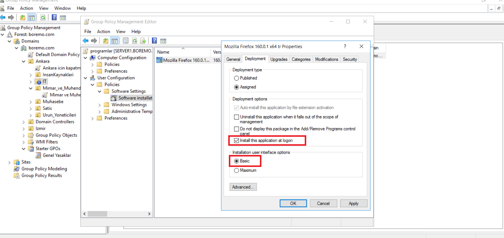
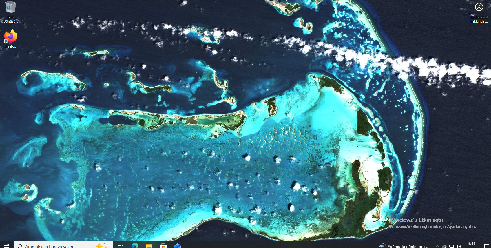

# WS 2016 — Group Policy ile Uzaktan Yazılım Dağıtımı (Software Deployment)

[← Modül içindekiler](README.md) · [Tüm laboratuvar notları](../LAB-INDEX.md)

### **🧠 Benzetme**

> Her çalışanın masasına tek tek program kurmak yerine, merkezi bir depoya kurulum dosyasını bırakıp bilgisayarların otomatik olarak kurulum yapmasını sağlamak gibidir.
### **📌 Ne?**

- **Software Deployment (Yazılım Dağıtımı):** Domain ortamındaki bilgisayarlara merkezi olarak yazılım yükleme işlemidir.
- Group Policy kullanılarak bilgisayarların başına gitmeden program kurulumu gerçekleştirilebilir.
- **MSI (Microsoft Installer)**, Windows Installer tarafından kullanılan ve otomatik yazılım dağıtımını destekleyen kurulum paketi formatıdır.

### **⚙️ Neden File Server Üzerinde Klasör Oluşturuyoruz?**

- Kurulum dosyalarını merkezi bir konumda saklamak için.
- Domain bilgisayarlarının kurulum paketine ağ üzerinden ulaşabilmesi için.
- Her bilgisayara ayrı ayrı kurulum dosyası kopyalamamak için.

Bu paylaşılan klasöre **Distribution Point (Dağıtım Noktası)** denir.

### **🛠️ Yapılacak İşlemler**

1. File Server üzerinde `Programlar` isimli klasör oluşturulur.
2. Kurulacak programın `.msi` dosyası klasöre eklenir.
3. Klasör ağ paylaşımına açılır.
4. Hedef bilgisayarlara okuma Read & execute izni verilir.

Örnek kurulum dosyası yolu:

```
\\FILESERVER01\Programlar\firefox.msi
```

Bir sonraki aşamada bu ağ yolu GPO içerisinde tanımlanacaktır.

### **⚠️ IT Specialist İçin Kritik Bilgiler**

- GPO'nun Software Installation özelliği doğrudan `.msi` paketlerini destekler; `.exe` dosyaları için farklı yöntemler kullanılabilir.
- Bilgisayar bazlı kurulumlarda hedef bilgisayar hesaplarının paylaşım ve NTFS okuma izinleri bulunmalıdır.
- Kurulum dosyalarını değiştirme yetkisi yalnızca yetkili yöneticilere verilmelidir.

---

#### **Ayarlama Aşamaları**













- Yapılandırma işlemlerini tamamladıktan sonra IT birimindeki herhangi bir kullanıcı hesabıyla oturum açıyoruz. Ardından, ilgili yazılımın otomatik olarak yüklendiğini kontrol ederek **Group Policy üzerinden uzaktan yazılım dağıtımının** başarıyla gerçekleştiğini doğruluyoruz.


