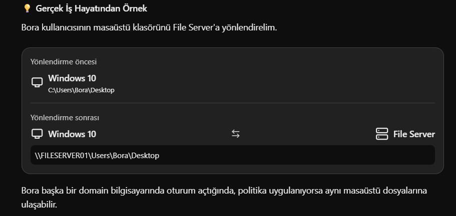
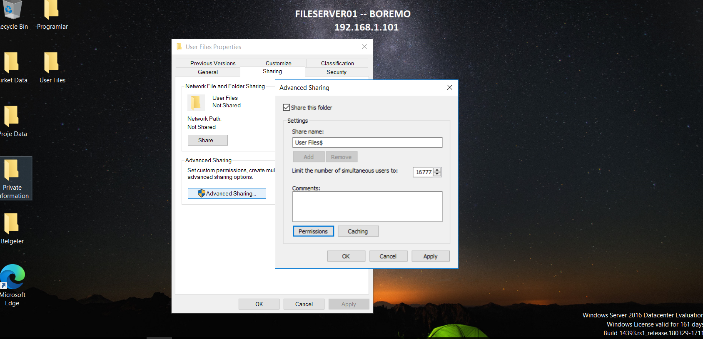
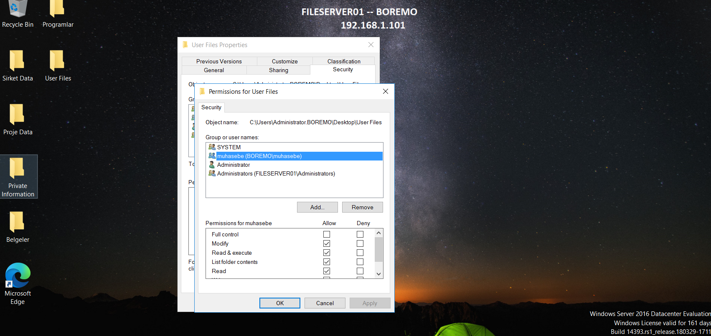
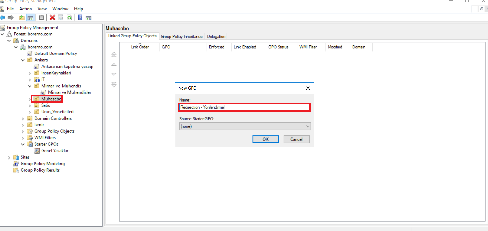
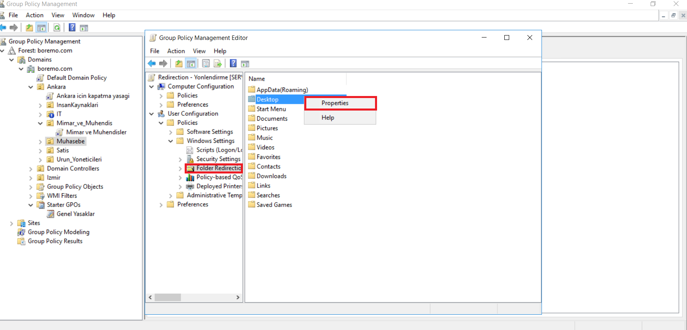
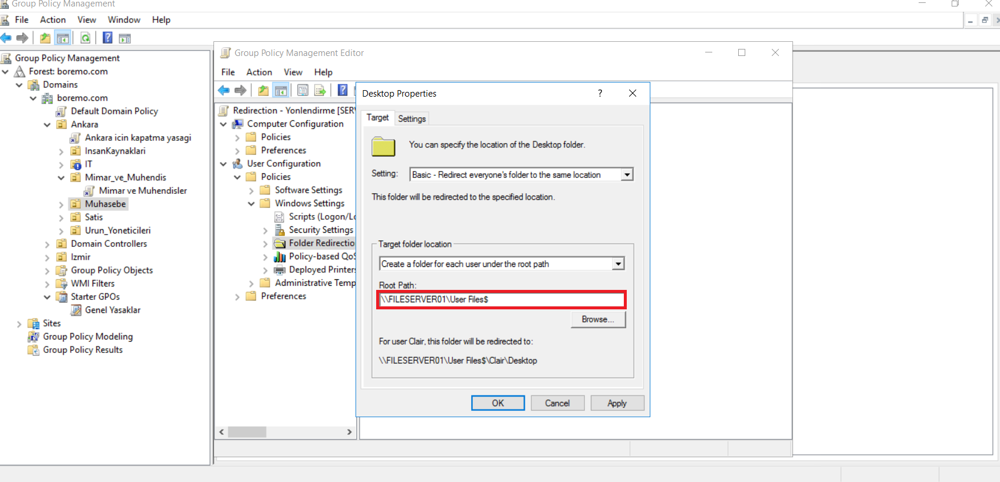
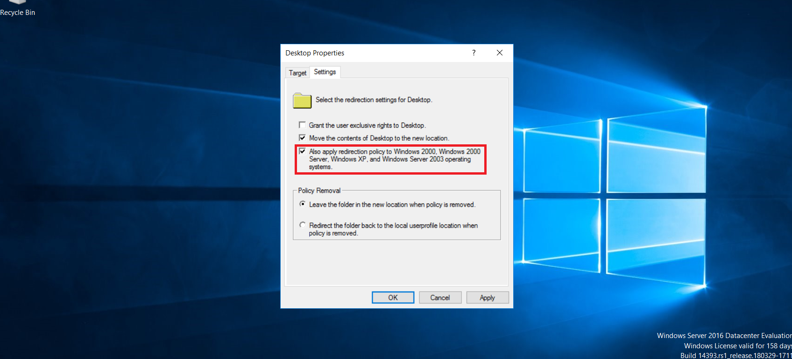
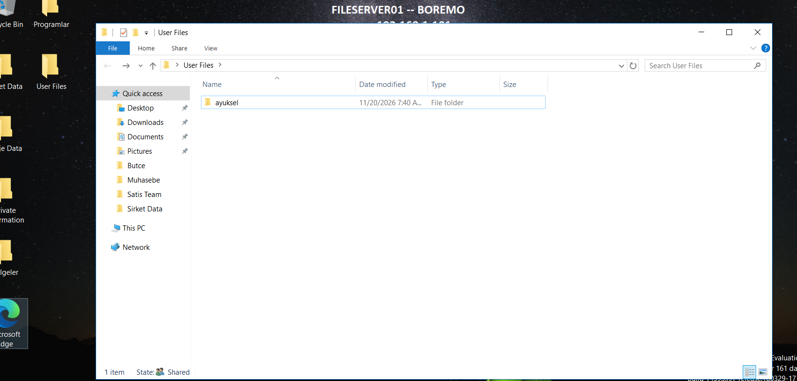
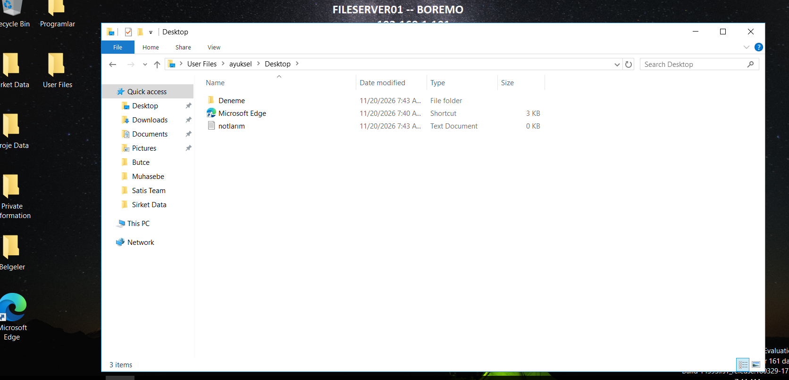

# WS 2016 — Group Policy ile Folder Redirection (Klasör Yönlendirme)

[← Modül içindekiler](README.md) · [Tüm laboratuvar notları](../LAB-INDEX.md)

### **🧠 Benzetme**

> Önemli belgelerini evinde saklamak yerine merkezi bir kasada sakladığını düşün. Hangi şubeye gidersen git aynı belgelerine ulaşabilirsin.
### **📌 Ne?**

- **Folder Redirection**, kullanıcıların belirli yerel klasörlerini Group Policy aracılığıyla başka bir konuma, genellikle File Server'a yönlendirme işlemidir.
- Desktop, Documents, Downloads ve Pictures gibi klasörler yönlendirilebilir.
- Kullanıcı, dosyalarına normal şekilde erişmeye devam eder ancak dosyaların asıl konumu değişir.

### **⚙️ Neden Kullanılır?**

- Kullanıcı verilerini merkezi olarak saklamak.
- Bilgisayar arızası veya format durumunda veri kaybı riskini azaltmak.
- Merkezi yedekleme işlemlerini kolaylaştırmak.
- Farklı domain bilgisayarlarından aynı dosyalara erişebilmek.

### **🛠️ Nereden Yapılandırılır?**

`User Configuration → Policies → Windows Settings → Folder Redirection`

| Seçenek | Görevi |
| --- | --- |
| Basic | Kullanıcıları ortak bir kök konuma yönlendirir. |
| Advanced | Güvenlik gruplarına göre farklı konumlara yönlendirir. |
| Not Configured | Yönlendirme politikası tanımlamaz. |

### **⚠️ Kritik Bilgiler**

- Her kullanıcının klasörüne uygun NTFS izinleri verilmelidir.
- **Offline Files (Çevrimdışı Dosyalar)** sayesinde ağ bağlantısı kesildiğinde önbelleğe alınmış dosyalara erişilebilir.
- Folder Redirection tek başına yedekleme değildir.

---

#### **File Server Üzerinde Kullanıcı Verilerinin Saklanması İçin Paylaşımlı Klasör Yapılandırılması**

---

→ Windows Server 2016 üzerinde Domain Controller (DC) olarak yapılandırdığımız sunucudan **Group Policy Management** konsoluna girerek gerekli grup ilkesi ayarlarını yapılandırıyoruz.

---

- Yapılandırma işlemlerini tamamladıktan sonra Muhasebe birimindeki herhangi bir kullanıcı hesabıyla oturum açıyoruz. Masaüstünde (Desktop) yeni klasörler ve metin belgeleri oluşturarak bu dosyaların File Server üzerindeki ilgili kullanıcı klasörüne kaydedilip kaydedilmediğini kontrol ediyoruz. Böylece **Folder Redirection (Klasör Yönlendirme)** politikasının doğru çalıştığını doğruluyoruz. (Ahmet Yüksel — Muhasebe)

