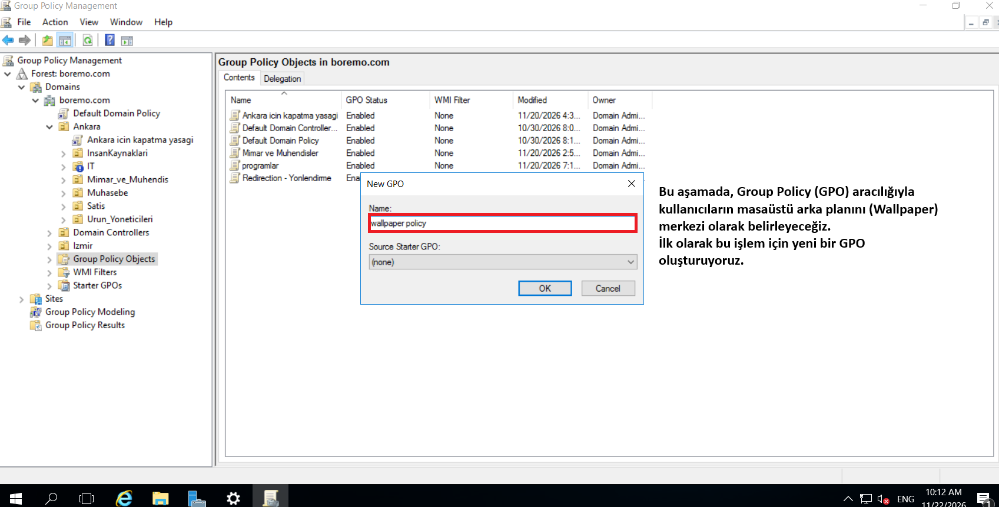
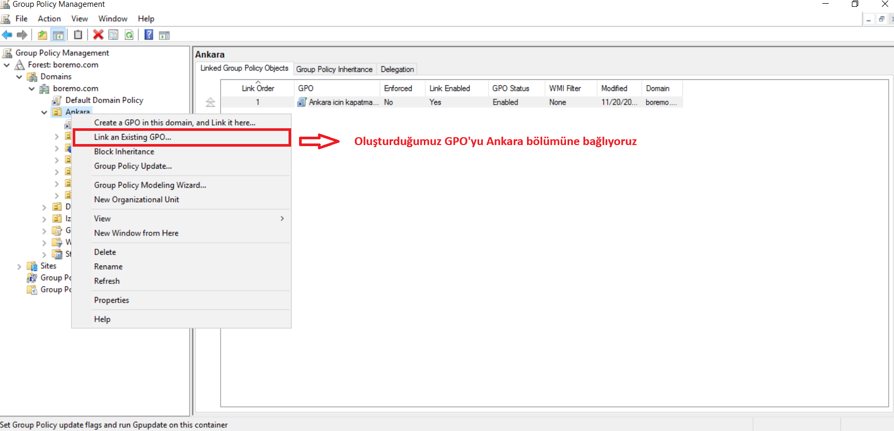
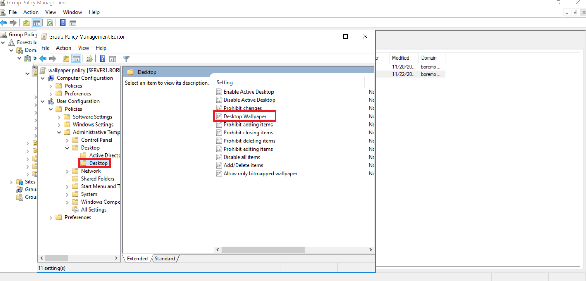
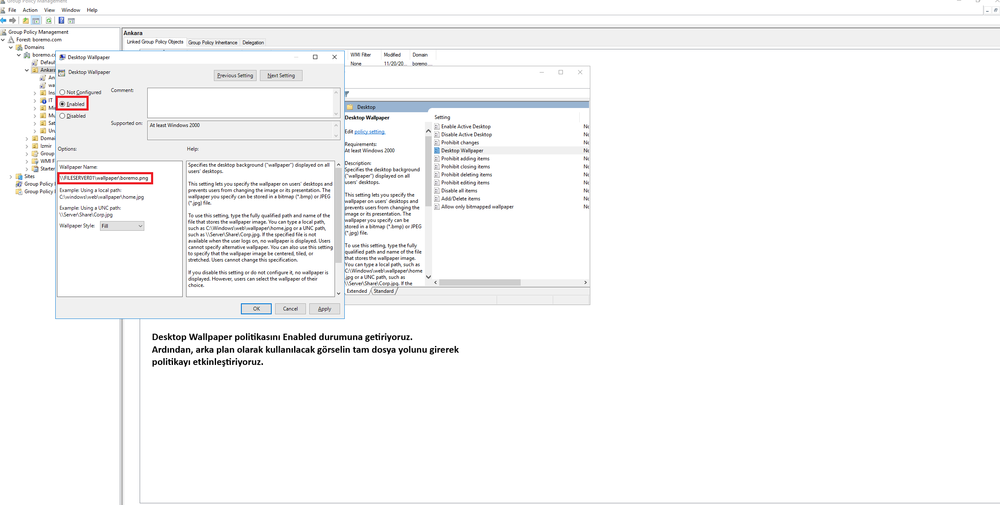
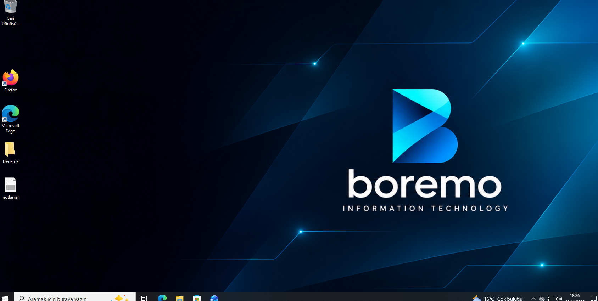

# WS 2016 — GPO ile Wallpaper uygulaması

[← Modül içindekiler](README.md) · [Tüm laboratuvar notları](../LAB-INDEX.md)

- Ankara OU'su altında bulunan herhangi bir kullanıcı hesabıyla oturum açıyoruz. Ardından, belirlediğimiz görselin masaüstü arka planı olarak otomatik şekilde uygulanıp uygulanmadığını kontrol ederek **Desktop Wallpaper** politikasının doğru çalıştığını doğruluyoruz.

