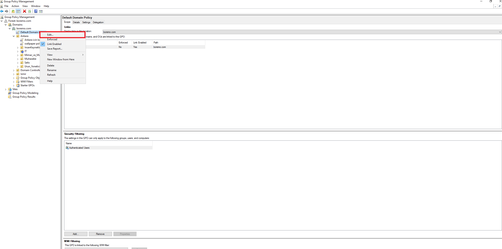
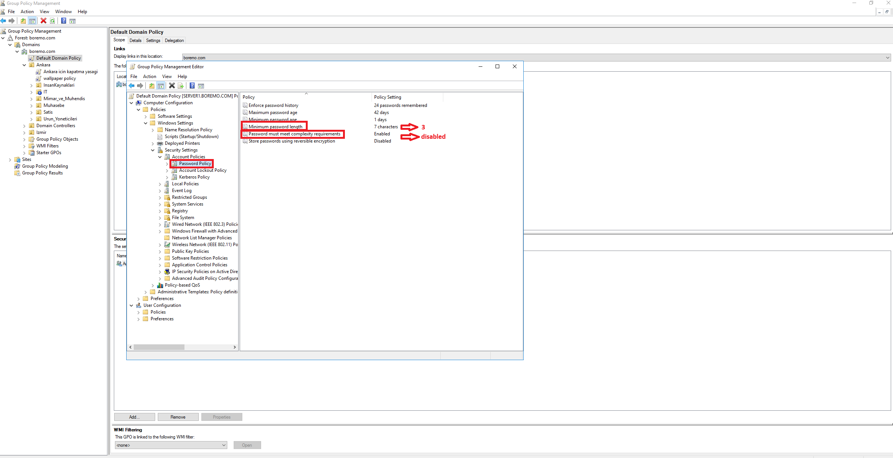
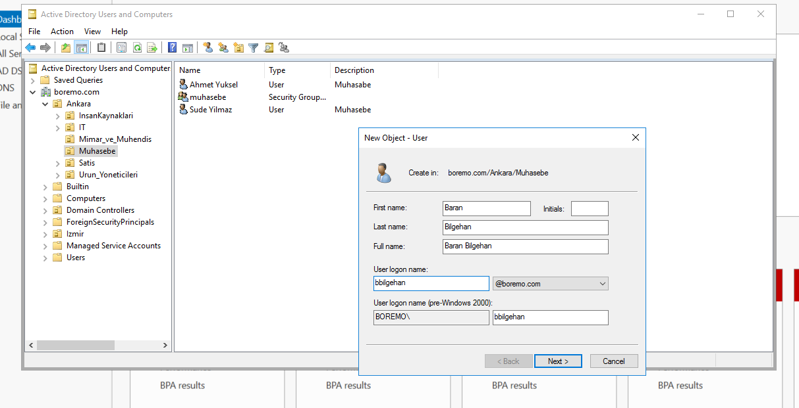
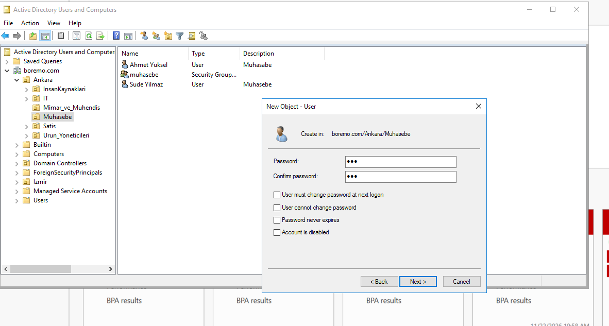
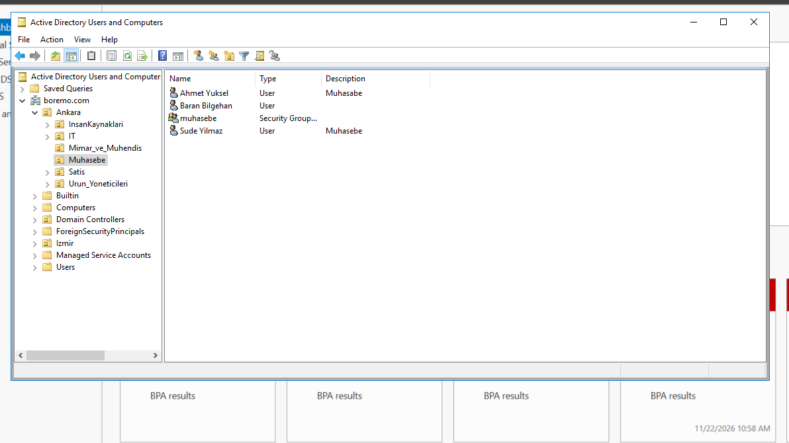

# WS 2016 — Domain Şifre Politikası Yapılandırması (Test Ortamı)

[← Modül içindekiler](README.md) · [Tüm laboratuvar notları](../LAB-INDEX.md)

> **Güvenlik notu:** Aşağıdaki yapılandırma, parola politikasının etkisini gözlemlemek için kontrollü laboratuvar ortamında yapılmıştır. Üretim ortamında parola güvenliğinin zayıflatılması önerilmez.

Bu aşamada amacımız, **Password Complexity (Parola Karmaşıklığı)** zorunluluğunu kaldırarak kullanıcıların daha basit parolalar oluşturabilmesini sağlamaktır. Yapılandırmanın tüm domain kullanıcılarını etkilemesi için **Default Domain Policy** üzerinden parola politikalarını düzenliyoruz.

**Not:** `123` gibi kısa parolalara izin vermek için **Minimum Password Length (Minimum Parola Uzunluğu)** ayarının da değiştirilmesi gerekir. Güvenlik nedeniyle bu işlem yalnızca test ortamlarında önerilir.

---

- Parola politikasını güncelledikten sonra Active Directory üzerinde yeni bir kullanıcı hesabı oluşturuyoruz. Kullanıcıya basit bir parola tanımlayarak **Password Complexity** zorunluluğunun başarıyla kaldırılıp kaldırılmadığını test ediyoruz.

