# WS 2016 — Print Server Kurulumu ve Yönetimi

[← Modül içindekiler](README.md) · [Tüm laboratuvar notları](../LAB-INDEX.md)

#### **KURULUM KISMI**

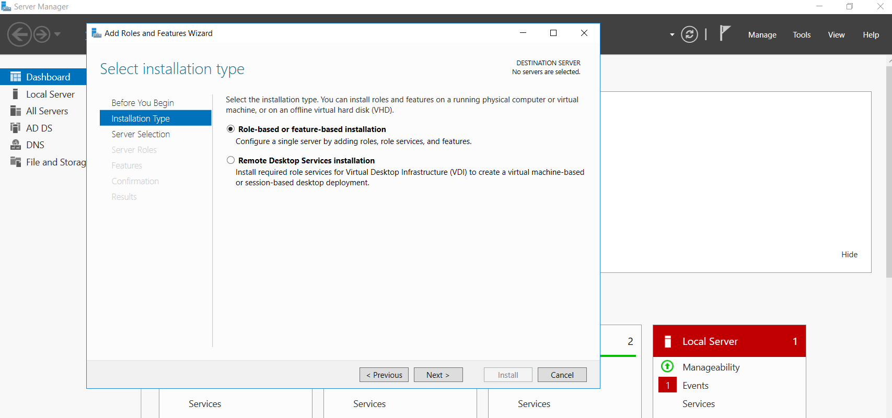

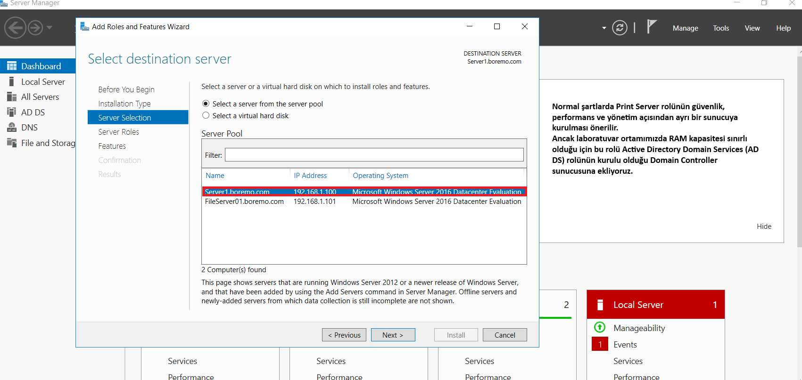

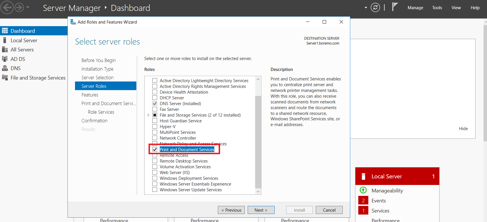

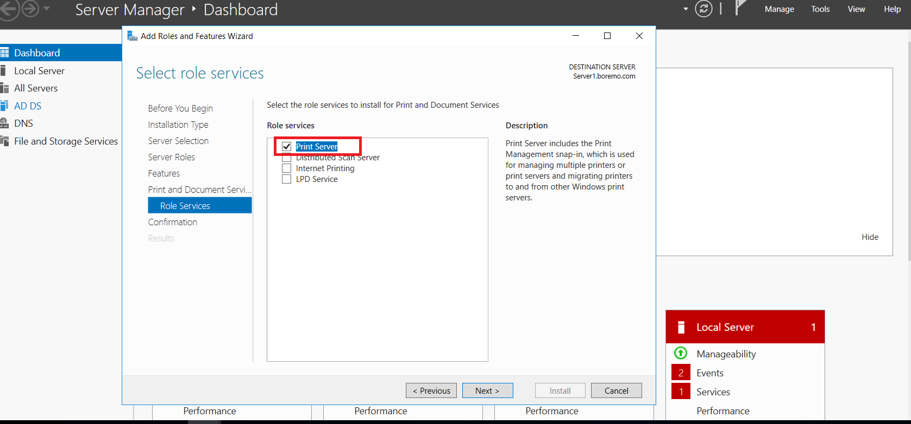

### **📌 1. Ekrandaki 4 Seçeneğin Görevleri**

| Rol Servisi | Ne İşe Yarar? | Ne Zaman Seçilir? |
| --- | --- | --- |
| **Print Server** | Yazıcıları, sürücüleri, yazdırma kuyruklarını ve paylaşımları merkezi olarak yönetir. | Şirketin ağ yazıcılarını yöneteceksen. |
| **Distributed Scan Server** | Uyumlu ağ tarayıcılarından gelen belgeleri merkezi olarak işler ve belirlenen konumlara yönlendirir. | Kurumsal tarama altyapısı kurulacaksa. |
| **Internet Printing** | IIS ve IPP kullanarak web tabanlı yazıcı erişimi sağlar. | Web üzerinden yazıcı bağlantısı gerekiyorsa. |
| **LPD Service** | LPR protokolünü kullanan Unix/Linux veya eski sistemlerden gelen yazdırma işlerini kabul eder. | Eski veya özel yazdırma sistemleriyle uyumluluk gerekiyorsa. |

### **⚙️ Nasıl Çalışırlar?**

**Print Server**

- Windows'un **Print Spooler** servisini kullanır.
- Gelen yazdırma işlerini kuyruğa alır ve yazıcıya gönderir.
- Yazıcılar Group Policy (GPO) ile çalışanlara dağıtılabilir.

**Distributed Scan Server**

- Uyumlu ağ tarayıcılarından gelen belgeleri merkezi olarak yönetir.
- Taranan belgeler belirlenmiş klasörlere veya hedeflere yönlendirilebilir.

**Internet Printing**

- **IIS (Internet Information Services)** web sunucusunu kullanır.
- **IPP (Internet Printing Protocol)** üzerinden yazıcı bağlantısı sağlar.
- İnternete doğrudan açılması güvenlik açısından önerilmez.

**LPD Service**

- **LPD/LPR** protokolünü kullanır.
- Genellikle TCP 515 portundan çalışır.
- Eski bir teknoloji olduğu için yalnızca ihtiyaç varsa kurulmalıdır.

### **🏢 3. Gerçek İş Hayatında Hangisini Seçmelisin?**

| İhtiyaç | Seçilecek servis |
| --- | --- |
| Ofiste 10 yazıcıyı merkezi yönetmek | Print Server |
| Ağ tarayıcılarından belgeleri merkezi toplamak | Distributed Scan Server |
| IPP ile web üzerinden yazdırma sağlamak | Internet Printing |
| Eski Linux/Unix sisteminden yazdırmak | LPD Service |

---

#### **YÖNETİM KISMI**

**Print and Document Services** rolünü kurduktan sonra **Print Management (Yazdırma Yönetimi)** konsolu kullanıma hazır hale gelir. Bu konsol üzerinden yazıcıları, yazdırma kuyruklarını ve yazdırma işlemlerini merkezi olarak yönetebilir ve kontrol edebiliriz.

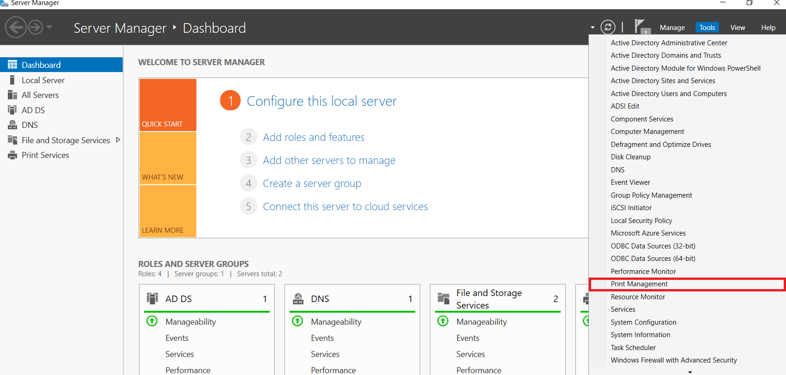

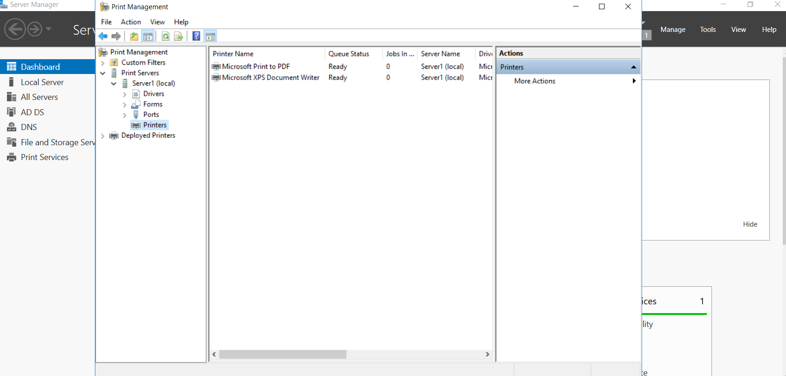

---

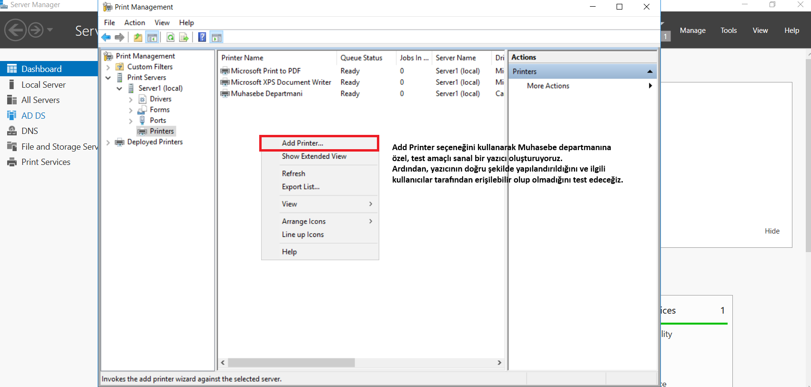

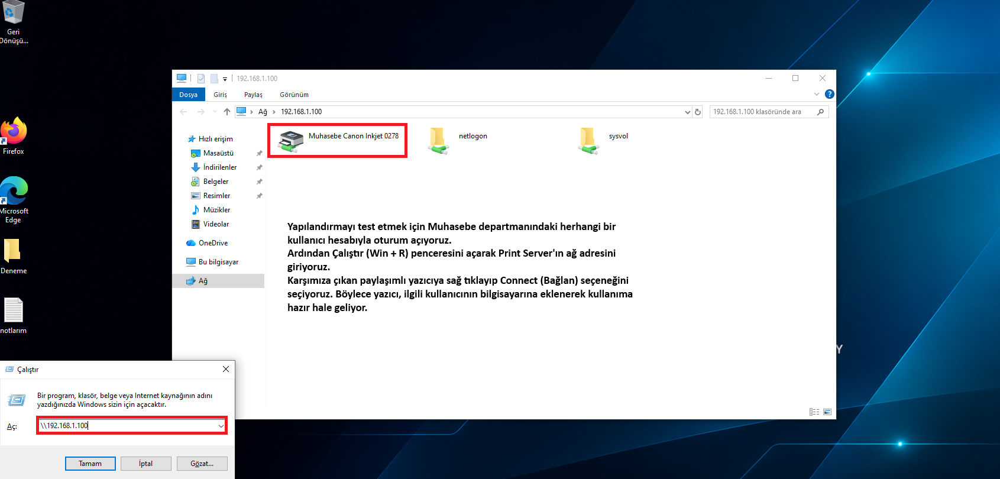

---

#### **YAZICI İÇİN GROUP POLİCY YAPILANDIRMASI**

Yazıcıyı her kullanıcı bilgisayarına tek tek eklemek yerine **Group Policy (GPO)** kullanarak merkezi olarak dağıtabiliriz. Böylece Muhasebe departmanındaki kullanıcılara ilgili yazıcı otomatik olarak atanır ve manuel kurulum yapmamıza gerek kalmaz.

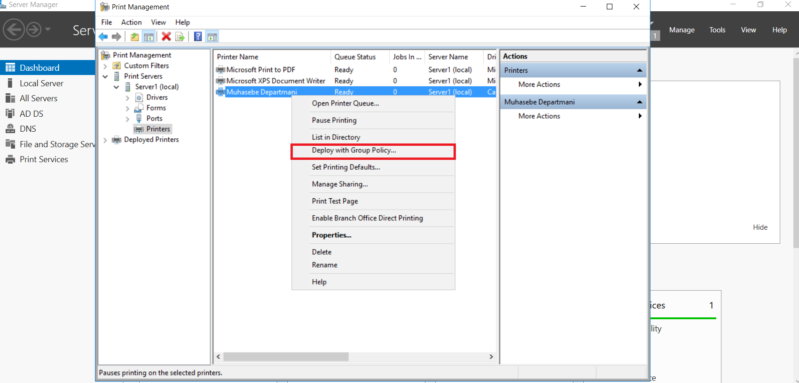

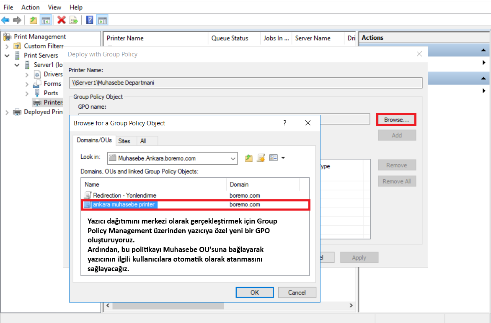

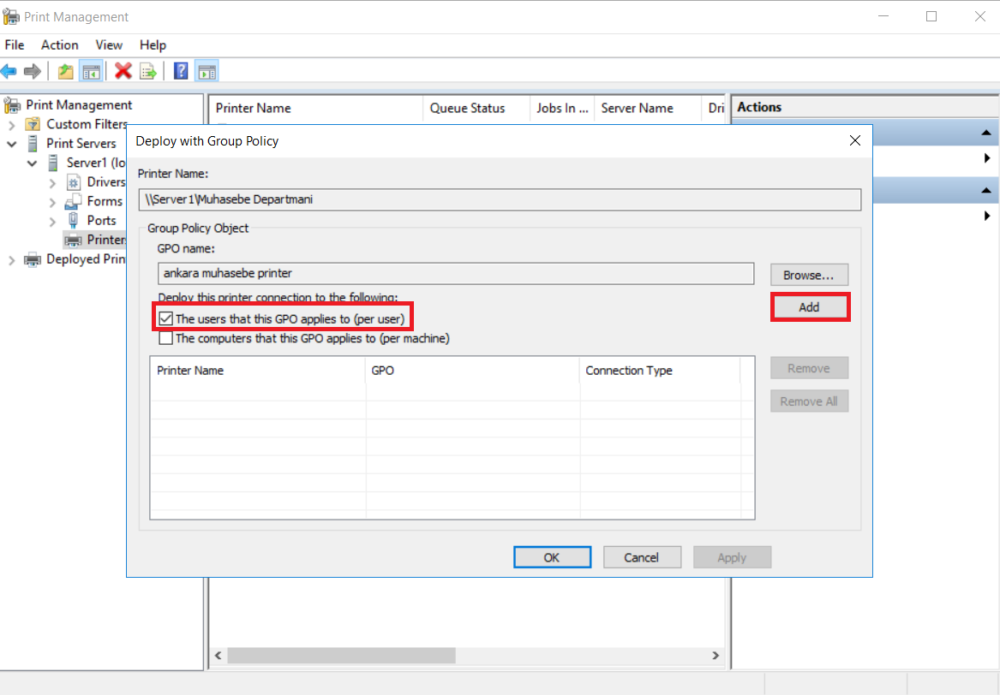

- Yapılandırmayı tamamladıktan sonra Muhasebe departmanındaki farklı bir kullanıcı hesabıyla oturum açıyoruz. Ardından, **Group Policy (GPO)** aracılığıyla dağıttığımız yazıcının kullanıcıya otomatik olarak eklenip eklenmediğini kontrol ederek politikanın başarıyla uygulandığını doğruluyoruz.

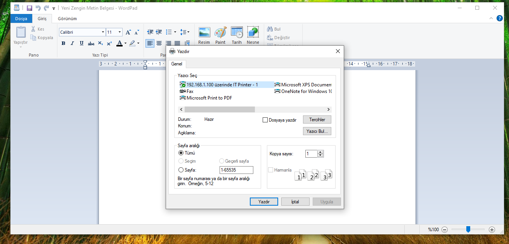

- Eğitimdeki ilk dağıtım yöntemiyle yazıcı kullanıcı hesabında görünmedi. Yapay zekâ desteğiyle alternatif bir GPO Preferences yöntemi denendi ve yazıcı görüntülendi. Uygulanan adımlar:

### Alternatif dağıtım yöntemi: GPO Preferences

Mevcut GPO'yu silmeden alternatif dağıtım yöntemini deneyebiliriz.

1. Domain Controller üzerinde Group Policy Management'ı aç.

2. `IT Printer` GPO'suna sağ tıkla ve **Edit** seç.

3. Şu yolu izle:

User Configuration

Preferences

Control Panel Settings

**Printers**

4. **Printers > New > Shared Printer** seç ve şu bilgileri gir:

| Ayar | Değer |
| --- | --- |
| Action | Update |
| Share Path | `\\Server1\IT Printer - 1` |
| Set this printer as default | İsteğe bağlı |

*Share Path değerini yazıcının Properties > Sharing sekmesindeki gerçek paylaşım adıyla doğrula.*

Test sırasında iki farklı dağıtım yöntemi çakışmasın diye, eski **Deployed Printers** kaydını Print Management üzerinden kaldırıp yalnızca yeni Preferences kaydını kullan. Bu işlem yazıcının kendisini değil, eski GPO dağıtım bağlantısını kaldırmalı.

Ardından Windows Server'da:

```powershell
gpupdate /force
```

Oturumu kapatıp tekrar açarak yazıcının otomatik eklenip eklenmediğine bak.

**⚠️ Önemli:** Bu alternatif yöntem de sürücü yükleme izinlerine tabidir. Başarısız olursa güvenlik kısıtlamalarını kapatmak yerine Windows 10'a sürücüyü yönetici yetkisiyle önceden yüklemeyi test ederiz.

---

### **✅ Sorun ve çözüm**

- **Sorun:** Print Management üzerinden *Deploy with Group Policy* yöntemiyle dağıtılan yazıcı, IT kullanıcılarında görünmüyordu.
- **Tespit:** Event Viewer'da `Event ID 7016 – Error 283` hatası vardı.
- **Çözüm:** `User Configuration > Preferences > Control Panel Settings > Printers` üzerinden **Shared Printer** oluşturup `Update` seçeneğiyle dağıttık.
- **Sonuç:** Yazıcı kullanıcı hesabında göründü.

**📌 Önemli:** İlk yöntemin neden başarısız olduğu kesinleşmedi ancak alternatif dağıtım yöntemi çalıştı.
