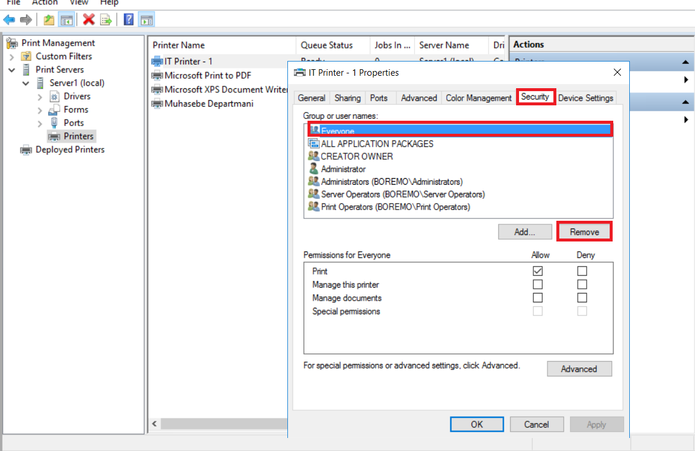
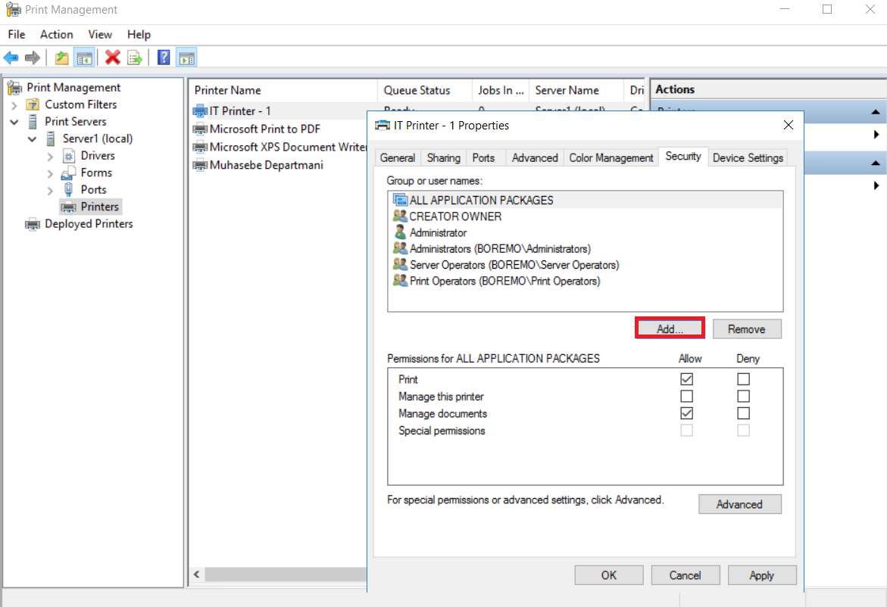
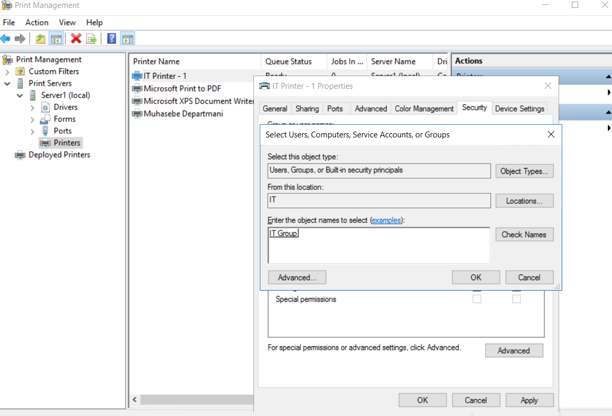

# WS 2016 — Print Server Güvenliği ve Erişim Yetkilendirmesi

[← Modül içindekiler](README.md) · [Tüm laboratuvar notları](../LAB-INDEX.md)

Yazıcıları oluşturduktan sonra yetkisiz kullanıcıların erişimini engellemek için **Security** ayarlarını yapılandırıyoruz. Her yazıcıya yalnızca ilgili Active Directory grubunun erişebilmesini sağlıyoruz. Örneğin, **IT Printer** yazıcısına sadece **IT Group** üyelerine yazdırma yetkisi veriyoruz. Böylece diğer departmanların ve yetkisiz kullanıcıların yazıcıyı kullanmasını engelliyoruz.

