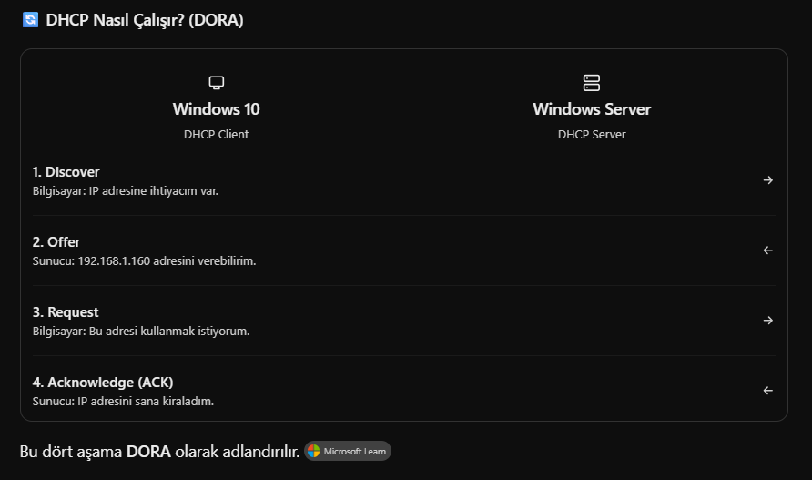
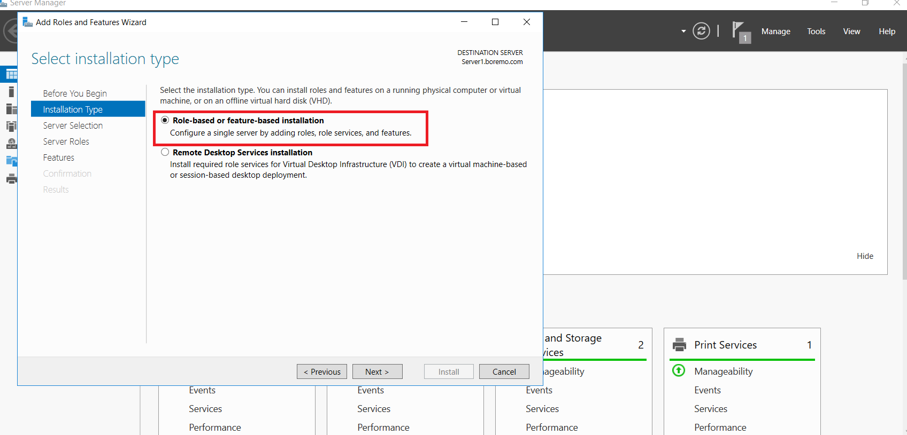
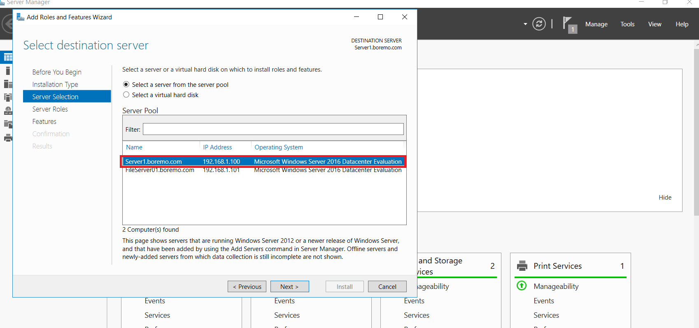
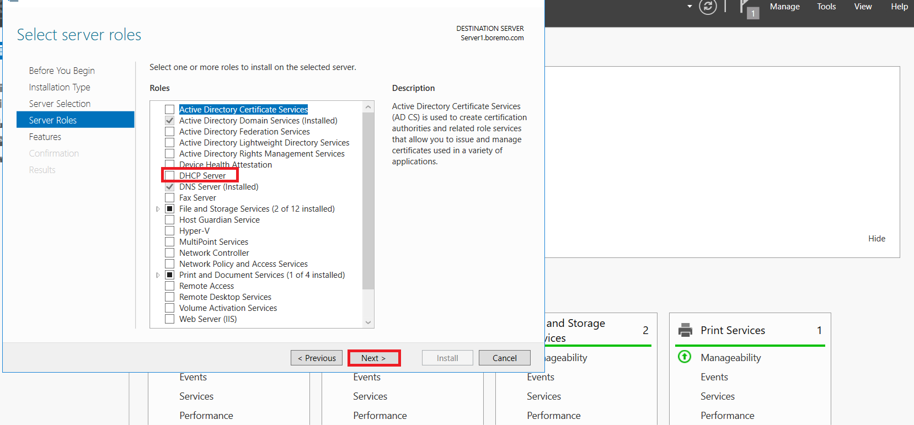
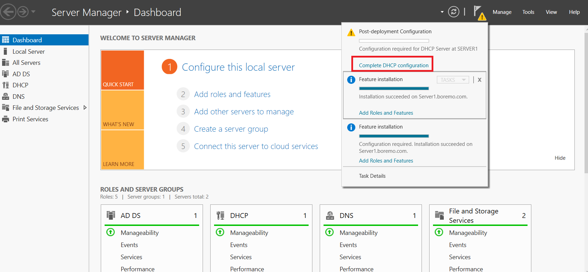
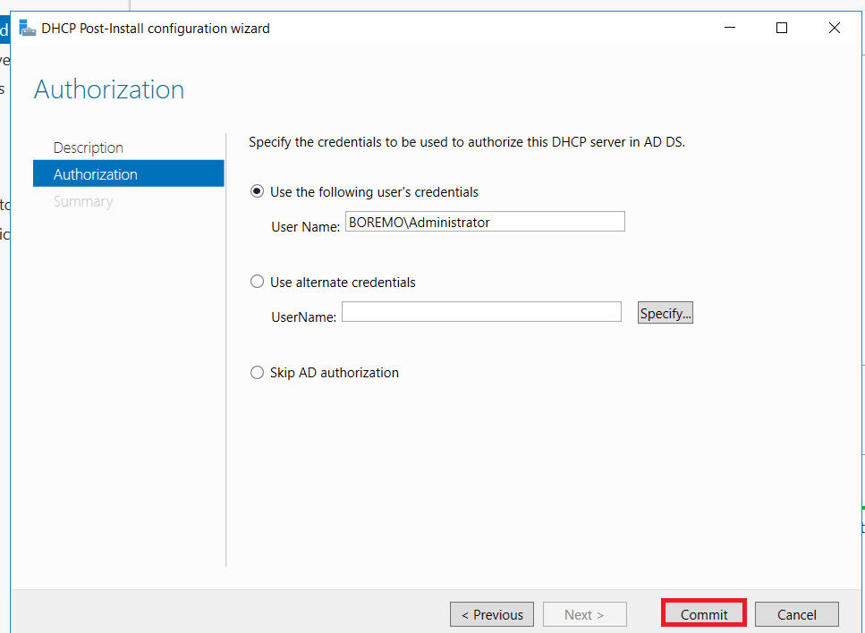

# WS 2016 — DHCP Nedir & Nasıl Kurulur

[← Modül içindekiler](README.md) · [Tüm laboratuvar notları](../LAB-INDEX.md)

### **🧠 Benzetme**

> Bir otele gelen müşterilere resepsiyonun boş oda numarası vermesi gibi, DHCP de ağa bağlanan bilgisayarlara otomatik IP adresi dağıtır.
### **📌 Ne?**

**DHCP (Dynamic Host Configuration Protocol)**, ağa bağlanan cihazlara otomatik olarak IP adresi ve gerekli ağ ayarlarını dağıtan protokoldür.

DHCP sunucusu şu bilgileri verebilir:

- **IP Address:** Bilgisayarın ağdaki adresi.
- **Subnet Mask:** Bilgisayarın hangi yerel ağda olduğunu belirler.
- **Default Gateway:** Diğer ağlara ve internete çıkış için kullanılan yönlendirici adresi.
- **DNS Server:** Domain ve diğer alan adlarını çözümleyen sunucunun adresi.

### **⚙️ Neden Kullanılır?**

- Her bilgisayara tek tek statik IP vermeyi önler.
- IP adreslerinin merkezi olarak yönetilmesini sağlar.
- Yanlış IP yapılandırması ve IP çakışması riskini azaltır.
- Yeni cihazlar ağa bağlandığında otomatik IP alabilir.

### **🛠️ Windows Server 2016 – DHCP Kurulumu**

**1. DHCP rolünü yükle**

`Server Manager → Manage → Add Roles and Features`

1. **Role-based or feature-based installation** seç.
2. Kurulum yapılacak sunucuyu belirle.
3. **DHCP Server** rolünü işaretle.
4. **Install** ile kurulumu tamamla.
5. **Complete DHCP configuration** üzerinden gerekli yapılandırmayı ve Active Directory yetkilendirmesini tamamla.

---

#### **KURULUM ADIMLARI**

---
