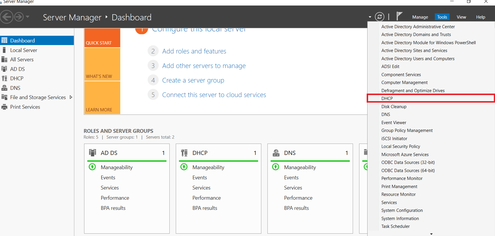
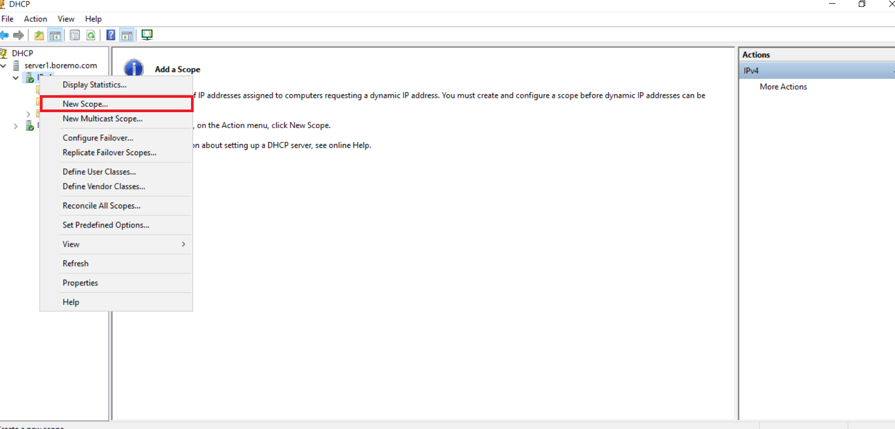
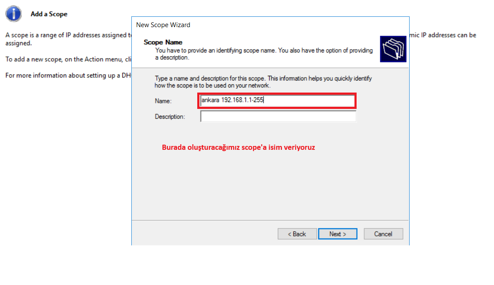
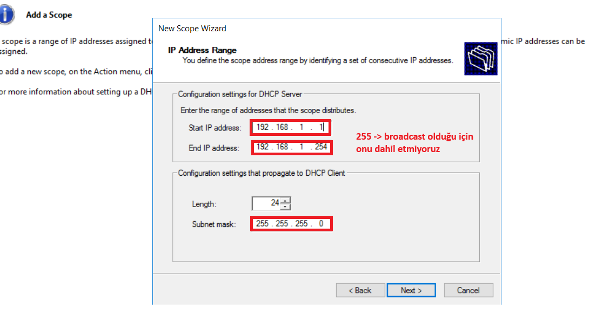
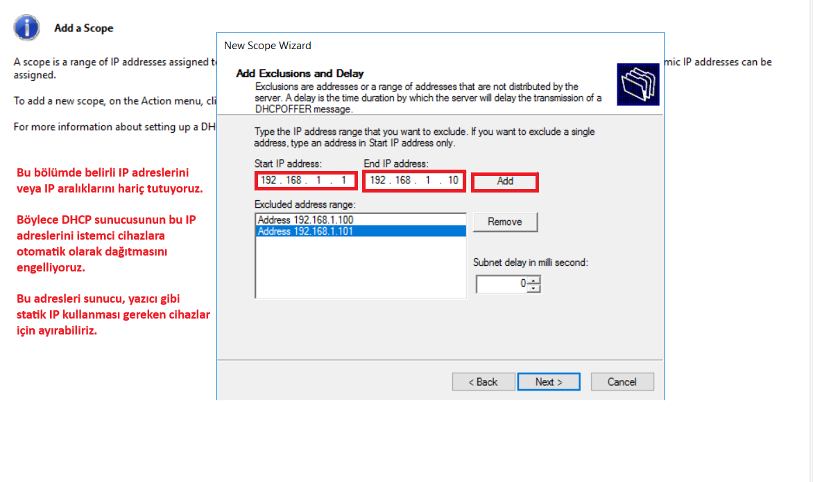

# WS 2016 — DHCP YAPILANDIRMA

[← Modül içindekiler](README.md) · [Tüm laboratuvar notları](../LAB-INDEX.md)

## **DHCP Scope (IP Dağıtım Havuzu) Oluşturma**

### **🧠 Benzetme**

> Bir otelde 100–150 numaralı odaların müşterilere ayrıldığını düşün. DHCP sunucusu resepsiyon, Scope ise müşterilere dağıtılabilecek oda numaralarının listesidir.
### **📌 Ne?**

- **DHCP Server:** Bilgisayarlara otomatik IP adresi ve ağ ayarlarını dağıtan sunucudur.
- **DHCP Management Console:** DHCP sunucusunun IP dağıtımını ve diğer ayarlarını yönettiğimiz paneldir.
- **IPv4:** Ağdaki cihazların kullandığı 32 bitlik IP adresleme sistemidir.
- **New Scope:** DHCP sunucusunun hangi IP adreslerini dağıtabileceğini belirleyen yeni bir IP havuzu oluşturur.

### **⚙️ Neden Bu İşlemleri Yaptık?**

**1. Server Manager → Tools → DHCP**

- DHCP yönetim panelini açtık.
- Çünkü DHCP rolünü kurmak, IP dağıtımını başlatmak için tek başına yeterli değildir.
- IP dağıtım kurallarını ayrıca yapılandırmamız gerekir.

**2. IPv4 → Sağ Tık → New Scope**

- IPv4 üzerinden dağıtılacak IP adreslerinin aralığını belirlemek için bu seçeneği açtık.
- DHCP'nin istemcilere rastgele değil, bizim belirlediğimiz ağdan IP vermesini sağlarız.

### **💡 Gerçek İş Hayatından Örnek**

Bir şirkette 50 bilgisayar olduğunu düşün.

DHCP Scope ayarlarımız:

| Ayar | Değer | Açıklama |
| --- | --- | --- |
| Scope Name | Sirket-Ag | IP havuzunun adı |
| Start IP | 192.168.1.160 | İlk dağıtılacak IP |
| End IP | 192.168.1.200 | Son dağıtılacak IP |
| Subnet Mask | 255.255.255.0 | Yerel ağ sınırı |
| Gateway | 192.168.1.1 | Diğer ağlara çıkış |
| DNS | 192.168.1.100 | Active Directory DNS sunucusu |

Bu örnekte DHCP sunucusu **41 adet IP adresinden oluşan bir havuz** oluşturur.

Windows 10 bilgisayarı ağa bağlandığında DHCP'den otomatik olarak `192.168.1.160` gibi uygun bir IP adresi alabilir.

### **⚠️ IT Support İçin Kritik Bilgiler**

- **Scope oluşturmak tek başına yeterli değildir.** Havuz etkinleştirilmeli (Activate), DHCP servisi çalışmalı ve domain ortamında sunucu yetkilendirilmiş olmalıdır.
- **IP çakışması:** DHCP havuzu, başka cihazların statik kullandığı IP adreslerini içermemelidir.
- **Exclusion Range:** DHCP'nin dağıtmaması gereken IP adreslerini belirler.
- **Reservation:** Belirli bir cihazın her zaman aynı IP adresini almasını sağlar.
- **Lease Duration:** Dağıtılan IP adresinin kiralama süresidir.

