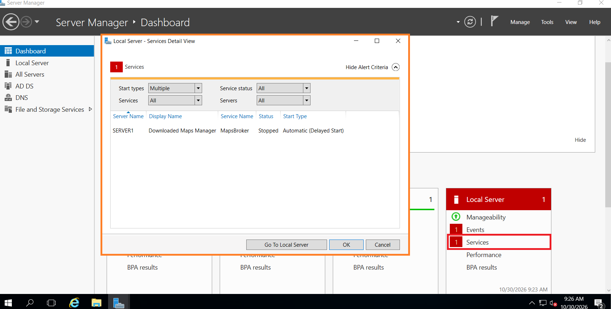
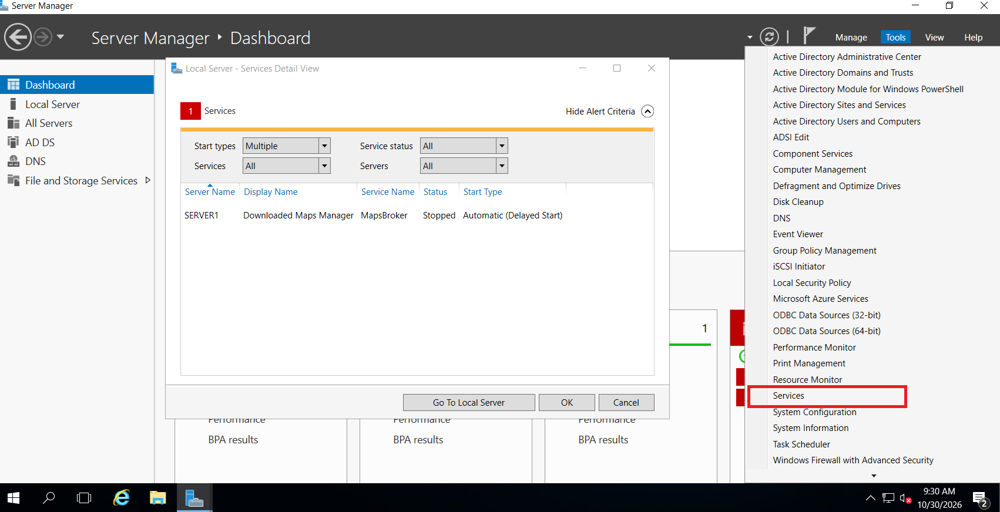
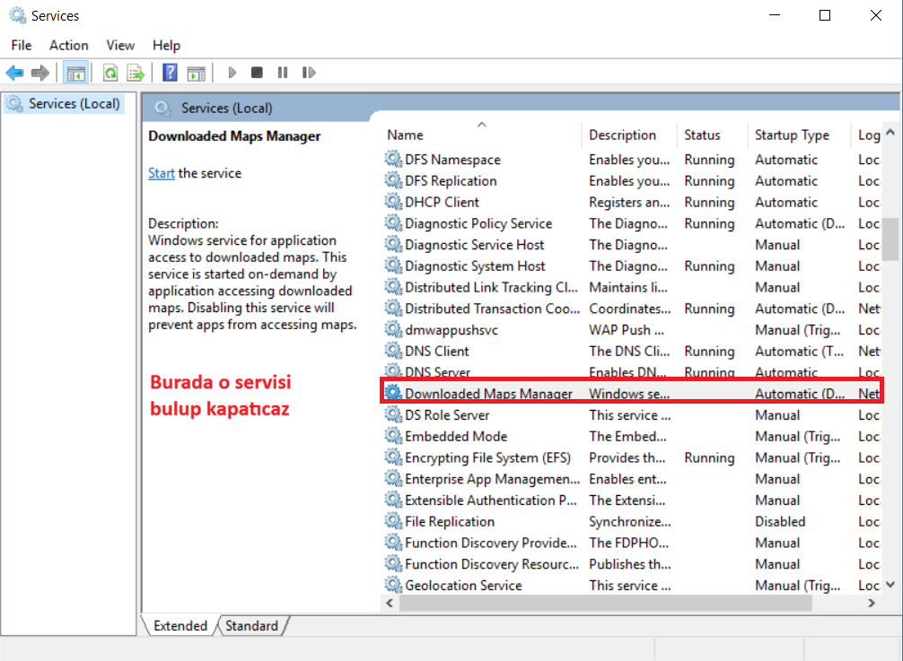
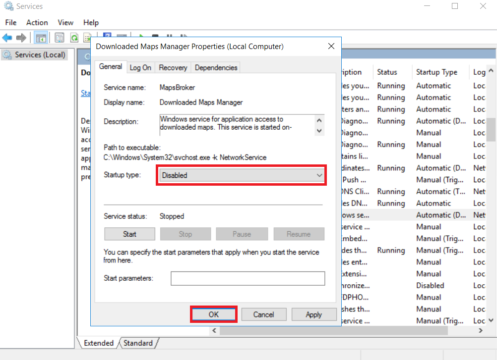
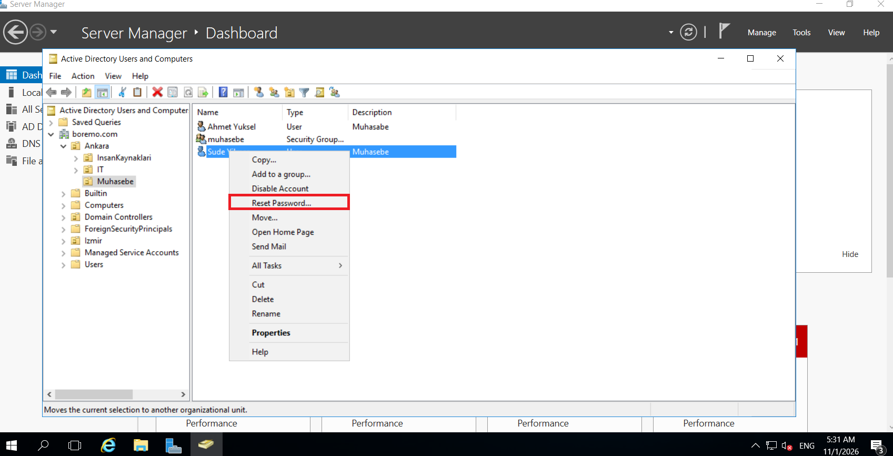
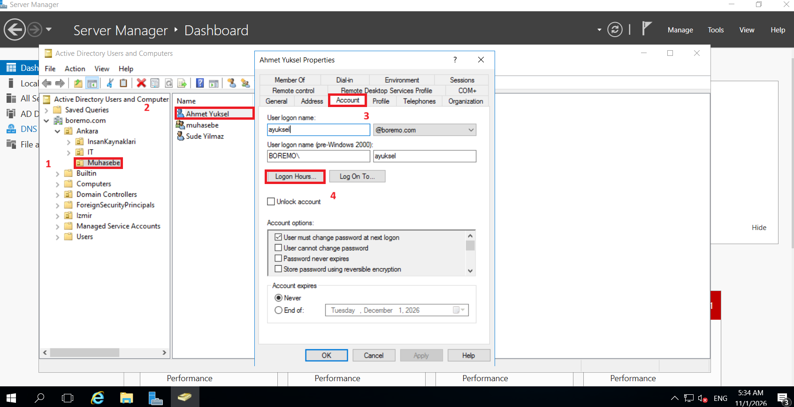
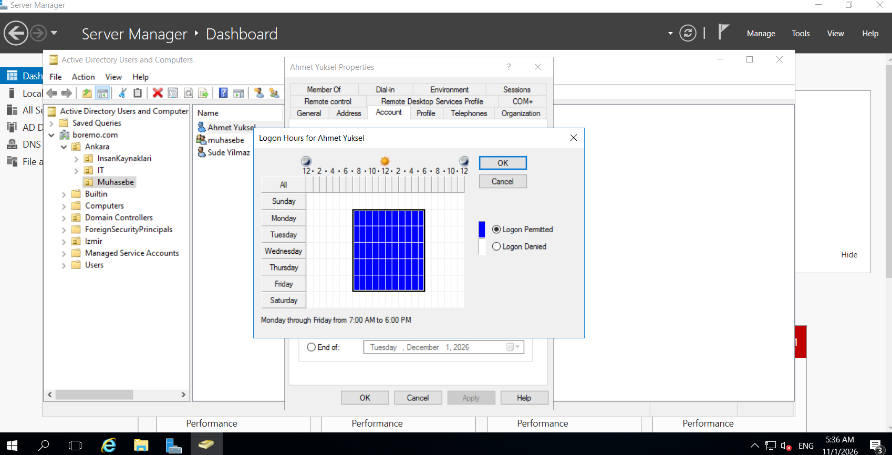
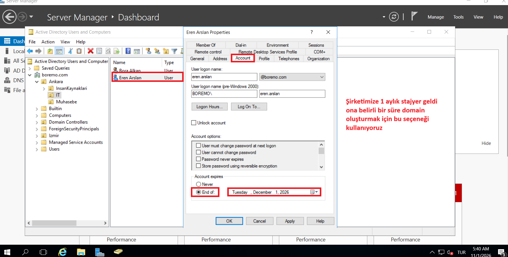
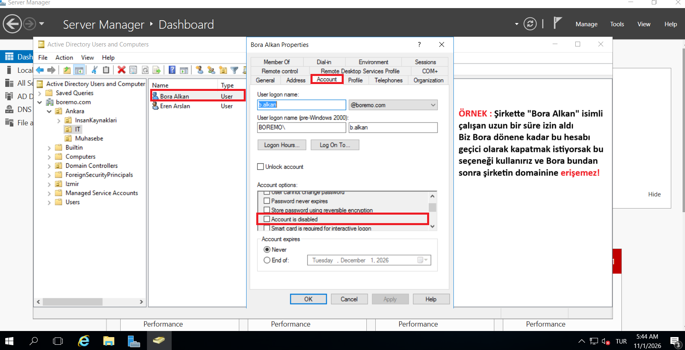

# WS 2016 — DİĞER NOTLAR 1

[← Modül içindekiler](README.md) · [Tüm laboratuvar notları](../LAB-INDEX.md)

Ekran görüntüsünde Local Server → Services bölümünde kırmızı `1` görünmesinin sebebi, bir Windows servisinin durdurulmuş olmasıdır.

Soruna neden olan servis:

- Service Name: MapsBroker
- Display Name: Downloaded Maps Manager
- Status: Stopped (Durduruldu)
- Start Type: Automatic (Delayed Start) – Otomatik (Gecikmeli Başlatma)

### ⚙️ Neden?

- Windows, otomatik başlaması beklenen bir servisin çalışmadığını tespit ettiği için uyarı gösteriyor.
- Downloaded Maps Manager, çevrimdışı haritaların indirilmesi ve yönetilmesiyle ilgilidir.
- Servis ihtiyaç olmadığında durabilir. Bu durum tek başına ciddi bir arıza anlamına gelmez.
- Active Directory veya DNS hizmetlerinin bozulduğu anlamına gelmez.

**—> Bu servisin bizi rahatsız etmemesi için kapatıyoruz şimdi onun adımlarını göstericem :**

→ Sonrasında dashboard’ı yenilediğimizde bu uyarı birdaha gözükmez

---

### **KULLANICILARIN DOMAİN ŞİFRELERİNİ SIFIRLAMAK**

---

### **DOMAİN KULLANICILARININ OTURUM AÇMA SAATLERİNİ BELİRLEMEK**

---

### **GEÇİCİ ÇALIŞANLAR İÇİN DOMAİN HESABI OLUŞTURMAK**

---

### **BİR DOMAİN HESABINI DEVRE DIŞI BIRAKMAK**

---
